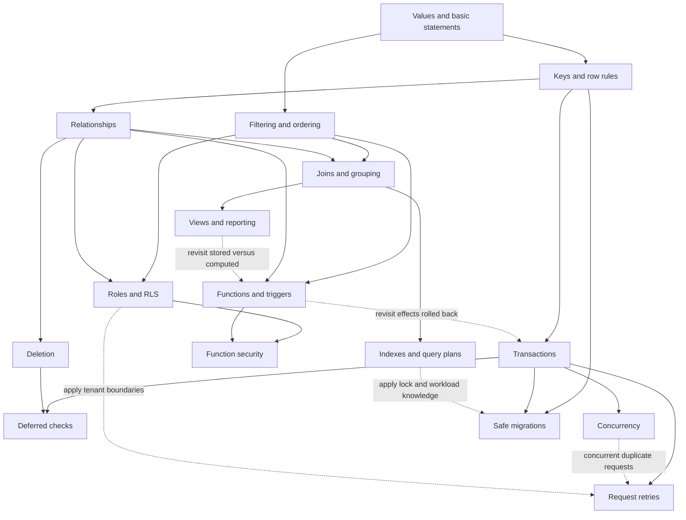

# Course map

Start with a question, then follow its connections. This map describes both available drafts and planned destinations. Article numbers are stable filenames, not a required study sequence.

## The beginner route

This is the intended foundation route. Only the onramp and some later branches exist today; the missing steps are not hidden prerequisites for a supposedly complete beginner course.

| Stop | Question and outcome | State |
|---|---|---|
| Read and change a row | What is a table, and which rows will this statement affect? | [Short onramp available](articles/00-reading-the-examples.md); full querying lesson planned |
| Values and missing information | How do types, NULL, empty text, defaults, and comparisons differ? | Planned; F01–F07, F15, Q05–Q07 |
| Identity and row rules | What identifies a row, and where are duplicates forbidden? | Planned; F08–F11, F14, F16, B13 |
| Ask a precise question | Filter, order, page, and summarize rows without changing the question accidentally | Planned; Q01, Q08, Q13–Q16 |
| Model relationships | Choose cardinality and keys, then test what the reference guarantees | [FK draft available](articles/01-foreign-keys.md); R03–R07 and modelling depth planned |
| Combine facts | Preserve unmatched rows and avoid multiplying totals | Planned; Q02, Q03, Q08, Q09, R06, R14 |

From there, branch into rules, transactions, access, reporting, or operational work below. A reader with the necessary background can enter at that branch; a prerequisite explains the knowledge needed, not a gate to unlock.

## The first route

This shorter route uses only existing drafts. It explores guarantees and failures; it does not substitute for the planned foundation lessons.

[Read the SQL](articles/00-reading-the-examples.md) → [Foreign keys](articles/01-foreign-keys.md) → [Business rules](articles/02-business-rules.md) → [Derived values](articles/03-derived-values.md).

Branch from foreign keys to [Deletion](articles/04-deleting-related-rows.md). Read [Transaction boundaries](articles/06-transaction-boundaries.md) before [Deferred checks](articles/05-deferred-checks.md).

The transaction lab supplies its trigger, so you can observe rollback before learning to write that function. Return to derived values when you want to trace its internals.

## The wider course

Topic IDs refer to the [inventory](TOPIC_INVENTORY.md), which records the narrower objectives actually covered. A route below can contain several short articles and labs.

| Route | Destination and topic families | Prior knowledge | State |
|---|---|---|---|
| Values and identity | Select types, distinguish missing values, define keys and row constraints; F, Q05–Q07, B13 | Reading simple statements | Onramp only; depth planned |
| Relationships and modelling | Cardinality, junctions, optional references, deletion, normalization; R, D03, D13 | Keys and row meaning | FK and deletion drafts; modelling depth planned |
| Query meaning and reporting | Joins, grouping, subqueries, CTEs, windows, sets and pagination; Q | Values and basic SELECT; relationships for joins | Basic examples only; dedicated lessons planned |
| Rules and automation | Constraints, functions, trigger events, derived values, transitions; B | Writes, constraints; lookups for cross-table rules | Validation and derivation drafts; remaining coverage planned |
| Transactions and concurrency | Atomic groups, deferral, counters, locking, isolation, retries; T, R11 | Writes and constraints | Rollback and deferral drafts; concurrent and request labs planned |
| Identity and access | Authentication, privileges, RLS, function execution identity, tenants; A | Filtering, relationships; functions for definer work | Planned |
| Data over time | Generated values, views, snapshots, exact money, calendars and audits; D | Expressions; joins and grouping for reports | Stale-copy example only; dedicated lessons planned |
| Performance and recovery | Indexes, query plans, statistics, pooling, imports, backup restoration; O01–O06, O15–O19 | Queries; transactions for locks and recovery | Planned |
| Evolution and integration | Versioned migrations, compatibility, APIs, safe parameters, useful errors; O07–O14, O20–O21 | Constraints, transactions and access | Request boundaries introduced; full workflow planned |

The scope is application-focused SQL/PostgreSQL, from foundations through maintaining a database-backed service. Full database administration, replication, and sharding are optional future case-study directions, not hidden requirements for finishing this course. The inventory can grow when new learning questions justify it.

## Prerequisites and connections

Solid arrows mean prior knowledge. Dotted arrows mean a later application or a useful revisit, not another prerequisite. Nodes describe knowledge, including planned knowledge, rather than claiming finished articles.

For the advanced branches, learn concurrency before implementing concurrent retry deduplication; learn privileges and functions before definer functions. These are deeper applications of the basic request-boundary question, not prerequisites for reading that initial explanation.

## Follow a question across settings

| Start here | Return in a different setting | What to explain |
|---|---|---|
| Clinic: an FK accepts an existing receptionist | Shop: a customer exists but is suspended | Why existence does not prove eligibility; available FK transfer prompt |
| Clinic: a profile changes after validation | Library: a borrower becomes inactive | Which later writes affect the chosen rule; available validation transfer prompt |
| Clinic: a note keeps an old owner | Shop: an old order keeps a shipping address | Whether the copy is stale or intentionally historical; available derivation transfer prompt |
| Clinic: deleting a patient affects visits | Team: deleting a membership | Which direction the relationship runs; available deletion variation |
| Import: references are temporarily missing | Shop: import orders and items together | When validation runs and what happens if repair never occurs; available deferral prompt |
| Clinic: invoice failure undoes a table counter | Reservations: seat claim and booking fail together | Locate all writes inside the boundary; review prompt available, reservation SQL lab planned |
| Shop: totals multiply after a join | Subscriptions: usage and payments share an account | State the grain before aggregating; planned |
| Team: a user sees only their workspace | Clinic: a staff member has limited branch access | Trace identity through privileges and row policy; planned |
| Subscriptions: a retry repeats a charge request | Reservations: a confirmation response disappears | Separate rollback from deduplication; planned |

Every planned route needs a worked example, a changed-setting task with feedback, and a later retrieval prompt. The table is the authoring contract for future lessons, not a claim those SQL labs already exist.

## Which system are we discussing?

| Available draft | General SQL idea | PostgreSQL focus | Supabase focus |
|---|---|---|---|
| Reading the examples | Rows, columns and basic statements | Qualified names and runnable lab syntax | None; optional setup only |
| Foreign keys | Reference existence, nullability | Exact declarations and error outcomes | None |
| Business rules | Existence versus eligibility | PL/pgSQL trigger attachment and exceptions | None |
| Derived values | Input versus stored or copied data | BEFORE trigger assignment | None |
| Deletion | Choosing what happens to related rows | Tested delete actions and constraint interactions | None |
| Deferred checks | Validation timing inside a transaction | DEFERRABLE and SET CONSTRAINTS | Editor request boundaries only |
| Transaction boundaries | Atomic groups versus network outcomes | Trigger rollback and ordinary table counters | Connection/request guidance only |

These labels do not certify cross-database portability. Future Supabase identity/Data API lessons will name the platform explicitly; PostgreSQL roles and RLS will first get their own explanation.

## Reader controls

Use [review prompts](REVIEW.md) after a gap. You can open solutions, choose a different branch, or stop midway. A personal record of read / attempted / explained / revisited is optional and is not a mastery certificate.
