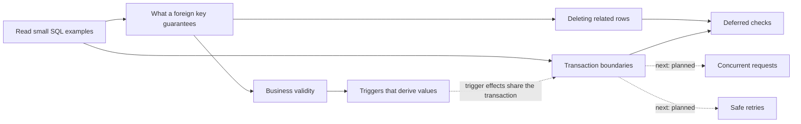

# Course map

A suggested route provides direction. Links explain where an idea connects to other ideas.

## The first route

[Read the SQL](articles/00-reading-the-examples.md) → [Foreign keys](articles/01-foreign-keys.md) → [Business rules](articles/02-business-rules.md) → [Derived values](articles/03-derived-values.md).

From foreign keys, branch to [Deletion](articles/04-deleting-related-rows.md). Before [Deferred checks](articles/05-deferred-checks.md), read the transaction introduction in [Transaction boundaries](articles/06-transaction-boundaries.md). Return to deferred checks to connect the two ideas.

You can read transaction boundaries before the trigger articles: its lab setup provides the trigger, and the article explains the relevant effect. For the code behind that trigger, return to derived values.

Solid arrows suggest prior knowledge. Dotted arrows explain a connection or a later application. A connection may run both ways; prerequisites should not create a circular requirement.

## The wider course

| Area | Main thread | Connections and later applications | State |
|---|---|---|---|
| Values and identity | Types, NULL, defaults, primary keys, scoped uniqueness | Money, API identifiers, tenant ownership | Onramp available; depth planned |
| Relationships | Foreign keys, cardinality, junctions, optional references | Deletion, membership, typed versus polymorphic references | Initial articles available |
| Query meaning | SELECT, joins, grouping, EXISTS, subqueries | Dashboard totals, accidental double counting, views | Planned |
| Rules and automation | CHECK, functions, trigger timing, validation, derivation | Owner rules, timestamps, invoice creation | Initial articles available |
| Transactions | Atomicity, deferred checks, concurrent updates, isolation | Invoice numbering, totals, retries | Initial articles available; concurrency planned |
| Access | Authentication, database roles, grants, RLS, invoker/definer | Multi-tenant data, trusted identity, API requests | Planned |
| Data over time | Generated data, views, snapshots, audit history, money and dates | Price changes, package expiry, approvals, reporting | Planned |
| Operations and integration | Indexes, EXPLAIN, migrations, RPC, error handling | Safe changes, polling/realtime, repeatable verification | Planned |

The [inventory](TOPIC_INVENTORY.md) gives every discovered concept a stable ID and a home. Planned areas are destinations, not fabricated finished articles.

## Why the same idea returns

| First encounter | Later encounter | What changes |
|---|---|---|
| FK rejects patient 999 | Owner points to an existing receptionist | Existence is separated from suitability. |
| Trigger checks an owner | Profile role changes later | A rule must cover the operations that can break it. |
| Note owner comes from patient | Patient changes owner later | Copying a value once is separated from keeping it synchronized. |
| Delete fails | Deferred transaction succeeds after repair | Timing becomes part of the rule. |
| Invoice failure rolls back counter | Server commits but response disappears | The database boundary is separated from the network boundary. |
| One invoice gets a number | Two connections try together, planned | Correctness must include concurrent work. |

## Reader controls

You may read solutions, take a different branch, or stop midway. At each article's end there is one suggested next step and a related branch.

Optional record: read / attempted / solved without hints / revisited after a gap. This is a personal record, not a certification. See [review prompts](REVIEW.md).

