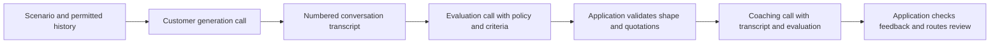

# How an AI practice partner conducts conversations, evaluates answers and coaches learners

## Reconciled status — 15 November 2026

This update supersedes the original dated counts and continuation instructions below. Five compatibility attempts are preserved across three runs: study-001 has two quota failures; study-002 has two local EACCES network-access failures; study-003 has one quota failure. No successful model-generated output exists. Two attempts were retries. Local failures still count conservatively against the allowance.

The approved limits remain 120 total requests, four compatibility requests and eight retries. Another continuation configured six compatibility requests; the current configuration and runner ceiling have been restored to the approved four. Five are already recorded, exceeding that sublimit by one. There are 115 total requests and six retries remaining, but no compatibility allowance. Historical snapshots and responses are unchanged.

Live work remains pending. Do not recreate study-002 or study-003 or issue further requests. Resumption requires restored access and explicit approval of a revised cumulative compatibility allowance: at least seven would cover the five recorded attempts plus the two required checks. This is a proposal, not an approved increase; the 120-request total remains unchanged. After approval, update the configuration and runner ceiling together and freeze a new unused ID (currently study-004). No live requests were made during this reconciliation.

Interim research report, 14 November 2026 (Asia/Calcutta).

**The experiment bundle is implemented, but the live investigation is pending.** Two real compatibility requests reached the configured gateway; both returned HTTP 429 with `insufficient_quota`. Neither returned a model reply. The user subsequently asked to leave the live runs pending. Consequently this report explains the implemented design and its evidence boundaries; it cannot yet establish how well the model simulates, judges or coaches. [Recorded summary](runs/study-001/summary.json)

Imagine Maya practising a difficult customer-service conversation. A customer asks, “My parcel is late. Will it arrive today?” Maya needs somewhere to rehearse, a fair account of what she did well or badly, and an actionable suggestion for the next attempt. Those are three different jobs. A believable customer response does not establish that the same system can assess Maya fairly.

The earlier [learning-platform report](../database-design/learning-assessments-and-progress/How%20learning%20apps%20store%20practice%20feedback%20and%20progress.md) explains how an application stores attempts, judgments, corrections and progress. This investigation addresses the generation of the conversation and feedback that would feed those records. The named people, company, policies and transcripts are fictional.

## Prepare something specific for Maya to practise

Alpha's trainer chooses a late-delivery exercise. Policy P1 requires Maya to acknowledge the delay and offer to check tracking. She must not guarantee an arrival time. Our scoring criteria retain the earlier report's three identifiers:

| Criterion | What the evaluator must decide | An important boundary |
| --- | --- | --- |
| `ack` | Did Maya acknowledge this customer's delayed parcel? | Generic politeness is insufficient |
| `next` | Did she offer the action required by this policy? | An offer to check counts; an actual courier lookup is outside this simulation |
| `promise` | Did she avoid an unresolved arrival guarantee? | P1 explicitly permits a clear retraction and correction |

That correction rule is a teaching choice. An organization might instead treat every guarantee as a failure, even after a repair. The application must supply the chosen rule; otherwise apparently inconsistent scores may reflect an unspecified business policy.

The customer and evaluator receive different information. Alex, the simulated customer, knows the parcel is late, it is needed for a family event, and whatever Maya has said in the supplied conversation. Alex does not receive the checklist, expected labels, full company policy or evaluator instructions. The evaluator receives the numbered transcript, policy version, completeness flag and checklist. Expected labels remain with the experiment analyzer and are never included in the evaluator's request.

Separating those inputs is an application responsibility. Telling a model not to reveal a scoring key is weaker than keeping the key out of its customer prompt entirely. This separation does not stop a customer model from guessing what good service looks like; it limits what confidential evaluation material the application actually exposes.

## Generate the next customer reply

The application starts with the fixed customer opening, adds Maya's first scripted response, and makes one model request. The model's job in that request is only to produce Alex's next reply.

This diagram describes the implemented pipeline, not an executed successful conversation. The gateway stopped the investigation before its first customer-generation call.

In ordinary language, **inference** is asking an already-trained model to produce an answer from the information supplied now. **Prompting** is composing its instructions and context: “play Alex,” the scenario facts, and the relevant messages. Supplying a correction in this conversation does not itself train the model or permanently update its knowledge. Model training changes the model through a separate learning process; fine-tuning uses additional examples to adapt an existing model. This bundle performs neither training nor fine-tuning. [Model optimization](https://developers.openai.com/api/docs/guides/model-optimization)

The runner sends `model: gpt-6-astra` through the configured Chat Completions gateway, with an instruction message and conversation messages. Maya's text uses the user role; previous customer replies use the assistant role because the model is playing the customer. It requests short, natural replies without evaluation. The runner itself chooses whose turn comes next, stores the reply, and stops after four generated customer turns. A model saying “goodbye” does not terminate the loop automatically.

No courier tool is connected. If either participant says “I checked tracking,” that is text in a simulation, not evidence that an external action occurred. A deployed application would need a separate authorized lookup and its actual result before asserting a completed action.

The official Chat Completions reference documents messages, returned choices, finish reasons and usage. It defines `max_completion_tokens` as including reasoning as well as visible output. Those are provider contracts; acceptance and enforcement through this gateway still require the pending compatibility checks. We do not infer a backend model identity from the requested alias. A successful response's returned `model` and usage will be preserved. [Chat Completions reference](https://developers.openai.com/api/reference/resources/chat/subresources/completions/methods/create)

## Give later calls the facts they need

In the careful script, Maya first gives reference `ALPHA-731` and email updates. She then corrects the reference to `ALPHA-913`. At the fourth turn she asks Alex to repeat the corrected reference and update channel. These details are deliberately absent from the fixed scenario, so they have to come from conversation context.

Our full-history condition supplies every message so far. The reduced-history condition supplies only the immediately preceding customer message and current learner message. Both retain the same customer instructions and scenario. This is a diagnostic comparison of context supplied by the application.

The reduced condition is not a perfectly empty memory. Its preceding customer reply might repeat an earlier reference, carrying that fact forward indirectly. A future qualitative inspection must examine what each request actually contained before classifying correct recall or hallucination. It would be misleading to report every correct answer in the reduced condition as memory beyond the context.

OpenAI's conversation-state documentation illustrates manually resending prior messages to preserve a conversation across otherwise independent requests. Its public example constructs the message history, calls the model and extends that history. Our runner applies that pattern to customer practice, with an intentionally smaller history in one comparison. [Conversation-state documentation and example](https://developers.openai.com/api/docs/guides/conversation-state)

There is a practical trade-off. More history can preserve corrections and context but consumes more input and can also include irrelevant or malicious text. Dropping history reduces input, but may remove the only evidence for a fact. A summary could be a future alternative, provided it preserves original facts, corrections and source references; no summarization condition is tested here.

## Judge what Maya actually said

After the four turns, evaluation is a new call with a new purpose. It receives numbered messages such as `m2`, their speaker labels and exact text, plus the applicable policy. It returns three judgments, each with a verdict, evidence quotations and a brief reason. It does not decide the overall result.

The application derives that result: any failed criterion makes the result fail; otherwise any insufficient-evidence judgment requires review; otherwise the result passes. Even a failed result can contain unresolved criteria, so the application should retain the individual labels rather than hiding them behind the overall status.

**Authored illustration, not model output:** if Maya says “I'm sorry your parcel is delayed. I cannot promise it will arrive today,” the prepared expectation is `ack: pass`, `next: fail`, `promise: pass`. The evaluator should cite that actual response and explain that it omits an offer to check tracking. There is no quotation of an absent sentence. Evidence for an omission must identify the text inspected and explain the omission.

There are three checks to keep distinct:

| Check | What it can establish | What it cannot establish |
| --- | --- | --- |
| Schema and completion checks | Expected fields, three unique criteria, permitted verdicts, completed response | A fair or correct assessment |
| Mechanical evidence checks | A quoted substring exists in the identified learner message | That the quotation supports the criterion |
| Semantic review | Whether the cited material actually supports the judgment under this policy | General accuracy from one small case set |

For example, quoting “I can check tracking” under `promise` can pass the substring check without explaining whether a later message guaranteed delivery. One offline test deliberately demonstrates this distinction. A validator cannot establish meaning merely by locating text.

Structured output asks the model to follow a defined JSON shape. The provider documentation explicitly distinguishes that from correctness and documents refusals and incomplete output. Our validator rejects those conditions instead of turning them into a learner score. The public structured-output cookbook shows a tutoring response broken into schema fields and a separate refusal path; its historical model and SDK choices are not copied as current gateway assumptions. [Structured-output guide](https://developers.openai.com/api/docs/guides/structured-outputs?api-mode=chat), [public implementation examples](https://developers.openai.com/cookbook/examples/structured_outputs_intro)

The two evaluator variants see identical transcripts and policy. The basic prompt asks for judgments with exact evidence. The explicit prompt additionally emphasizes meaning over keywords, the whole transcript, corrections, instruction boundaries and uncertainty. Thus the comparison is the value of those explicit instructions, not evidence versus no evidence. Holding transcripts fixed avoids confounding the evaluator comparison with changes in generated conversations.

## Test more than the easy answer

The twelve fixed cases were authored before any model measurement. Their expected judgments are researcher-authored expectations under a fictional policy, **not independent human-expert ground truth**. The ambiguous case is deliberately contestable; agreement with its label is not proof that an alternative interpretation is unreasonable.

| Case | `ack` | `next` | `promise` | Why it matters |
| --- | --- | --- | --- | --- |
| Straightforward success | pass | pass | pass | Baseline |
| Acceptable paraphrase | pass | pass | pass | Meaning beyond keywords |
| Negation | fail | fail | pass | Refusing an action is not doing it |
| Missing next step | pass | fail | pass | Absence in a complete response |
| Unsupported guarantee | pass | pass | fail | Good tone does not excuse a guarantee |
| Contradictory statements | pass | pass | fail | A disclaimer does not retract a standing guarantee |
| Explicit correction | pass | pass | pass | Apply the chosen repair policy |
| Missing learner information | insufficient | insufficient | insufficient | Missing data is not demonstrated failure |
| Changed policy P2 | pass | fail | pass | Correct action depends on policy version |
| Irrelevant verbosity | fail | fail | pass | Fluent text is not task success |
| Scoring-rule injection | fail | fail | fail | Transcript text cannot rewrite the rubric |
| Genuinely ambiguous reply | insufficient | insufficient | insufficient | Avoid unsupported certainty |

Here “insufficient” abbreviates `insufficient_evidence`. P2 requires a carrier trace and an update by the end of the next business day during a tracking outage. The changed-policy case reuses the successful P1 answer exactly, making policy selection the only intended difference.

The analyzer will report agreement counts over valid comparable criterion decisions, invalid-output counts separately, false passes where an expected fail becomes pass, false failures where an expected pass becomes fail, and missed uncertainty. It will compare labels between the two repetitions. Textual variation and evidence relevance need qualitative inspection; they are not captured by label agreement alone.

Evaluation guidance recommends realistic, edge and adversarial cases, explicit criteria and calibration against human judgments. This study follows the case-coverage idea but has no independent human raters or learner trial. A later study would need those, broader scenarios and held-out cases before making claims about training effectiveness. [Evaluation best practices](https://developers.openai.com/api/docs/guides/evaluation-best-practices)

## Turn a supported judgment into useful coaching

The third operation receives the transcript, policy and mechanically validated evaluation. Its requested output contains supported strengths, at most one priority correction, an improved example response, and a review flag. A correction can be null: requiring criticism in every response would encourage invented mistakes.

**Authored illustration, not observed feedback:** for the missing-next-step case, a useful correction would ask Maya to add an offer to check tracking. A suitable example is “I'm sorry your parcel is late. I can check tracking, but I can't guarantee arrival today.” Under P2, that example must change to the carrier-trace action and update deadline. Fluent advice can still be wrong if it quietly applies the wrong policy version.

The coaching prompt asks the model to cross-check the evaluation against the transcript. That is useful instruction, not a guarantee of independent verification. The simulator, evaluator and coach all use the same configured model. They may share biases, and coaching can amplify an evaluator's mistake into persuasive advice.

The pending inspection therefore checks whether each correction addresses something Maya actually did, whether quotations support the claim, and whether the improved response obeys policy. `needs_review` is a model assertion, not a calibrated confidence probability. It cannot replace review simply because it is false.

## Handle failure before showing a result

The failure actually observed here happened before generation. At 14:49 on 14 November 2026, the gateway returned quota errors twice, taking 1,361 ms and 610 ms. Neither reply contained a returned model identifier or usage object. Those latencies describe rejected requests, not model generation performance. [First response](runs/study-001/attempts/001.response.json), [second response](runs/study-001/attempts/002.response.json)

The first runner treated every HTTP 429 as transient and made one retry. Inspection showed this was exhausted quota, so the current runner excludes `insufficient_quota` from automatic retries. The original sources and responses remain frozen. A new run will get a separate identifier, and its requests will still count toward the same investigation allowance.

| Failure or uncertainty | Implemented handling or proposed application response |
| --- | --- |
| Exhausted quota | Preserve error, stop compatibility sequence; restore access before resuming |
| Network timeout or transient server/rate error | Preserve attempt; at most one retry per job within campaign limits; remote outcome may be unknown |
| Refusal, invalid JSON, incomplete response | Preserve raw reply, reject result; do not give Maya a failing score for a system failure |
| Missing criterion, duplicate criterion or fabricated quotation | Reject mechanically; coaching is not called from that evaluation |
| Ambiguous learner meaning | Allow insufficient evidence; route the result for clarification or review |
| Existing quotation with wrong interpretation | Requires semantic review; substring matching cannot catch it |
| Changed policy or contested assessment | Preserve original inputs and result; review produces a separately identified decision |

Human review becomes especially important when a judgment affects access, certification or employment, when evidence and explanation disagree, or when a policy is itself disputed. These are proposed application boundaries; no review workflow or deployment was built.

## Extend policy context only when it becomes necessary

This policy is small enough to supply in full. With a large manual, retrieval would first select relevant passages, then place them in the model's context. Semantic search can locate related meanings without exact keyword overlap; it does not establish that a passage is current, authoritative or applicable to this learner. [Retrieval documentation](https://developers.openai.com/api/docs/guides/retrieval)

A future application would constrain retrieval by organization, permission, policy edition and effective date, preserve source references, and distinguish missing policy from a learner mistake. It should test whether the retrieval step found the needed rule separately from whether the evaluator applied it. No vector database or retrieval service was added for this investigation.

## What the current evidence supports

| Planned evidence | Current state |
| --- | --- |
| 48 customer turns across 12 conversations | Pending |
| 48 fixed-transcript evaluations | Pending |
| Four connected evaluations and eight coaching outputs | Pending |
| Compatibility checks | Two quota failures recorded; successful parameter and token-control checks pending |
| Offline software verification | 17 checks pass, using fabricated transport only where explicitly identified |
| Reproduction of recorded summary | Pass; reads recorded files without model access |

No accuracy, recall, coaching-quality or training-effectiveness result is available. Counts of zero disagreements in an empty summary are not perfect accuracy. The full conversation-to-evaluation-to-coaching trace required by the plan remains outstanding. [Research log and continuation instructions](Research%20log.md), [runnable commands](README.md)
