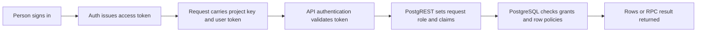

# Authenticated application access: research and next-batch recommendation

Research completed 13 November 2026, Asia/Kolkata (12 November UTC). This is an authoring decision document, not an implemented lesson batch or a record of live Supabase tests. Read alongside the [source register](Authenticated%20access%20-%20source%20register.md).

Follow-up: [implementation decisions and lifecycle research](Authenticated%20access%20-%20implementation%20decisions%20and%20lifecycle%20research.md) refines the proposed receipt-read exercise and membership lock, records a bounded embedded experiment, updates the repository snapshot, and develops nine identity-lifecycle chapter briefs. Use that follow-up for those decisions; the original findings below retain their dated context.

## Recommendation and why it comes next

Author lessons **33–35 around one complete journey: a person signs in, accesses the correct store, places an order, and recovers its receipt after a lost response**. The course can advance independently of the author's personal studies. The personal master curriculum is useful evidence of the desired standard of independent practice, not a restriction on the course's subject matter or writing schedule.

The curriculum supplies a durable map of capabilities. It does not predetermine every lesson or example. Choose each batch by asking:

1. What useful operation can the reader not yet explain and perform end to end?
2. Which prerequisites already have worked examples and practice?
3. Which missing boundary could invalidate the apparent success of those examples?
4. What original engineering experience changes the example or decision?
5. What observable result, failure and changed setting would establish the new capability?

Here, the existing course already supplies local roles/RLS/functions in lessons 23–26, accepted order facts in 29, and concurrency/replay in 30–32. It does not yet establish identity through a genuine application request. That makes authenticated access a strong next branch: it connects substantial existing material while adding a missing trust boundary. More JSON, recursive SQL and calendar modelling remain worthwhile branches; they close different gaps.

The existing [inventory](../../../TOPIC_INVENTORY.md) identifies A03, A04, A11 and A13 as planned, and distinguishes local execution from hosted identity. This batch should address those exact outcomes. A01, A02, A08 and A10 gain integration practice. A12 remains only partly addressed until provisioning and email failures receive their own treatment. Do not mark the entire access area complete.

Three lessons are a proposed division by question, not a size limit. An initial editorial budget is roughly **1,500–2,500 words per article, with lesson 35 allowed more space**, excluding labs, solutions and source records. These are planning estimates, not evidence of learning time. Split a lesson if it contains two independent questions; do not remove necessary reasoning to meet a word quota.

## Current-state check

The authoritative repository is `omsrivastava512/sql-postgresql-course`; live GitHub metadata identifies `main` as its default branch. The live head is `9fbadbedca2e2828d619d9d47b47a6f31baf0887`. Local `main` is `879ffe8b523a25c3aecf8b6ba2649bc1893d07c6`: **11 ahead, zero behind**, verified against that live SHA. All-state PR and issue collections were empty. All eight remote commits and the recent local history were inspected; no equivalent authenticated-access batch was found. No branch update is required for this research.

The earlier course work is committed locally: access lessons at `7c27b50`, catalog lessons at `d7c95fb`, reliable writes at `0fdc81d`, and the latest research revisions at `879ffe8`. Local commits have not reached the live default branch. This research grants no push or commit authority.

The worktree also contains untracked `learning/` and `research/database-design/identity-permissions-and-sharing/`. The latter report describes substantial PostgreSQL/SpiceDB permission experiments, but explicitly starts after identity resolution and uses simulated sessions. Its reported experiments were not rerun or independently certified here. It is complementary background, not proof of an Auth-to-Data-API journey. Both directories were left untouched.

The referenced Main, commit and Continue commit chats were read. Their useful editorial principle is to connect actions, records, decisions, failure and recovery, with small mechanisms explained before their combination. Continue commit's newer discussion also argues for full identity-lifecycle depth. That supports a substantial later branch; it does not make the current simulated-identity report a completed authentication course.

## What the original sources changed

| Source and evidence type | Bounded finding | Consequence for this batch |
| --- | --- | --- |
| Stojan Dimitrovski, Supabase, 14 July 2025; product engineering announcement | The signing-key change separates token signing from public-key verification and explains the operational cost of shared secrets. | Lesson 33 traces who issues and who verifies a token. Decode-only inspection must fail as an authentication argument. We use the platform's verifier rather than teach homemade cryptography. |
| Miki Pokryvailo, Nile, 26 July 2022; firsthand shipping account | Testing caught a deployment using the wrong database identity and reuse of a previous request's user context. | Lesson 34 alternates Alice, Bob and an unauthenticated caller and records identity plus returned rows. A passing admin query cannot substitute for this test. |
| Todd Jefferson, Shopify, 27 August 2019; firsthand payment-service account | Incoming requests were identified by client plus idempotency key, with duplicate coordination and recovery state. | Lesson 35 asks whose operation a key identifies before implementing replay. The course's actor/store scope is our policy, not a claimed Shopify schema. |

Originals: [Supabase signing keys](https://supabase.com/blog/jwt-signing-keys), [Nile's RLS account](https://www.thenile.dev/blog/multi-tenant-rls), [Shopify's idempotency account](https://shopify.engineering/building-resilient-graphql-apis-using-idempotency). These are historical accounts; current mechanisms were checked separately against official documentation. Shopify's remote payment recovery is not implemented by a local order transaction.

## The identity chain the reader must be able to explain

The publishable key identifies the application component; it does not identify Alice. The bearer access token carries her user identity. Alice and Bob normally share the `authenticated` database role while having different user IDs. Secret/service credentials would invalidate ordinary-user RLS tests. Use current publishable-key terminology, with legacy `anon` keys explained only for existing projects. [Supabase API keys](https://supabase.com/docs/guides/getting-started/api-keys)

PostgREST validates the JWT according to its configuration and switches role for the request. It exposes claims through transaction-scoped settings. Do not assert that every deployment validates every possible issuer/audience rule identically: record the actual platform and configuration. [Authentication](https://docs.postgrest.org/en/stable/references/auth.html), [request transactions](https://docs.postgrest.org/en/stable/references/transactions.html)

The inspected Supabase migration implements `auth.uid()` by reading the subject from request settings and casting it to UUID. It does not verify a signature itself. This is why setting a claim manually in SQL can demonstrate policy mechanics but cannot prove login. The pinned migration is implementation evidence, not proof of the definition installed in a future lab project; inspect that definition there. [Pinned Auth migration](https://github.com/supabase/auth/blob/e062eeae0079a6b1a70d5d5da9e5ac5cb8c21194/migrations/20220224000811_update_auth_functions.up.sql)

A plain privileged SQL-editor query usually lacks a user's request context. Record `session_user`, `current_user` and `auth.uid()` instead of assigning the editor an imagined application identity. If the editor has an impersonation facility or retained settings, record those too.

Two corrections matter when adapting documentation:

- A request without a user token can reach the anonymous role; an invalid or expired supplied token is a validation-error case. Do not teach expired JWTs as simply producing an anonymous query. [PostgREST errors](https://docs.postgrest.org/en/stable/references/errors.html)
- `NULL = user_id` evaluates to unknown, not SQL false. Neither result admits a row through a policy requiring true. Explain the actual three-valued logic. [PostgreSQL comparisons](https://www.postgresql.org/docs/17/functions-comparison.html), [CREATE POLICY](https://www.postgresql.org/docs/17/sql-createpolicy.html)

An anonymously signed-in Supabase user is another case: it has a user ID and uses `authenticated`; `is_anonymous` distinguishes it. Lesson 33 should include this boundary even if anonymous sign-in is disabled in the main fixture. [Anonymous sign-ins](https://supabase.com/docs/guides/auth/auth-anonymous)

When comparing SDK methods, explain verified token claims, a fresh Auth user lookup, and merely retrieving locally stored session data as distinct operations. The optional SDK note can reference `getClaims`, `getUser` and `getSession`; it should not turn this SQL batch into a framework tutorial. [Supabase's method comparison](https://supabase.com/docs/guides/auth/server-side/creating-a-client#choosing-an-auth-method)

## One fictional shop, three questions

Use North and South from the existing shop labs. North sells SKU `17`, three packs at 2,000 paise each: a 6,000-paise receipt. South has its own SKU `17`. Alice may place North orders; Bob may read North offers; Cara belongs only to South. Their real Auth UUIDs are created at setup and assigned readable aliases in explanations. Membership is protected application data, separate from an optional display profile.

### 33 — Who is making this request?

**Opening:** Alice and Bob both produce `current_user = authenticated`. Why are they not the same person?

Work through a real password sign-in, a sanitized token-claim inspection, a request carrying that token, and a diagnostic result limited to the caller's role and ID. Show a valid user who has no profile or store membership yet. Connect the auth account to a profile through a key, while demonstrating that neither the presence of a profile nor a self-editable label grants store access.

The main fixture may provision synthetic, confirmed test accounts administratively, then require real password login. Label that shortcut: it proves sign-in, not signup, email delivery or account recovery. The Auth API specification describes the password token endpoint and its JSON request, so a small Node caller can use built-in `fetch` without a new SDK dependency. [Auth API specification](https://github.com/supabase/auth/blob/master/openapi.yaml)

**Prediction:** edit the decoded subject to Bob's ID without a valid new signature. It must not authenticate as Bob. Use only disposable fixture accounts and the normal API route.

**Independent transfer:** a library has two patrons sharing the same database role. Explain which identity determines each patron's loans, and why a request-body `patron_id` cannot establish it. The explained answer must follow the trust chain rather than merely name JWTs.

**Return:** given a token, profile row and membership row, identify which one establishes identity, which stores display data and which grants permission.

### 34 — Which requests may this person make?

**Opening:** Alice's query works; Bob sees fewer rows; the same SQL in the editor sees everything. Which outcome is wrong?

Make calls over the Data API, then inspect database state through a separate verifier. Include an allowed read and write, a hidden cross-store row, a rejected proposed row, an unauthenticated request and a missing-grant control. Repeat Alice → Bob → no token → Alice to expose accidental context reuse. Add a relation that is deliberately unavailable through the API to distinguish exposure from authorization.

Propose a dedicated exposed lesson schema and an unexposed internal schema, with explicit per-object privileges. Existing `public` defaults must be inspected instead of assumed. Hiding an internal schema is not sufficient if an exposed function can reach its objects incorrectly. [Securing the Data API](https://supabase.com/docs/guides/api/securing-your-api)

For write observations request representations deliberately; default write responses may contain no body. A zero-row update is not proof that a row existed and permission alone hid it. Seed a known row and use the independent verifier to establish unchanged state. [PostgREST return preferences](https://docs.postgrest.org/en/stable/references/api/preferences.html#return-representation)

Use current database membership for store authorization. A user-editable metadata claim is unsuitable authority; even protected application claims can remain stale in an already-issued token. [Supabase RLS helper guidance](https://supabase.com/docs/guides/database/postgres/row-level-security#helper-functions)

**Independent transfer:** design the request matrix for a training centre: instructor at Centre A, read-only assistant at A, instructor at B, and no signed-in user. Supply one successful write, one hidden row and one rejected proposed row. Explain the expected response and unchanged data, with hints and a reference answer in a separate section.

**Return:** repair a test that accidentally uses an elevated credential. Explain which conclusions must be retested.

### 35 — May this person place and recover this order?

**Opening:** Alice's North order committed, its response disappeared, and her membership was removed. Should repeating the key return the receipt?

Use one authorized RPC to combine identity, permission, duplicate arbitration, accepted order facts and saved response. Existing lab 32 is the prerequisite, not the finished implementation: its key is `(store, request_key)`, its store is caller supplied, and it has no authenticated actor. Wrapping it unchanged with a token would not establish receipt ownership.

The proposed main policy is explicit: **a request belongs to one authenticated account within one store, and both execution and replay require current order-placement permission**. Bob cannot obtain Alice's receipt by guessing her key. Revocation does not undo a committed order or erase duplicate protection. An authorized operator's reconciliation is a separate operation.

A proposed transaction sequence is:

1. Resolve the actor from verified request context; reject a missing identity. The caller supplies the requested store, key, SKU and quantity, never trusted actor identity or accepted price.
2. Acquire the chosen membership coordination lock and check current permission. Reject before inspecting or returning a receipt.
3. Arbitrate the unique `(store, actor, request_key)` record. Compare the immutable request parameters; a changed payload conflicts.
4. If a completed matching request exists, return its saved receipt without rereading today's offer.
5. Otherwise read the current offer, write order and accepted line, and save the receipt in the same transaction.
6. Commit, then deliver the response. After an uncertain response, repeat the same operation identity. Do not invent a fresh key to retry.

This is a proposed protocol, not executed SQL. PostgREST runs a resource request in a transaction, and RPC arguments are supplied as JSON. A write RPC must use the appropriate volatility and HTTP method, with the schema cache refreshed after definition changes. Several separate REST calls do not become one transaction because they came from one button click. [Transactions](https://docs.postgrest.org/en/stable/references/transactions.html), [RPC functions](https://docs.postgrest.org/en/stable/references/api/functions.html)

**Worked failure:** the original receipt remains 6,000 paise after North's price rises. Alice's retry returns that receipt only while currently authorized. Once removal commits before a new attempt, the retry denies access and the verifier still finds exactly one order. Returning to a lost receipt and creating a new sale are different operations.

**Independent transfer:** a training-centre coordinator loses booking permission after accepting a booking. Specify whether an assistant may recover that booking, and design tests for the chosen rule. The reference answer compares an actor-owned request with a separate staff-visible booking record; sharing a request key is not a substitute for delegation.

**Return:** explain why idempotency does not imply permission, and why denying replay does not imply that the original order failed.

## Decisions to settle before implementation

These are researched recommendations, not approved architecture changes or universal business rules.

| Decision | Alternatives and consequence | Recommended teaching contract |
| --- | --- | --- |
| Key ownership | Store-wide permits coordinated clients but requires a separate ownership/access rule. Actor-wide alone can make stores collide. | Store + stable authenticated actor + key. Two actors using the same text name different operations; the response must never reveal the other's request. |
| Replay permission | Current placement permission is simple but denies a downgraded reader. A separate receipt-read permission supports more workflows. | Require current placement permission for the command and its replay; make read-only receipt access a changed-requirement exercise. |
| Revocation timing | Snapshot checks are simple; a request admitted before revocation may finish afterward. Coordinated locking establishes a clearer ordering but makes revocation and writes wait. | For the order RPC, lock the active membership row, recheck after waiting, and require revocation/role-change writers to take a conflicting lock. Prove both orderings. Ordinary reads retain their snapshot limit. |
| Function privileges | Invoker functions reuse caller permissions but require careful grants on internal data. A definer can offer a command-only interface but becomes an enforcement boundary. | A narrowly owned definer for the final command; ordinary table-policy practice stays in 34. Explicit actor checks, fixed safe path, qualified objects, selective EXECUTE, and no client access to mutate replay records. |
| Account/profile lifecycle | A trigger can create a profile with the Auth account but can also break signup. An explicit profile step admits recoverable incomplete onboarding. | Seed profiles independently for the core route; demonstrate missing profile without extra authority. Develop provisioning failure and repair in the next batch. |
| Rejoining | A fresh membership episode can intentionally isolate old grants. Stable account-owned receipts can intentionally survive membership episodes. | Keep request identity stable across rejoining. If the same account regains placement permission, the old key can recover its old receipt; it cannot create a duplicate. State this policy explicitly. |
| Record retention | Deleting receipts or resetting their namespace can permit repeat execution. Cascading account deletion may destroy order history. | Retain accepted requests until an explicit lab reset; no expiry or account-deletion promise in this batch. Preserve historical orders and evaluate deletion separately. |

The membership-lock recommendation only works if every relevant permission writer cooperates. It does not retract a response already in transit or serialize arbitrary resource reads. Avoid a global store lock when only one member's authority needs coordination. A more complex policy with organization suspension or multiple grants will need a wider protocol. PostgreSQL documents both snapshot behavior and races in policies that consult other rows. [Isolation](https://www.postgresql.org/docs/17/transaction-iso.html), [row-security race example](https://www.postgresql.org/docs/17/ddl-rowsecurity.html)

For a definer function, execution privileges come from its owner; the keyword does not automatically bypass RLS. Record the owner's attributes and table ownership. Exclude untrusted schemas from `search_path`, account for temporary objects, and revoke default PUBLIC execution in the same creation transaction. Do not expose a generic claims setter or SQL executor. [CREATE FUNCTION](https://www.postgresql.org/docs/17/sql-createfunction.html#SQL-CREATEFUNCTION-SECURITY)

Profile design should reference the managed Auth primary key and avoid copying credentials into an application table. Supabase explicitly warns that a failing profile trigger can block signup; account creation, profile completion and membership assignment therefore deserve separate evidence. [Managing user data](https://supabase.com/docs/guides/auth/managing-user-data)

## Verification matrix for the implementation

All entries below are **required future observations**, not results obtained in this research. Capture exact HTTP status, structured code, relevant sanitized role/ID, returned rows and final database state. Error strings and some status details vary with the deployed API version; record that version before freezing expectations.

| ID | Experiment | Required evidence |
| --- | --- | --- |
| I1 | Alice and Bob log in separately | Real Auth responses; distinct subjects, same application DB role |
| I2 | Wrong password; altered signature; expired token | Distinct controlled attempts rejected; none becomes the requested user; expiry tested beyond documented skew |
| I3 | No user token | Anonymous context if enabled, no private rows; distinguish missing privilege from empty allowed query |
| I4 | Ordinary editor versus user request | Recorded connection/role/UID explains different results |
| I5 | Valid account, absent profile/membership | Identity succeeds; store operation denies; no automatic membership |
| I6 | Anonymous sign-in boundary | Executed optional fixture or clearly labelled documentation exercise; never equate this user with no token |
| P1 | Allowed North read/write | Exact intended rows and mutation, correct actor |
| P2 | North actor requests South row | No South payload; known fixture remains unchanged |
| P3 | Hidden-row UPDATE/DELETE | Zero affected rows where policy semantics specify hiding; independent verifier confirms preservation |
| P4 | Visible row changed to forbidden store/owner; invalid INSERT | Policy rejection and unchanged state, not a blanket expectation that every denial is an empty array |
| P5 | Missing table/function grant; unexposed schema | Distinct failures located at privilege/exposure boundary |
| P6 | Alice → Bob → no token → Alice | No identity or result contamination across sequential and concurrent requests |
| P7 | Caller edits profile/user metadata to claim authority | No new store access |
| P8 | Membership revoked while same JWT remains valid | Subsequent fresh request denies; record concurrency/snapshot limit |
| O1 | Successful order RPC | One order, one line, one complete matching saved receipt |
| O2 | Failure after an intermediate database write | Transaction rolls back all order/request changes; sequence gaps are permitted |
| O3 | Drop successful response after server completion, then retry | One accepted order and the same complete receipt, even after price change |
| O4 | Response fails with outcome initially unknown | Retry same key; determine accepted state through permitted recovery and verifier, never assume rollback from client timeout |
| O5 | Same actor/store/key, changed payload | Conflict and no second order |
| O6 | Concurrent equal requests; first creator commit and rollback | Native sessions and API calls establish arbitration, final count and receipt identity |
| O7 | Bob supplies Alice's key | No access to Alice's request; an authorized Bob operation is independent under the proposed scope |
| O8 | Membership removal before replay | Denial with original order and request retained |
| O9 | Order versus revocation in both lock orderings, plus revocation rollback | Observe real blockers with a separate connection; verify the specified winner and unchanged state on denial |
| O10 | Attempt direct mutation of request/receipt/order internals | Command boundary holds against ordinary API credentials |
| O11 | Rejoin, then retry old key | Original receipt under renewed permission; no duplicate |

Distinguish response suppression from an actual transport interruption. For O3, a test relay can receive the upstream success and deliberately withhold it from the learner caller; label the relay's privileged knowledge. O4 requires a separate interruption before the client knows the outcome. Neither proves all network-failure schedules. O6/O9 require controlled synchronization and blocker observations, not timed sleeps presented as proof.

A 401/403/empty array is not sufficient evidence alone. PostgREST distinguishes authentication errors from PostgreSQL privilege errors, and RLS checks distinguish row visibility from admissibility of a proposed row. Compare both the response and the stored facts. [Error mapping](https://docs.postgrest.org/en/stable/references/errors.html), [policy semantics](https://www.postgresql.org/docs/17/sql-createpolicy.html)

## Environment and feasible delivery

The current machine exposes Node on PATH; Docker, Supabase CLI, psql and postgres were not found there. This is a PATH check, not proof that none is installed anywhere. No hosted project was inspected or modified for this research.

Two viable execution routes need to remain separate:

- **Local Supabase stack:** best primary development route for reproducible Auth, PostgREST and database resets, with captured mail for the later onboarding branch. Current Windows instructions require a Docker-compatible runtime. The documented experimental native runtime supports Linux and Apple-silicon macOS, so it is not a verified Windows escape route. [CLI setup](https://supabase.com/docs/guides/local-development/cli/getting-started)
- **Dedicated hosted Supabase test project:** necessary to meet the course's existing hosted release gate and verify platform-specific configuration. Identify a disposable course project explicitly before any writes. Never repurpose a clinic or unrelated application project.

Use a small supplied Node caller with `fetch` for Auth and HTTP requests. Keep existing `pg` for controlled SQL verification and concurrency observation. Administrative setup credentials and ordinary-user caller credentials must be separate. Tokens/passwords must not appear in saved teaching transcripts. No dependency installation, service deployment or project creation is authorized by this research document.

Email-confirmation defaults differ between hosted and local setups; record settings explicitly. Administratively confirmed fixtures avoid email as a prerequisite for lessons 33–35, but they do not test email delivery. [Password Auth configuration](https://supabase.com/docs/guides/auth/passwords)

A valid access token can remain usable after sign-out until expiry; membership checks address a different revocation axis. Sensitive-operation session checks may add a server-side lookup. A session row's presence alone is not a universal test of every configured timeout. This deserves a later lifecycle experiment rather than an unsupported claim of immediate logout. [Supabase sessions](https://supabase.com/docs/guides/auth/sessions)

The existing embedded checker executes SQL, not the complete identity chain. It cannot certify JWT validation, HTTP error mapping or hosted configuration. Keep database-unit, native concurrent, full local stack, hosted integration and human walkthrough evidence separately dated. Historical passing assertions remain evidence only for their original scope.

## What follows this batch

The next strongest continuation is **account lifecycle and recovery**, with enough depth to follow a person through signup, verification, incomplete profile repair, membership admission, refresh, logout, removal and recovery. Start with the failures left deliberately visible here: an account exists without a profile; a confirmation email did not arrive; a token outlives a removed membership; recovering an account must not resurrect old permissions.

That branch can use the ongoing identity/permissions research after its final state is reviewed. It should execute real provider/session boundaries where it claims integration. Passkeys, MFA, account linking and enterprise SSO/provisioning deserve connected later chapters as needed; they should not be compressed into terminology boxes merely to claim breadth.

After that, **external effects and operational recovery** is a natural bridge from accepted order to payment/email/job delivery: committed intent, worker retries, ambiguous remote outcomes, reconciliation and retention. JSON/arrays, recursive relationships, time/calendar modelling and restore rehearsals remain explicit parallel branches in the master course. This is a revisable authoring sequence, not a learner-paced gate or an upper limit on the course.

## Research completion and implementation handoff

This investigation establishes the next batch's rationale, source-grounded mechanism, concrete lesson questions, proposed policy choices, integration feasibility and acceptance matrix. It does not establish that the proposed labs pass.

Before authoring executable lessons, confirm the concrete design choices in the decision table and select the disposable execution route. Then implement the three article/lab pairs using the existing file conventions, add the real request harness, update exact inventory outcomes and source records, and execute the relevant tests. Keep all existing numbers stable. Publication additionally requires the local/hosted and reader checks already specified in [AUTHORING.md](../../../AUTHORING.md) and [PUBLICATION.md](../../../PUBLICATION.md).

No repository file, lesson, dependency or Git state was changed by this research. Only this memo and its companion source register were created in the chat's artifact directory.
