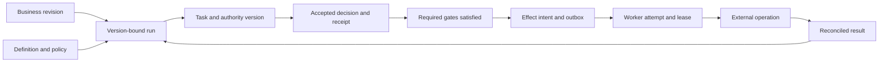
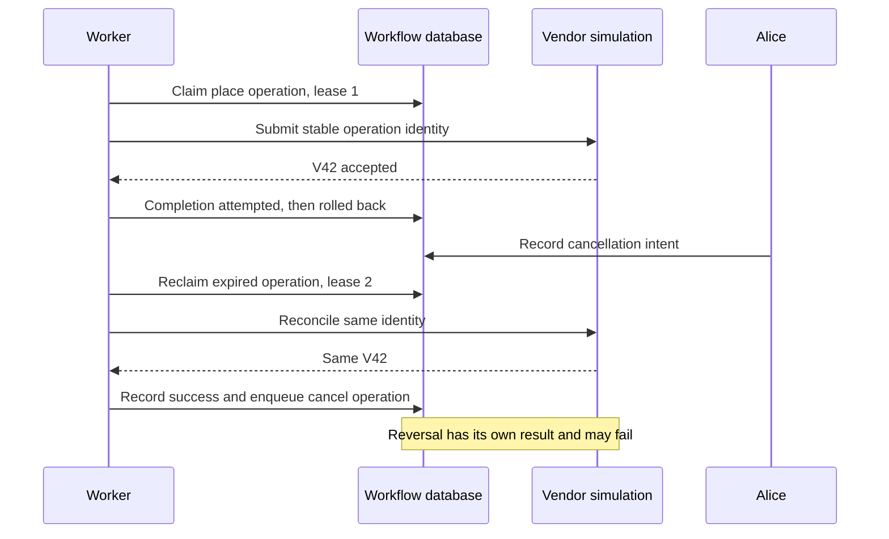

# How business systems run workflows and approvals

Research completed 11 Nov 2026 after starting 10 Nov. **Native PostgreSQL verification: 103 assertions and 14 observed blocking schedules passed.** See the [research log](Research%20log.md) for sources, reproduction, coverage audit and evidence limits.

Teaching connections revised later on 11 Nov. The SQL and reproduction harness are unchanged; the native results above belong to the earlier run, not a new execution during this writing pass.

## 1. Follow a purchase that cannot finish in one request

[Inferred — connected teaching scenario] Alice requests equipment costing 120,000 illustrative currency units in purchase P42/revision 1. Her manager must approve the need; Finance and Security must both approve their parts. The manager goes on leave and Ops reassigns his task to Erin. After Erin and Finance approve, Alice amends the request to 180,000 in revision 2, requiring a fresh approval round. A newer policy exists, but this run remains on its original definition 7/policy 12. Later, the vendor accepts the order but the local completion is lost. Alice cancels while recovery is pending. The system must determine what actually happened and whether cancellation remains possible.

This is one business story with several kinds of state. A single `status = 'pending'` cannot explain which decision is missing, what amount was approved, whether a timer is due, who can act, whether an external effect already happened, or which rules apply. Conversely, creating a workflow engine does not eliminate the business object's own lifecycle. An approved purchase can still be unfulfilled; an engine execution can be failed while the vendor has already accepted an order.

The investigation uses purchase approval as its main thread and compares expense claims, onboarding and service provisioning where they expose different mechanisms. Numerical thresholds and policies in examples are invented, not requirements of a named provider.

| Identity or record | Illustrative value | Question it answers |
| --- | --- | --- |
| Business object | Purchase P42, initially revision 1; later revision 2 | What is being requested now? |
| Reviewed snapshot | Revision 1: 120,000; revision 2: 180,000 | What exactly did the approver see and approve? |
| Process definition/version | Equipment purchase, version 7 | Which executable structure governs this run? |
| Policy version/evaluation | Procurement policy 12, evaluated facts | Why were these steps and approvers selected? |
| Process instance | Run W90 | Which particular execution is progressing? |
| Step occurrence | Finance review, round 2 | Which visit to a step is this? A loop can visit it again. |
| Human task | T1/W90/round 1/manager, Bob then Erin | Who has work to do, and what can they do? |
| Decision | Erin accepts that task under authority version 2 | What decision was accepted, by whom and under which authority? |
| Timer/subscription | Escalation due; waiting for vendor result | What can wake the execution later? |
| Attempt | Worker holding lease 2 for place:2 | Which execution currently has authority to record the result? |
| External operation | Submit P42/r2 with stable key T1/W90/place:2 | Which business effect should retries refer to? |
| Event/outbox/inbox | Accepted decision; queued action; received callback | What was recorded and what remains to be delivered or consumed? |

These are conceptual distinctions, not a requirement that every product implement twelve SQL tables. Some engines serialize internal state; some business applications primarily attach rules to an existing document. The important question is where each responsibility resides and how its state survives failure.

Follow [the worked purchase](#12-connected-database-walkthrough-and-experiments) for the concrete model, using sections 2–10 to compare the decisions it makes. Human task authority, reviewed revisions, the departmental join and uncertain vendor work receive executable treatment. Arbitrary process graphs, quorum voting, calendars, engine migration and other domains receive explanation and comparisons, not complete implementations. The same purchase identifiers recur below so a newer task, lease or definition cannot quietly become a different business request.



## 2. Three concrete storage designs

### A business document governed by transition rules

[Confirmed, Frappe v15.0.0] The Workflow DocType defines the target document type, states, transitions and the document field containing workflow state. The inspected `apply_workflow` path reloads the document from the database, gets permitted transitions from state, current roles and conditions, checks self-approval policy, changes state, and saves/submits/cancels the document as appropriate. It also adds a workflow comment. `get_workflow_name` locates the active workflow for the document type; this path does not establish that each document is bound to an immutable definition version. [Definition metadata](https://github.com/frappe/frappe/blob/b8c1f492c492f7cbbfd3cc768234fbb244fd3737/frappe/workflow/doctype/workflow/workflow.json), [transition implementation](https://github.com/frappe/frappe/blob/b8c1f492c492f7cbbfd3cc768234fbb244fd3737/frappe/model/workflow.py).

[Inferred] This is a useful counterexample to the assumption that all workflows are separate long-lived engine executions. For an application with a modest document state machine, the document can carry the current state while reusable configuration specifies allowed transitions. Whether editing that configuration safely handles documents already in flight is an additional question. Reloading the document is also not, by itself, proof of correct concurrency: persistence checks and transaction boundaries still need inspection.

[Confirmed, same pinned file] The bulk approval loop commits individual successful documents and rolls back failed ones. [Bulk operation implementation](https://github.com/frappe/frappe/blob/b8c1f492c492f7cbbfd3cc768234fbb244fd3737/frappe/model/workflow.py). [Inferred] An “approve selected” UI can therefore represent several independent outcomes rather than one all-or-nothing decision over the selection.

### A task engine with explicit relational task fields

[Confirmed, Flowable 7.1.0] The inspected MyBatis mapper inserts task rows into `ACT_RU_TASK`. The columns distinguish owner, assignee, delegation state, process instance/definition references, task-definition key, lifecycle timestamps, due dates, tenant and form. Updates increment `REV_` and match both task ID and the old revision. [Pinned task mapper](https://github.com/flowable/flowable-engine/blob/46e0b79cbd02ebd637890b78d428595b1a9a6299/modules/flowable-task-service/src/main/resources/org/flowable/task/service/db/mapping/entity/Task.xml).

[Inferred] Owner, candidate, assignee and deciding actor should not be treated as interchangeable merely because a UI displays one person's name. Nor does a due-date column prove that the engine automatically rejects a late response: a field can support display/filtering while a separate timer or process rule enforces a deadline. The mapper proves persistence details, not the full permission algorithm or the behavior of a losing concurrent command. Those require callers and transaction handling.

[Confirmed, same Flowable release] The claim command rejects an already assigned task when the requested claimant differs, while the same claimant satisfies that check. The persistence layer throws an optimistic-locking exception if its entity update affects zero rows. Together with the mapper's revision predicate, these establish a concrete conflict-detection path; application retry and authorization policy remain separate. [Claim command](https://github.com/flowable/flowable-engine/blob/46e0b79cbd02ebd637890b78d428595b1a9a6299/modules/flowable-engine/src/main/java/org/flowable/engine/impl/cmd/ClaimTaskCmd.java), [database flush](https://github.com/flowable/flowable-engine/blob/46e0b79cbd02ebd637890b78d428595b1a9a6299/modules/flowable-engine-common/src/main/java/org/flowable/common/engine/impl/db/DbSqlSession.java).

### Durable code execution with history and mutable execution state

[Confirmed, Temporal server v1.27.0 PostgreSQL schema] `executions` is keyed by shard, namespace, workflow ID and run ID; `current_executions` separately identifies the current run. Execution state is partly serialized into byte payloads with encoding fields. Separate structures store history nodes/branches, buffered events, activity and timer information, scheduled tasks and task queues. [Pinned schema](https://github.com/temporalio/temporal/blob/b1ae42e00f5d784b66c41ac7d353ef9e55390241/schema/postgresql/v12/temporal/schema.sql).

[Confirmed, current documentation] Temporal reconstructs workflow progress through replay, checking generated commands against recorded event history. Activities perform ordinary work such as calling another service; their code can be nondeterministic and should tolerate retries without duplicate effects. A retry generally starts an Activity attempt again, with recorded heartbeat details available for application-defined checkpoint recovery. [Workflow execution](https://docs.temporal.io/workflow-execution), [Activities](https://docs.temporal.io/activities).

[Inferred] Replay is not a snapshot of a sleeping operating-system thread, and replaying workflow logic is not permission to replay every real-world side effect. Recorded Activity results allow control logic to progress without treating a previously completed call as an instruction to purchase again. An external action that succeeded without a recorded completion still creates uncertainty; the external operation needs its own retry/reconciliation contract.

[Confirmed] Continue-As-New starts a fresh execution history under the same Workflow ID with a different Run ID, carrying application-selected state into the new run. This helps with long histories; it is not automatic preservation of every local variable or a substitute for designing the handoff. [Continue-As-New](https://docs.temporal.io/workflow-execution/continue-as-new).

[Confirmed, pinned Temporal server] `UpdateWorkflowExecution` calls history append operations before entering the shard-locked transaction that updates mutable execution state and, where applicable, the current run/new-run snapshot. Thus, even this PostgreSQL backend must not be summarized as “every history and state change occurs in one SQL transaction.” [Update implementation](https://github.com/temporalio/temporal/blob/b1ae42e00f5d784b66c41ac7d353ef9e55390241/common/persistence/sql/execution.go#L342). [Unknown] This bounded trace does not establish every recovery/garbage-collection path for an append followed by a failed update; nor was that engine failure exercised here.

## 3. Waiting has several lifetimes

[Confirmed] Microsoft's known-issues documentation describes approval records that remain in the action center after the waiting flow fails. It also documents a race in which a response arrives between separate creation and wait actions, and a Teams card that can remain stale after a response through another channel. [Power Automate known issues](https://learn.microsoft.com/en-us/power-automate/approvals-known-issues).

The same known-issues page describes a 28-day approval wait, while the general limits page lists a 30-day flow-run duration including pending approvals. The tutorial recommends storing long-running approvals in Dataverse and separating creation from response handling. These pages do not establish one consistent universal timeout; preserve the discrepancy and verify the particular action/version before deployment. The durable approval-versus-waiter distinction holds regardless of that numerical disagreement. [Run limits](https://learn.microsoft.com/en-us/power-automate/limits-and-config), [long-running approval pattern](https://learn.microsoft.com/en-us/power-automate/modern-approvals).

[Inferred] These are three different records: the durable approval, the executor waiting for it, and a user-facing notification. A visible button does not prove that a live executor is listening. An email marked sent does not prove the person received or acted on it. A correct backend must define which record is authoritative when these views disagree.

| Lifetime | What can end it | What may remain |
| --- | --- | --- |
| Browser/API request | Response, disconnection, timeout | Business request and process instance |
| Worker attempt | Completion, crash, lease expiry | Durable work and retry policy |
| Wait/subscription | Matching event, timeout, cancellation | Approval record or late incoming event |
| Approval task | Accepted response, withdrawal, replacement | Decision history and stale notification |
| Engine execution | Completion, failure, cancellation/termination | Business object and external effects |
| Business obligation | Fulfillment, cancellation, reversal or explicit resolution | Audit records and retention obligations |

[Confirmed] AWS distinguishes Standard workflows from Express workflows. Standard supports long-running execution and callback/job-wait integration patterns; Express does not support those two patterns. Its comparison distinguishes asynchronous Express's at-least-once execution from synchronous Express's at-most-once execution. Standard's stated exactly-once execution model explicitly allows configured retries. [Workflow-type comparison](https://docs.aws.amazon.com/step-functions/latest/dg/choosing-workflow-type.html).

[Inferred] Execution semantics must be read at the named boundary. An engine's scheduling guarantee is not a general distributed transaction with a vendor, payment service or employee's mailbox. “Retry” also needs an object: retry an API request, an Activity attempt, a step, a failed branch or the entire business process can each repeat different work.

## 4. Human approval is a policy over decisions

[Inferred] “Three approvals” is ambiguous. Are these three people, three roles, three independent departments, or any three members of a larger panel? Can one person occupying two roles satisfy two requirements? Does rejection terminate immediately? Are abstentions allowed? Freeze the relevant policy for an approval round and record its evaluated facts; an aggregate counter alone cannot answer these questions.

| Policy | Condition to proceed | Edge case to define |
| --- | --- | --- |
| Sequential | Each required step succeeds in order | A future approver must not approve an unopened step. |
| Unanimous parallel | Every required participant approves | A rejection may close the remaining tasks without their response. |
| First response | First accepted response determines outcome | “First” must mean an authoritative ordering, not two browser timestamps. |
| Quorum | Required number of distinct eligible approvals | Duplicates and one actor occupying several roles must not inflate the tally. |
| Department gates | Each required department's rule succeeds | Three Finance votes cannot substitute for Security approval. |
| Conditional approval | Approved subject to recorded conditions | Decide who verifies conditions and whether fulfillment may begin. |

[Confirmed] Salesforce's ProcessInstanceStep contract exposes current and original actor relationships and a step status. Under unanimous approval, one rejection changes other approvers' steps to `NoResponse`; under first-response approval, the remaining approvers likewise become `NoResponse`. These are API-level records, not a disclosure of Salesforce's physical SQL schema. [Approval step reference](https://developer.salesforce.com/docs/platform/object-reference/references/standard-objects/object-processinstancestep.html).

### Assignment, delegation and substitution

[Confirmed, Flowable 7.1.0] Delegation sets the task's delegation state to pending, retains the original assignee as owner if no owner exists, and changes the assignee. Resolution sets delegation to resolved and assigns the task back to its owner. Resolving delegated work is consequently distinct from simply completing the business process. [Delegate command](https://github.com/flowable/flowable-engine/blob/46e0b79cbd02ebd637890b78d428595b1a9a6299/modules/flowable-engine/src/main/java/org/flowable/engine/impl/cmd/DelegateTaskCmd.java), [resolve command](https://github.com/flowable/flowable-engine/blob/46e0b79cbd02ebd637890b78d428595b1a9a6299/modules/flowable-engine/src/main/java/org/flowable/engine/impl/cmd/ResolveTaskCmd.java).

[Inferred] An absence rule can instead permanently reassign a task, temporarily allow a substitute to decide, or ask a delegate to prepare a recommendation. Store which occurred, who authorized it, its validity interval and the actual actor. Never rewrite an earlier approval as if the replacement approver made it. Reassignment should invalidate or recheck outstanding action tokens; old emails must not preserve the former assignee's authority indefinitely.

Candidate membership and final authority are also different. A task can be visible in a group inbox, claimed by one member, then completed only by its current assignee. Membership can disappear between viewing and submitting. Recheck eligibility at the mutation boundary. For separation of duties, decide whether the requester, document owner, preparer, beneficiary or previous-stage approver is disallowed. These identities need not all be the same person.

[Confirmed, Camunda documentation version 8.10] A user-task instance suspends progress at that point until completion. Assignment expressions are evaluated when the task activates. The documentation explicitly says that current Tasklist releases do not use candidate users/groups for visibility or assignment; authorization controls apply separately. A field named `candidateGroups` therefore does not establish the same security behavior across products or releases. [User tasks](https://docs.camunda.io/docs/components/modeler/bpmn/user-tasks/).

### Approval binds to reviewed facts

[Inferred] If Alice changes the amount from 120,000 to 180,000 after Finance approves, silently retaining the approval can authorize something Finance never reviewed. Three common designs are to lock the document while pending, create immutable revisions with approval rounds, or invalidate selected decisions when material fields change. Define which fields are material and retain the old snapshot and reason for invalidation. A later cosmetic change need not force every approval again if that is the documented policy.

Forms have versions too. Preserve stable question IDs, answer values, attachment identities and the relevant rendering/schema version. Otherwise an old answer may be displayed under a newly worded question. Required fields and permissible choices must be validated by the backend, not just by the form. An approval comment can contain sensitive information and requires the same access review as the decision it accompanies.

## 5. Branches, joins, loops and business rules

[Inferred] A process graph describes allowed control flow. A run records which elements have actually been activated. A decision table chooses a route from facts. These are separate responsibilities: a policy can determine that Security is required without performing the Security review itself.

For P42, manager approval opens two required gates, Finance and Security. Each completion updates its own gate; the join advances only when both are satisfied. A conditional branch needs a record of which paths were selected. Waiting for every edge drawn in a diagram can deadlock when some paths were never activated. A loop needs a new occurrence/round identity; a response from Finance round 1 must not complete round 2.

A practical rule evaluation record contains the rule-set version, relevant input snapshot, selected result and explanation. Rules may use live facts such as department membership, exchange rates or vendor eligibility. Decide when those facts are frozen and when they are rechecked. An expired vendor certification at fulfillment time is not solved merely by an earlier approval.

Child processes can encapsulate provisioning or procurement, but parent cancellation and child lifetime require explicit rules. A completed parent may leave a detached child running if designed that way. Conversely, stopping all children can interrupt cleanup. Ad-hoc case work, such as an investigation that adds tasks as evidence arrives, may fit a case model better than a rigid sequence. This report compares these modeling choices without claiming that a directed acyclic graph can express arbitrary loops without additional execution semantics.

## 6. Timers, callbacks and workers

### Waiting is stored intent to resume

[Confirmed, Flowable 7.1.0] Job acquisition selects work up to the executor's available/configured capacity, then records a lock owner and expiration computed from its clock. This is a concrete time-bounded claim, not a database connection held open throughout the business wait. [Acquisition code](https://github.com/flowable/flowable-engine/blob/46e0b79cbd02ebd637890b78d428595b1a9a6299/modules/flowable-job-service/src/main/java/org/flowable/job/service/impl/cmd/AcquireJobsCmd.java).

[Confirmed] n8n's documented queue mode sends an execution ID through Redis; workers load execution data from the database and write results back. Its Wait node persists paused execution data and supports time, webhook and form conditions, with an explicit exception: time waits under 65 seconds do not offload to the database. The node's time behavior uses server time regardless of the workflow timezone setting. These are n8n-specific contracts. [Queue mode](https://docs.n8n.io/deploy/host-n8n/configure-n8n/scaling/enable-queue-mode.md), [Wait node](https://docs.n8n.io/integrations/builtin/core-nodes/n8n-nodes-base.wait).

[Inferred] A minimal durable timer stores an instance/step identity, due instant, timer kind, generation and state. A scheduler finds due work; a transaction validates that the timer still belongs to the current generation before applying its effect. Rescheduling increments the generation or cancels/replaces the old timer. An old queue message can then be recognized as stale instead of escalating a task that has already been reassigned or completed.

A due date, reminder, follow-up date, execution timeout and lease expiry have different purposes. “Three business days” needs a calendar, holiday rules, timezone and policy for daylight-saving changes. Store both the computed instant and enough rule context to explain it. A scheduler waking late should process the overdue obligation according to policy, not pretend it fired exactly on time. Timer firing and task completion must compete through one authoritative transition rule.

### A callback is a message, not necessarily a decision

[Confirmed] Temporal distinguishes asynchronous Signals, tracked Updates that can return results, and read-only Queries. Queries do not add history events; accepted Updates do. [Message passing](https://docs.temporal.io/encyclopedia/workflow-message-passing).

[Inferred] A purchase callback needs tenant, business object, step/round and operation identity, plus authentic sender evidence. Receiving an authentic callback does not mean its requested transition is still valid. It may refer to a canceled run, an old approval round or a previous retry attempt. Persist the received message before acknowledging it where the integration allows, deduplicate by a stable sender/message identity, and record whether it was applied, ignored as stale, rejected or held for reconciliation.

Create the durable wait/subscription before exposing a callback address, or make early responses durable and discoverable when the waiter starts. Avoid a design where a response is accepted only while a particular worker is listening in memory. An unguessable callback token is a bearer capability: protect it from logs, bind it narrowly, expire it and define whether it may be used once. For human approvals, also require the intended identity and current authority; possession of an old email alone need not be sufficient.

## 7. External effects, retries and the limits of exactly once

[Inferred] Suppose the vendor accepts P42, then the network fails before its response reaches the worker. The local state is “outcome unknown,” not “the vendor did nothing.” Repeating the request with a fresh business identity can purchase twice. Declaring success without evidence can invent a purchase. The recovery choice depends on the vendor contract: retry with the same idempotency key, look up the operation, reconcile through a later callback, or require manual resolution.

| Failure point | Durable evidence | Recovery requirement |
| --- | --- | --- |
| Before local action intent commits | No committed intent | Retry the business command with its request identity. |
| Intent commits; dispatch crashes | Outbox/work record exists | A dispatcher discovers and retries it. |
| Vendor succeeds; response disappears | Local result unknown | Query/retry the same external operation identity. |
| Result commits; response to caller disappears | Accepted result and request receipt exist | Return that result without another effect. |
| Lease expires while old worker runs | Another attempt may start | Fence stale local writes and use external idempotency/reconciliation. |
| Retry limit reached | Attempts and failure category remain | Park as an incident; do not erase the business obligation. |

An outbox joins the local state change and the intent to send in one database transaction. Delivery can still be duplicated. An inbox or result receipt prevents repeated application of an incoming result. Neither mechanism makes an arbitrary remote API transactional. A monotonically increasing lease generation can reject stale workers' database updates, but it cannot stop a remote purchase unless the remote side checks a corresponding fence or stable operation identity.

Separate retryable transport failures from business rejection, validation errors, expired authority and uncertain outcomes. Use bounded backoff and jitter, deadlines and capacity limits. Retrying a permanent rejection indefinitely occupies capacity and obscures the actual problem. Retrying every nested layer can multiply downstream calls; identify which layer owns the retry policy.

[Confirmed] Step Functions redrive preserves successful-step results and resumes unsuccessful work using the original state-machine definition/version. A changed definition requires a new execution; moving an alias does not silently upgrade the redriven run. [Redrive behavior](https://docs.aws.amazon.com/step-functions/latest/dg/redrive-executions.html). [Inferred] Operators need to know whether they are retrying a step, redriving an execution or starting a new business request. These actions have different duplication risks.

## 8. Cancellation and compensation are additional work

[Inferred] A cancellation request records intent. It is not proof that every worker stopped or that every external action was reversed. Pending human tasks can be withdrawn; a worker may be executing; a vendor may already have shipped. The system needs states such as `cancel_requested`, `reconciling`, `compensating`, `compensated` and `manual_review` where those distinctions matter.

Compensation is a new business action that addresses an earlier action: release a reservation, cancel an order, issue a refund or revoke newly provisioned access. It is not SQL rollback across several services. A refund may have fees, an email cannot be unsent reliably, and a shipment may require a return rather than cancellation. Compensation can fail and need retries or a human decision.

[Confirmed] AWS describes cancellation of an aborted `.sync` integration as best effort: missing permissions or an outage can prevent the integrated job from being canceled. Its request-response, job-wait and task-token callback patterns also wait for different kinds of completion. [Service integration patterns](https://docs.aws.amazon.com/step-functions/latest/dg/connect-to-resource.html). [Inferred] Stopping the orchestration is consequently insufficient evidence that downstream work stopped.

[Confirmed, Camunda documentation version 8.10] Compensation invokes handlers for eligible completed activities. The default invocation is not in a specific order; targeted compensation can impose order. Handlers inside active or terminated embedded subprocesses are not invoked in the same way as completed subprocesses. [Compensation events](https://docs.camunda.io/docs/components/modeler/bpmn/compensation-events/). [Inferred] Do not assume every workflow engine automatically reverses all steps in reverse chronological order.

For P42, cancellation arriving during an uncertain vendor submission should first reconcile whether an order exists. If it does, create a cancellation operation referring to that exact order; if it has shipped, route to a return/manual policy. Preserve the original successful effect and the later reversal as two facts. A failed reversal must remain visible even if the main engine execution has been stopped.

## 9. Change the rules without rewriting the past

[Inferred] There are at least three independent versions: workflow definition, policy/rule set and business-data revision. There can also be worker build, form schema and external API versions. A new deployment must say which of them changes for existing work.

| Strategy | Benefit | Cost or required decision |
| --- | --- | --- |
| Finish on the old version | Preserves original execution meaning | Keep compatible workers/rules available; old policy may need explicit exceptions. |
| Compatible code with version branches | Supports old and new histories | Maintain and test both paths until older runs drain. |
| Explicit instance migration | Moves selected active work to a new definition | Map active steps, timers, subscriptions, variables and completed obligations. |
| Cancel and resubmit | Creates a clear new approval round | Reconcile existing effects; retain links to superseded work. |

[Confirmed] Temporal's deployment guidance requires deterministic workflow changes and describes worker versioning or patching for incompatible changes. This concerns workflow replay compatibility, not proof that a new business policy is fair or that old approvals authorize amended facts. [Safe deployments](https://docs.temporal.io/develop/safe-deployments).

[Confirmed, Camunda documentation version 8.10] Migration maps active elements to a deployed target definition. Catch-event mappings determine whether subscriptions are preserved, removed or recreated. Its example distinguishes keeping a week-long timer's remaining two days from resetting the full wait. Migration is rejected if required mappings are missing, and the operation migrates all active elements or none. [Instance migration](https://docs.camunda.io/docs/components/concepts/process-instance-migration/).

[Inferred] A migration preview should show old/new step identities, timer treatment, variable/form compatibility and effects already performed. Record who approved the migration and its reason. Replaying a recorded decision with a newly changed rule function can silently rewrite the explanation unless the rule version and evaluated result were preserved. A test should include histories from old releases, not only new runs created by the latest code.

## 10. Isolation, operations and what support staff need to see

[Inferred] Task IDs are not authorization. A trusted identity must be checked against tenant, active membership, task assignment/delegation, permitted action, business revision and round. The engine's service credential may have broader access than the human caller. Keep the authenticated actor, any represented actor and the service performing the change distinguishable in the audit trail.

Tenant boundaries apply to task lists, forms, attachments, search, history exports, callbacks, operator tools and worker credentials. A tenant column in a table is not proof that all paths enforce it. Avoid putting secrets or entire sensitive documents into event payloads when references with controlled access suffice. History retention, payload encryption, key recovery and redaction need a compatible design: deleting a payload required for replay may affect recovery. Engine history also need not contain every denied business request, so a security audit trail can have a different purpose.

[Confirmed, Uber engineering account, 16 Dec 2021] Cadence's team describes timer bursts and background work overloading shared resources even when incoming API traffic is low. Their redesign uses host-level priority processing and multiple queue cursors to reduce interference between tenants. This is dated evidence that rate-limiting API calls alone cannot control all future work created by those calls. [Multi-tenant task processing](https://www.uber.com/us/en/blog/cadence-multi-tenant-task-processing/).

[Inferred] Support should be able to answer: which gate is waiting, who can act, what facts were approved, which timer is next, what failed, whether an external effect is uncertain, and which repair is safe. Useful measurements include queue age, overdue timers, assignment time versus active work time, retry exhaustion, compensation backlog, outbox age, callback rejection and version populations. A run count alone hides stuck high-value work.

Repair commands should use normal version/authorization checks and create audit events. Directly changing `failed` to `approved` can skip an invariant or trigger actions twice. Dry-run/preview bulk repair, keep per-item results, and allow partial success to be understood. Salesforce explicitly documents that one record failing its `process()` request does not fail the whole array. [Approval API](https://developer.salesforce.com/docs/platform/api/guide/sforce-api-calls-process.html).

Backups must preserve compatible definitions, execution state, history, task queues/acknowledgements, business data and credentials or recoverable key material. A restored engine can re-emit work whose external effects survived the outage. Validate recovery with reconciliation and retained operation identities, not merely by observing that the server starts. Costs include active execution state, history/payload volume, transitions, queue operations, retries, retained worker versions and operator time; no provider price comparison is asserted here.

## 11. Comparison boundaries

| Evidence family | What it makes concrete | What it does not establish |
| --- | --- | --- |
| Frappe application workflow | State/role/condition transitions on a business document | A separate immutable run for every request or universal concurrency guarantees |
| Flowable pinned implementation | Task fields, delegation, revision-conflict detection and expiring job ownership | Every surrounding API's authorization policy or external exactly-once effects |
| Temporal docs and pinned PostgreSQL backend | Replay, Activities, message types, histories and execution-state storage | Human approval policy or a distributed transaction with arbitrary vendors |
| Camunda versioned documentation | Human tasks, BPMN compensation and active-instance migration | Identical storage/authorization behavior across Camunda 7 and all Camunda 8 releases |
| AWS Step Functions | Workflow types, retry/redrive and version-bound execution | One universal guarantee across Standard and both Express modes |
| Power Automate | Approvals separated from waiting flows and notification views | A consistent universal timeout across the inspected pages |
| Salesforce approval APIs | Actor/step/work-item semantics and per-record outcomes | Private database layout or equivalence to every newer Flow approval product |
| n8n | Queue handoff, database-backed waits and a short-wait exception | The same durability behavior for every wait mode |
| Uber's Cadence account | Real background-load isolation problems and a dated response | A reconstruction of current Uber infrastructure |

## 12. Connected database walkthrough and experiments

### Explicit policy and verification boundary

[Inferred — synthetic executable model] Tenant T1 owns purchase P42 and run W90. Alice requests 120,000 units. Bob is the manager; Carol and Dan represent Finance and Security. Erin can substitute when explicitly reassigned by Ops. This model implements a manager gate followed by two unanimous departmental gates. It does not implement every voting policy discussed above.

The current purchase revision, historical revision rows and the run's reviewed revision are separate. An amendment during review preserves accepted historical decisions but opens a new round requiring all three gates again. The run stays bound to definition 7/policy 12; merely inserting definition 8 does not migrate it. Definition rows document the policy identity; this example's procedures implement one fixed policy, not a general graph interpreter.

All mutations of a run, including eligibility changes, timer processing and operator repair, must acquire its run-row lock first. This deliberately coarse serialization point makes the experiment understandable and sacrifices throughput. Tasks carry an authority version; reassignment invalidates older versions. Decisions are accepted only before the database clock reaches the deadline. Expiry parks the run for intervention; an administrator can reassign an expired task with a new deadline. A lost decision response is recovered by replaying the same request key and identical payload, subject to the actor still being eligible. The returned receipt is the original response, not the run's latest status.

Final approval creates an immutable operation payload and an outbox row in the same transaction. A worker claims that operation with an expiring lease number. An expired/replaced worker cannot publish a result. The external idempotency identity is the tuple `(tenant, run, operation)`; it stays stable across attempts. The SQL cannot force a vendor to honor it. A timed-out attempt remains uncertain until a replacement worker reconciles the result.

Cancellation before a worker claim stops the pending operation. Cancellation after a claim records intent and awaits reconciliation. A later confirmed purchase creates a separate cancellation operation. A failed compensation goes to manual review; it is never reported as a completed reversal. Here, `failed` means a definitive unsuccessful effect, not an ambiguous timeout. `fulfilled` means the simulated vendor order was confirmed, not that physical equipment arrived.

The functions run as invoker and accept trusted actor identifiers. Worker functions, `make_round` and `enqueue_effect` are internal teaching helpers, not safe public API endpoints. There is no production authentication/RLS perimeter, general nested-group model, arbitrary workflow editor, real callback server or real vendor call. Direct SQL could violate workflow invariants; the experiment assumes the stated mutation protocol. Actual HTTP request fingerprint canonicalization, secret management, worker isolation, automatic retries and a fully implemented scheduler remain outside this model.

### Stored model and transition procedures

Run this block in a disposable PostgreSQL database. It creates the `wf_lab` schema and seeds one synthetic request. The reproduction harness in the log resets that schema between experiments.

#### Learn the four mechanisms before combining them

**A task is an opportunity to decide particular facts.** Initially P42/current revision and W90/reviewed revision are both 1. The manager task is ready; Finance and Security are blocked. The task's key includes tenant, run, round and gate, so a Finance response from round 1 cannot identify round 2's task. `authority_version` changes when assignment or accepted state changes. It solves a different stale-action problem from `reviewed_revision`: Erin may be the right person yet still be holding an old action, or the action may refer to an amount nobody is approving anymore. The original assignee is retained for explanation; it does not confer permanent authority. Flowable's delegation comparison is relevant here, but this model uses reassignment, not Flowable's delegate-then-resolve behavior.

**A receipt remembers an accepted command.** Erin's illustrative decision request contains W90, round 1, manager, authority 2, reviewed revision 1, `approve` and key `story-manager-1`. Tenant T1 and actor Erin come from validated request context; an HTTP client must not choose an arbitrary `p_actor` merely because the SQL accepts that parameter. `decide` locks the run, checks current participation, and compares a stored fingerprint if the key already exists. A matching retry returns its original receipt. For a new command it checks current round/revision, ready state, assignee, authority and deadline. The UI can then show “your approval was recorded” without suggesting that the purchase is already fully approved.

**A join asks whether the required work is complete.** Erin's acceptance makes the manager approved and the two departments ready. Finance's acceptance alone leaves W90 reviewing. Security's acceptance can release the join only in the same round. The SQL's count of three works because this fixed model creates exactly manager, finance and security, with one task per gate. It is not a generic algorithm for “any three approvals.” At final approval, the run state, immutable place-effect payload, outbox intent, decision receipt and audit event commit together. A crash before that commit leaves none of that final transition. A crash afterward leaves discoverable work even if no worker is currently running.

**An effect is an obligation; a lease is temporary permission to work on it.** The effect `place:2` preserves P42/revision 2/180,000. Its outbox row lets a dispatcher find it. Claiming it advances a lease number and commits quickly; no database transaction stays open around the vendor call. Lease 2 can replace an expired lease 1, but both concern the same external key `T1/W90/place:2`. The local result check rejects an old lease. It cannot prevent the old worker from sending packets to the vendor: that needs the external operation contract. This is the distinction behind the Temporal Activity and AWS execution-boundary comparisons, rather than an “exactly once” property conferred by the table name.

The schema's foreign keys preserve these relationships; they do not make arbitrary direct writes follow the protocol. The run lock is the common meeting point for competing decisions, amendments, authority changes and workers. Check state after acquiring it. The deadline uses the database's actual clock because time spent waiting for the lock must not let an already-expired decision through. These small mechanisms are what the following procedures combine.

```sql
CREATE SCHEMA wf_lab;
SET search_path = wf_lab, public;

CREATE TABLE definition (
    version integer PRIMARY KEY,
    policy_version integer NOT NULL,
    description text NOT NULL
);
CREATE TABLE purchase (
    tenant text, id text, requester text NOT NULL, current_revision integer NOT NULL,
    PRIMARY KEY (tenant, id)
);
CREATE TABLE purchase_revision (
    tenant text, purchase_id text, revision integer CHECK (revision > 0),
    amount bigint NOT NULL CHECK (amount > 0),
    PRIMARY KEY (tenant, purchase_id, revision),
    FOREIGN KEY (tenant, purchase_id) REFERENCES purchase(tenant, id)
);
ALTER TABLE purchase ADD FOREIGN KEY (tenant, id, current_revision)
    REFERENCES purchase_revision(tenant, purchase_id, revision) DEFERRABLE INITIALLY DEFERRED;
CREATE TABLE run (
    tenant text, id text, purchase_id text NOT NULL, reviewed_revision integer NOT NULL,
    definition_version integer NOT NULL REFERENCES definition(version),
    round integer NOT NULL DEFAULT 1 CHECK (round > 0),
    state text NOT NULL DEFAULT 'reviewing' CHECK (state IN
        ('reviewing', 'needs_attention', 'approved', 'ordering', 'fulfilled',
         'rejected', 'cancel_requested', 'compensating', 'cancelled', 'manual_review')),
    PRIMARY KEY (tenant, id), UNIQUE (tenant, purchase_id),
    FOREIGN KEY (tenant, purchase_id, reviewed_revision)
        REFERENCES purchase_revision(tenant, purchase_id, revision)
);
CREATE TABLE participant (
    tenant text, run_id text, actor text, active boolean NOT NULL DEFAULT true,
    administrator boolean NOT NULL DEFAULT false,
    PRIMARY KEY (tenant, run_id, actor),
    FOREIGN KEY (tenant, run_id) REFERENCES run(tenant, id)
);
CREATE TABLE task (
    tenant text, run_id text, round integer, gate text CHECK (gate IN ('manager','finance','security')),
    assignee text NOT NULL, original_assignee text NOT NULL,
    authority_version integer NOT NULL DEFAULT 1,
    due_at timestamptz NOT NULL,
    state text NOT NULL CHECK (state IN ('blocked','ready','approved','rejected','withdrawn','expired')),
    PRIMARY KEY (tenant, run_id, round, gate),
    FOREIGN KEY (tenant, run_id, assignee) REFERENCES participant(tenant, run_id, actor),
    FOREIGN KEY (tenant, run_id, original_assignee) REFERENCES participant(tenant, run_id, actor)
);
CREATE TABLE decision_receipt (
    tenant text, run_id text, request_key text, fingerprint jsonb NOT NULL, response jsonb NOT NULL,
    PRIMARY KEY (tenant, run_id, request_key),
    FOREIGN KEY (tenant, run_id) REFERENCES run(tenant, id)
);
CREATE TABLE effect (
    tenant text, run_id text, id text, round integer NOT NULL,
    kind text NOT NULL CHECK (kind IN ('place','cancel')),
    payload jsonb NOT NULL,
    state text NOT NULL DEFAULT 'pending' CHECK (state IN ('pending','running','succeeded','failed','cancelled')),
    lease_number integer NOT NULL DEFAULT 0, lease_until timestamptz, remote_ref text,
    PRIMARY KEY (tenant, run_id, id), UNIQUE (tenant, run_id, round, kind),
    FOREIGN KEY (tenant, run_id) REFERENCES run(tenant, id)
);
CREATE TABLE outbox (
    tenant text, run_id text, effect_id text,
    PRIMARY KEY (tenant, run_id, effect_id),
    FOREIGN KEY (tenant, run_id, effect_id) REFERENCES effect(tenant, run_id, id)
);
CREATE TABLE effect_receipt (
    tenant text, run_id text, message_id text, fingerprint jsonb NOT NULL, response text NOT NULL,
    PRIMARY KEY (tenant, run_id, message_id),
    FOREIGN KEY (tenant, run_id) REFERENCES run(tenant, id)
);
CREATE TABLE audit (
    seq bigint GENERATED ALWAYS AS IDENTITY PRIMARY KEY,
    tenant text NOT NULL, run_id text NOT NULL, actor text, kind text NOT NULL, details jsonb NOT NULL,
    occurred_at timestamptz NOT NULL DEFAULT clock_timestamp(),
    FOREIGN KEY (tenant, run_id) REFERENCES run(tenant, id)
);

CREATE FUNCTION make_round(p_tenant text, p_run text) RETURNS void
LANGUAGE sql SET search_path = wf_lab, pg_temp AS $$
    INSERT INTO task(tenant,run_id,round,gate,assignee,original_assignee,due_at,state)
    SELECT r.tenant,r.id,r.round,x.gate,x.actor,x.actor,clock_timestamp()+interval '7 days',
           CASE WHEN x.gate='manager' THEN 'ready' ELSE 'blocked' END
    FROM run r CROSS JOIN (VALUES ('manager','bob'),('finance','carol'),('security','dan')) x(gate,actor)
    WHERE r.tenant=p_tenant AND r.id=p_run;
$$;

CREATE FUNCTION enqueue_effect(p_tenant text, p_run text, p_kind text, p_payload jsonb)
RETURNS void LANGUAGE plpgsql SET search_path = wf_lab, pg_temp AS $$
DECLARE r run%ROWTYPE; operation text;
BEGIN
    SELECT * INTO STRICT r FROM run WHERE tenant=p_tenant AND id=p_run FOR UPDATE;
    operation := p_kind || ':' || r.round;
    INSERT INTO effect(tenant,run_id,id,round,kind,payload)
        VALUES (p_tenant,p_run,operation,r.round,p_kind,p_payload) ON CONFLICT DO NOTHING;
    INSERT INTO outbox VALUES (p_tenant,p_run,operation) ON CONFLICT DO NOTHING;
END;
$$;

CREATE FUNCTION decide(p_tenant text, p_run text, p_round integer, p_gate text,
    p_actor text, p_authority integer, p_revision integer, p_choice text, p_key text)
RETURNS jsonb LANGUAGE plpgsql SET search_path = wf_lab, pg_temp AS $$
DECLARE r run%ROWTYPE; t task%ROWTYPE; receipt decision_receipt%ROWTYPE;
        fp jsonb; answer jsonb; requester_id text; current_rev integer; amount_value bigint;
BEGIN
    SELECT * INTO STRICT r FROM run WHERE tenant=p_tenant AND id=p_run FOR UPDATE;
    SELECT requester,current_revision INTO requester_id,current_rev FROM purchase
        WHERE tenant=p_tenant AND id=r.purchase_id;
    IF NOT EXISTS (SELECT 1 FROM participant WHERE tenant=p_tenant AND run_id=p_run
                   AND actor=p_actor AND active) OR p_actor=requester_id THEN
        RAISE EXCEPTION 'actor not eligible';
    END IF;
    IF p_choice NOT IN ('approve','reject') OR p_choice IS NULL OR p_key IS NULL THEN
        RAISE EXCEPTION 'invalid decision';
    END IF;
    fp := jsonb_build_array(p_actor,p_round,p_gate,p_authority,p_revision,p_choice);
    SELECT * INTO receipt FROM decision_receipt
        WHERE tenant=p_tenant AND run_id=p_run AND request_key=p_key;
    IF FOUND THEN
        IF receipt.fingerprint IS DISTINCT FROM fp THEN RAISE EXCEPTION 'request key reused'; END IF;
        RETURN receipt.response;
    END IF;
    IF r.state <> 'reviewing' OR r.round IS DISTINCT FROM p_round
       OR r.reviewed_revision IS DISTINCT FROM p_revision OR current_rev <> p_revision THEN
        RAISE EXCEPTION 'stale review';
    END IF;
    SELECT * INTO STRICT t FROM task WHERE tenant=p_tenant AND run_id=p_run
        AND round=p_round AND gate=p_gate;
    IF t.state <> 'ready' OR t.assignee IS DISTINCT FROM p_actor
       OR t.authority_version IS DISTINCT FROM p_authority THEN
        RAISE EXCEPTION 'stale task authority';
    END IF;
    IF t.due_at <= clock_timestamp() THEN RAISE EXCEPTION 'decision after deadline'; END IF;
    UPDATE task SET state=CASE p_choice WHEN 'approve' THEN 'approved' ELSE 'rejected' END,
                    authority_version=authority_version+1
        WHERE tenant=p_tenant AND run_id=p_run AND round=p_round AND gate=p_gate;
    IF p_choice='reject' THEN
        UPDATE run SET state='rejected' WHERE tenant=p_tenant AND id=p_run;
        UPDATE task SET state='withdrawn',authority_version=authority_version+1
            WHERE tenant=p_tenant AND run_id=p_run AND round=p_round AND state IN ('ready','blocked');
    ELSE
        IF p_gate='manager' THEN
            UPDATE task SET state='ready' WHERE tenant=p_tenant AND run_id=p_run
                AND round=p_round AND state='blocked';
        END IF;
        IF (SELECT count(*) FROM task WHERE tenant=p_tenant AND run_id=p_run
            AND round=p_round AND state='approved')=3 THEN
            UPDATE run SET state='approved' WHERE tenant=p_tenant AND id=p_run;
            SELECT amount INTO amount_value FROM purchase_revision
                WHERE tenant=p_tenant AND purchase_id=r.purchase_id AND revision=p_revision;
            PERFORM enqueue_effect(p_tenant,p_run,'place',
                jsonb_build_object('purchase',r.purchase_id,'revision',p_revision,'amount',amount_value));
        END IF;
    END IF;
    SELECT jsonb_build_object('round',p_round,'gate',p_gate,'decision',p_choice,'state',state)
        INTO answer FROM run WHERE tenant=p_tenant AND id=p_run;
    INSERT INTO decision_receipt VALUES (p_tenant,p_run,p_key,fp,answer);
    INSERT INTO audit(tenant,run_id,actor,kind,details) VALUES (p_tenant,p_run,p_actor,'decision',fp);
    RETURN answer;
END;
$$;

CREATE FUNCTION reassign_task(p_tenant text,p_run text,p_gate text,p_actor text,
    p_expected integer,p_new_actor text,p_due timestamptz) RETURNS integer
LANGUAGE plpgsql SET search_path = wf_lab, pg_temp AS $$
DECLARE r run%ROWTYPE; new_version integer;
BEGIN
    SELECT * INTO STRICT r FROM run WHERE tenant=p_tenant AND id=p_run FOR UPDATE;
    IF NOT EXISTS (SELECT 1 FROM participant WHERE tenant=p_tenant AND run_id=p_run
        AND actor=p_actor AND active AND administrator) THEN RAISE EXCEPTION 'admin required'; END IF;
    IF r.state NOT IN ('reviewing','needs_attention') OR p_due IS NULL OR p_due<=clock_timestamp()
        THEN RAISE EXCEPTION 'invalid reassignment'; END IF;
    IF NOT EXISTS (SELECT 1 FROM participant WHERE tenant=p_tenant AND run_id=p_run
        AND actor=p_new_actor AND active) THEN RAISE EXCEPTION 'replacement not eligible'; END IF;
    UPDATE task SET assignee=p_new_actor,authority_version=authority_version+1,due_at=p_due,state='ready'
        WHERE tenant=p_tenant AND run_id=p_run AND round=r.round AND gate=p_gate
        AND authority_version=p_expected AND state IN ('ready','expired')
        RETURNING authority_version INTO new_version;
    IF NOT FOUND THEN RAISE EXCEPTION 'stale reassignment'; END IF;
    UPDATE run SET state=CASE WHEN EXISTS (
        SELECT 1 FROM task WHERE tenant=p_tenant AND run_id=p_run AND round=r.round AND state='expired'
    ) THEN 'needs_attention' ELSE 'reviewing' END WHERE tenant=p_tenant AND id=p_run;
    INSERT INTO audit(tenant,run_id,actor,kind,details)
        VALUES (p_tenant,p_run,p_actor,'reassigned',jsonb_build_array(r.round,p_gate,p_new_actor,new_version));
    RETURN new_version;
END;
$$;

CREATE FUNCTION expire_task(p_tenant text,p_run text,p_round integer,p_gate text,p_authority integer)
RETURNS boolean LANGUAGE plpgsql SET search_path = wf_lab, pg_temp AS $$
DECLARE r run%ROWTYPE;
BEGIN
    SELECT * INTO STRICT r FROM run WHERE tenant=p_tenant AND id=p_run FOR UPDATE;
    IF r.state<>'reviewing' OR r.round<>p_round THEN RETURN false; END IF;
    UPDATE task SET state='expired',authority_version=authority_version+1
        WHERE tenant=p_tenant AND run_id=p_run AND round=p_round AND gate=p_gate
        AND state='ready' AND authority_version=p_authority AND due_at<=clock_timestamp();
    IF NOT FOUND THEN RETURN false; END IF;
    UPDATE run SET state='needs_attention' WHERE tenant=p_tenant AND id=p_run;
    INSERT INTO audit(tenant,run_id,kind,details)
        VALUES (p_tenant,p_run,'expired',jsonb_build_array(p_round,p_gate,p_authority));
    RETURN true;
END;
$$;

CREATE FUNCTION amend(p_tenant text,p_run text,p_actor text,p_revision integer,p_amount bigint)
RETURNS integer LANGUAGE plpgsql SET search_path = wf_lab, pg_temp AS $$
DECLARE r run%ROWTYPE; owner_id text;
BEGIN
    SELECT * INTO STRICT r FROM run WHERE tenant=p_tenant AND id=p_run FOR UPDATE;
    SELECT requester INTO owner_id FROM purchase WHERE tenant=p_tenant AND id=r.purchase_id;
    IF p_actor IS DISTINCT FROM owner_id OR NOT EXISTS (SELECT 1 FROM participant
        WHERE tenant=p_tenant AND run_id=p_run AND actor=p_actor AND active)
        THEN RAISE EXCEPTION 'requester required'; END IF;
    IF r.state NOT IN ('reviewing','needs_attention') OR r.reviewed_revision IS DISTINCT FROM p_revision
        THEN RAISE EXCEPTION 'cannot amend this review'; END IF;
    INSERT INTO purchase_revision VALUES (p_tenant,r.purchase_id,p_revision+1,p_amount);
    UPDATE purchase SET current_revision=p_revision+1 WHERE tenant=p_tenant AND id=r.purchase_id;
    UPDATE task SET state='withdrawn',authority_version=authority_version+1
        WHERE tenant=p_tenant AND run_id=p_run AND round=r.round AND state IN ('blocked','ready','expired');
    UPDATE run SET reviewed_revision=p_revision+1,round=round+1,state='reviewing'
        WHERE tenant=p_tenant AND id=p_run;
    PERFORM make_round(p_tenant,p_run);
    INSERT INTO audit(tenant,run_id,actor,kind,details)
        VALUES (p_tenant,p_run,p_actor,'amended',jsonb_build_array(p_revision,p_revision+1,p_amount));
    RETURN p_revision+1;
END;
$$;

CREATE FUNCTION cancel_run(p_tenant text,p_run text,p_actor text) RETURNS text
LANGUAGE plpgsql SET search_path = wf_lab, pg_temp AS $$
DECLARE r run%ROWTYPE; e effect%ROWTYPE; owner_id text; answer text;
BEGIN
    SELECT * INTO STRICT r FROM run WHERE tenant=p_tenant AND id=p_run FOR UPDATE;
    SELECT requester INTO owner_id FROM purchase WHERE tenant=p_tenant AND id=r.purchase_id;
    IF NOT EXISTS (SELECT 1 FROM participant WHERE tenant=p_tenant AND run_id=p_run AND actor=p_actor
        AND active AND (administrator OR actor=owner_id)) THEN RAISE EXCEPTION 'cancellation denied'; END IF;
    IF r.state IN ('cancel_requested','compensating','cancelled','manual_review') THEN RETURN r.state; END IF;
    SELECT * INTO e FROM effect WHERE tenant=p_tenant AND run_id=p_run AND round=r.round AND kind='place';
    IF NOT FOUND OR e.state IN ('pending','cancelled') THEN
        answer := 'cancelled';
        UPDATE effect SET state='cancelled' WHERE tenant=p_tenant AND run_id=p_run AND state='pending';
    ELSIF e.state='succeeded' THEN
        answer := 'compensating';
        PERFORM enqueue_effect(p_tenant,p_run,'cancel',jsonb_build_object('remote_ref',e.remote_ref));
    ELSIF e.state='running' THEN
        answer := 'cancel_requested';
    ELSE
        RAISE EXCEPTION 'manual reconciliation required';
    END IF;
    UPDATE run SET state=answer WHERE tenant=p_tenant AND id=p_run;
    UPDATE task SET state='withdrawn',authority_version=authority_version+1
        WHERE tenant=p_tenant AND run_id=p_run AND state IN ('ready','blocked','expired');
    INSERT INTO audit(tenant,run_id,actor,kind,details)
        VALUES (p_tenant,p_run,p_actor,'cancel_requested',jsonb_build_object('state',answer));
    RETURN answer;
END;
$$;

CREATE FUNCTION claim_effect(p_tenant text,p_run text,p_operation text) RETURNS integer
LANGUAGE plpgsql SET search_path = wf_lab, pg_temp AS $$
DECLARE r run%ROWTYPE; e effect%ROWTYPE; token integer;
BEGIN
    SELECT * INTO STRICT r FROM run WHERE tenant=p_tenant AND id=p_run FOR UPDATE;
    SELECT * INTO STRICT e FROM effect WHERE tenant=p_tenant AND run_id=p_run AND id=p_operation;
    IF (e.kind='place' AND r.state NOT IN ('approved','ordering','cancel_requested'))
       OR (e.kind='cancel' AND r.state<>'compensating') THEN RETURN NULL; END IF;
    UPDATE effect SET state='running',lease_number=lease_number+1,lease_until=clock_timestamp()+interval '1 minute'
        WHERE tenant=p_tenant AND run_id=p_run AND id=p_operation
        AND (state='pending' OR (state='running' AND lease_until<=clock_timestamp()))
        RETURNING lease_number INTO token;
    IF token IS NOT NULL AND r.state='approved' THEN
        UPDATE run SET state='ordering' WHERE tenant=p_tenant AND id=p_run;
    END IF;
    RETURN token;
END;
$$;

CREATE FUNCTION finish_effect(p_tenant text,p_run text,p_operation text,p_lease integer,
    p_outcome text,p_remote text,p_message text) RETURNS text
LANGUAGE plpgsql SET search_path = wf_lab, pg_temp AS $$
DECLARE r run%ROWTYPE; e effect%ROWTYPE; receipt effect_receipt%ROWTYPE; fp jsonb; answer text;
BEGIN
    SELECT * INTO STRICT r FROM run WHERE tenant=p_tenant AND id=p_run FOR UPDATE;
    fp := jsonb_build_array(p_operation,p_lease,p_outcome,p_remote);
    SELECT * INTO receipt FROM effect_receipt WHERE tenant=p_tenant AND run_id=p_run AND message_id=p_message;
    IF FOUND THEN
        IF receipt.fingerprint IS DISTINCT FROM fp THEN RAISE EXCEPTION 'message key reused'; END IF;
        RETURN receipt.response;
    END IF;
    IF p_outcome IS NULL OR p_outcome NOT IN ('succeeded','failed') OR p_message IS NULL
       OR (p_outcome='succeeded' AND p_remote IS NULL) THEN RAISE EXCEPTION 'invalid effect result'; END IF;
    SELECT * INTO STRICT e FROM effect WHERE tenant=p_tenant AND run_id=p_run AND id=p_operation;
    IF e.state<>'running' OR e.lease_number IS DISTINCT FROM p_lease OR e.lease_until<=clock_timestamp()
        THEN RAISE EXCEPTION 'stale worker'; END IF;
    UPDATE effect SET state=p_outcome,remote_ref=p_remote WHERE tenant=p_tenant AND run_id=p_run AND id=p_operation;
    IF e.kind='place' AND p_outcome='succeeded' THEN
        IF r.state='cancel_requested' THEN
            answer := 'compensating';
            PERFORM enqueue_effect(p_tenant,p_run,'cancel',jsonb_build_object('remote_ref',p_remote));
        ELSE answer := 'fulfilled'; END IF;
    ELSIF e.kind='cancel' AND p_outcome='succeeded' THEN answer := 'cancelled';
    ELSIF e.kind='place' AND r.state='cancel_requested' THEN answer := 'cancelled';
    ELSE answer := 'manual_review'; END IF;
    UPDATE run SET state=answer WHERE tenant=p_tenant AND id=p_run;
    INSERT INTO effect_receipt VALUES (p_tenant,p_run,p_message,fp,answer);
    INSERT INTO audit(tenant,run_id,kind,details) VALUES (p_tenant,p_run,'effect_result',fp);
    RETURN answer;
END;
$$;

BEGIN;
INSERT INTO definition VALUES (7,12,'Manager then Finance and Security'),(8,13,'Future policy; not silently applied');
INSERT INTO purchase VALUES ('T1','P42','alice',1);
INSERT INTO purchase_revision VALUES ('T1','P42',1,120000);
INSERT INTO run(tenant,id,purchase_id,reviewed_revision,definition_version) VALUES ('T1','W90','P42',1,7);
INSERT INTO participant(tenant,run_id,actor,administrator)
SELECT 'T1','W90',actor,actor='ops' FROM unnest(ARRAY['alice','bob','carol','dan','erin','ops']) actor;
SELECT make_round('T1','W90');
COMMIT;
```

### Follow the rows through one complete story

The following is the second executable SQL block. Start with the seed above in a fresh `wf_lab` schema. It reassigns the manager task, records two approvals, amends the purchase, obtains fresh approvals, and exercises uncertain ordering followed by failed and then successful compensation. Its `vendor_sim` table stands for a remote system with a stable-key contract; it is a simulation in the same database using separate committed transactions. No vendor API is called.

The `BEGIN`/`ROLLBACK` after simulated vendor acceptance deliberately loses the local completion while preserving the separately committed vendor record. Subsequent fixture updates expire a lease and authorize a repair without waiting a minute or involving a real operator console. Those updates take the same run lock as application transitions. Run this script with ordinary statement autocommit, as the harness does, rather than wrapping the entire story in one outer transaction.

Read the calls as the following encounters with the same request:

- **Cover Bob's absence.** Ops asks to reassign the ready manager task using expected authority 1. The transaction checks Ops's active administrator status and Erin's participation, stores Erin and authority 2, and retains Bob as original assignee. Bob's old form can remain visible but cannot now approve. Erin's successful decision increments authority to 3 and opens the departments. That version increment prevents a fresh-key duplicate from acting on the completed task.
- **Amend what was reviewed.** Before `amend`, Erin and Carol have accepted 120,000; Dan has not answered. Alice supplies expected reviewed revision 1 and new amount 180,000. The transaction inserts revision 2, moves both current/reviewed pointers, withdraws unanswered old work and creates round 2. The two accepted round-1 tasks and receipts stay historical. `make_round` assigns Bob again, so Ops explicitly reassigns the new manager task to Erin; the earlier reassignment does not silently carry over. The person sees new review work, not an edited explanation of the old approvals.
- **Accept the new obligation.** Three round-2 decisions approve 180,000. Only now does `place:2` exist, with that revision and amount copied into its payload. Definition 8 being present does nothing to W90's definition 7. The worker claims lease 1; W90 becomes ordering. Alice can be told approval is complete and vendor confirmation is pending, rather than that equipment has arrived.
- **Lose the completion.** The separately committed vendor fixture contains V42. Rolling back `finish_effect` removes only the tentative local success/receipt, leaving W90 ordering and `place:2` running. There are now two truths to reconcile: the simulated vendor accepted the order, and the local database has no durable confirmation. A second purchase with a new key would worsen the uncertainty.
- **Cancel while uncertain.** Alice's authorized cancellation changes W90 to `cancel_requested`, because the worker had already claimed the effect. Lease 2 recovers that same operation. The simulation finds/deduplicates V42, then records its success and creates `cancel:2` referring to V42. Alice sees cancellation pending while the reversal is attempted. The original successful purchase effect remains intact.
- **Recover a failed reversal.** A definitive cancellation refusal leaves `cancel:2` failed and W90 in manual review. Only an audited Ops repair reopens that same cancellation effect; its next lease is 2. Confirmed cancellation finally makes W90 cancelled. Support can explain both the original obligation and the repair without erasing either.

The worker's action after `cancel_requested` needs special care outside this simulation. Prefer lookup/reconciliation of the earlier operation. The duplicate insert below assumes V42 already exists; it is not a policy to submit a brand-new purchase after Alice cancels. If a real vendor proves no order exists and no earlier call can still complete, cancel without inventing a reversal. If it cannot establish that, retain uncertainty or manual review. Local lease fencing alone cannot prove the absence of an in-flight external effect.

```sql
SET search_path=wf_lab,public;
SELECT reassign_task('T1','W90','manager','ops',1,'erin',clock_timestamp()+interval '2 days');
SELECT decide('T1','W90',1,'manager','erin',2,1,'approve','story-manager-1');
SELECT decide('T1','W90',1,'finance','carol',1,1,'approve','story-finance-1');
SELECT amend('T1','W90','alice',1,180000);
SELECT reassign_task('T1','W90','manager','ops',1,'erin',clock_timestamp()+interval '2 days');
SELECT decide('T1','W90',2,'manager','erin',2,2,'approve','story-manager-2');
SELECT decide('T1','W90',2,'finance','carol',1,2,'approve','story-finance-2');
SELECT decide('T1','W90',2,'security','dan',1,2,'approve','story-security-2');
SELECT claim_effect('T1','W90','place:2');

CREATE SCHEMA IF NOT EXISTS vendor_sim;
CREATE TABLE IF NOT EXISTS vendor_sim.orders (
    operation_key text PRIMARY KEY, payload jsonb NOT NULL, remote_ref text NOT NULL, state text NOT NULL
);
TRUNCATE vendor_sim.orders;
INSERT INTO vendor_sim.orders
SELECT 'T1/W90/place:2',payload,'V42','accepted' FROM effect WHERE id='place:2';
BEGIN;
SELECT finish_effect('T1','W90','place:2',1,'succeeded','V42','story-lost-result');
ROLLBACK;

BEGIN;
SELECT id FROM run WHERE tenant='T1' AND id='W90' FOR UPDATE;
UPDATE effect SET lease_until=clock_timestamp()-interval '1 second'
WHERE tenant='T1' AND run_id='W90' AND id='place:2';
COMMIT;
SELECT cancel_run('T1','W90','alice');
SELECT claim_effect('T1','W90','place:2');
INSERT INTO vendor_sim.orders
SELECT 'T1/W90/place:2',payload,'V42','accepted' FROM effect WHERE id='place:2'
ON CONFLICT (operation_key) DO NOTHING;
SELECT finish_effect('T1','W90','place:2',2,'succeeded','V42','story-reconciled');
SELECT claim_effect('T1','W90','cancel:2');
SELECT finish_effect('T1','W90','cancel:2',1,'failed',NULL,'story-cancel-refused');

BEGIN;
SELECT id FROM run WHERE tenant='T1' AND id='W90' FOR UPDATE;
UPDATE effect SET state='pending' WHERE tenant='T1' AND run_id='W90' AND id='cancel:2' AND state='failed';
UPDATE run SET state='compensating' WHERE tenant='T1' AND id='W90';
INSERT INTO audit(tenant,run_id,actor,kind,details)
VALUES ('T1','W90','ops','repair','{"reason":"definitive vendor refusal corrected"}');
COMMIT;
SELECT claim_effect('T1','W90','cancel:2');
UPDATE vendor_sim.orders SET state='cancelled' WHERE operation_key='T1/W90/place:2';
SELECT finish_effect('T1','W90','cancel:2',2,'succeeded','V42','story-cancel-confirmed');

SELECT tenant,id,round,reviewed_revision,definition_version,state FROM run;
SELECT round,gate,assignee,authority_version,state FROM task ORDER BY round,gate;
SELECT id,kind,payload,state,lease_number,remote_ref FROM effect ORDER BY id;
```

The main transitions are separate commits, not a transaction held open while people deliberate:

| Point in the story | Authoritative changes | What remains true |
| --- | --- | --- |
| Ops covers Bob's absence | Manager assignee becomes Erin; authority 1 becomes 2 | Bob remains the original assignee; his earlier action is stale. |
| Erin and Finance approve revision 1 | Two accepted task decisions and receipts; Security remains ready | No order intent exists yet. |
| Alice amends to 180,000 | New purchase revision and round 2; unanswered round-1 Security task withdrawn | Earlier approvals still describe revision 1; they do not authorize revision 2. |
| Three round-2 approvals finish | Run becomes approved; `place:2` and its outbox row commit together | Definition 7/policy 12 still govern this example; definition 8 is only an unused future record. |
| Vendor accepts but local completion rolls back | Vendor has V42; run remains ordering with a running operation | An unknown outcome cannot be treated as a rejection. |
| Cancellation arrives; worker reconciles | Cancellation intent, replacement lease 2, confirmed V42 and new `cancel:2` | The purchase remains a successful effect; compensation is additional work. |
| Vendor cancellation is definitively refused | Compensation fails; run becomes manual_review | Another click on Cancel cannot conceal this incident. |
| Ops authorizes repair; vendor confirms cancellation | Same compensation identity retries with lease 2 and succeeds; run becomes cancelled | Purchase and compensation remain separate records; five accepted approvals across two rounds remain explainable. |

Native execution produced these final records (selected columns; full queries appear above):

| Record | Identity | Stored outcome |
| --- | --- | --- |
| Run | T1/W90 | round 2; reviewed revision 2; definition 7; cancelled |
| Old manager task | round 1 / manager | Erin; authority 3; approved |
| Old Finance task | round 1 / finance | Carol; authority 2; approved |
| Old Security task | round 1 / security | Dan; authority 2; withdrawn |
| Current tasks | round 2 / manager, finance, security | All approved; authority versions 3, 2, 2 respectively |
| Purchase effect | place:2 | succeeded; lease 2; V42; payload P42/revision 2/180,000 |
| Cancellation effect | cancel:2 | succeeded; lease 2; payload remote_ref V42 |

**Predict a late click:** after the amendment, Erin repeats `story-manager-1` with identical inputs. If she is still eligible, she receives the old round-1 receipt; she does not approve round 2. A new key carrying the old revision fails the stale-review check. Thus the client must distinguish a replayed command result from a fresh read of W90's current progress. If Erin has been deactivated, even receipt replay is denied by the current-eligibility check. The historical approval remains recorded in either case.

**Predict a failure at the join:** Security tentatively approves but the transaction rolls back before commit. W90 remains reviewing; no final receipt, `place:2` or outbox intent survives. A retry can accept the same decision once. If the transaction committed and only the HTTP response vanished, retry returns the receipt instead. These branches explain why the receipt and outbox must share the final approval's transaction; the log records historical rollback and duplicate-command checks.



### Why the race outcomes are credible

[Confirmed, PostgreSQL 17] At Read Committed, a `SELECT FOR UPDATE` waits for an existing row locker and then returns the updated row if the other transaction commits. The check must use that returned state. `clock_timestamp()` reflects actual time when called, whereas `CURRENT_TIMESTAMP` reflects transaction start. These distinctions support the model's post-lock authority and deadline checks. [Transaction isolation](https://www.postgresql.org/docs/17/transaction-iso.html), [database clock functions](https://www.postgresql.org/docs/17/functions-datetime.html).

The harness opens three native PostgreSQL sessions: actors A and B plus an observer. A executes its transition without committing. B submits a conflicting transition. The observer must see A in `pg_blocking_pids(B)` before allowing A to commit or roll back. B then resumes and its result is checked. Two sequential calls alone would not prove this contention occurred.

| Observed competing schedule | A holds the run lock after… | B waits while trying to… | Outcome checked after A finishes |
| --- | --- | --- | --- |
| Duplicate final decision | Accepting Security approval | Submit the identical request | Same receipt; one final effect and receipt |
| Conflicting decisions | Approving manager task | Reject it with a different key | Stale authority; accepted approval preserved |
| Parallel departmental join | Approving Finance | Approve Security | Both accepted; one outbox intent |
| Reassignment wins | Assigning manager task to Erin | Approve as Bob | Stale authority rejected |
| Decision wins | Accepting Bob's approval | Reassign the completed task | Stale reassignment rejected |
| Revocation wins | Deactivating Bob under the run lock | Approve as Bob | Current eligibility rejects the request |
| Amendment wins | Opening revision/round 2 | Approve revision 1 | Stale review rejected |
| Deadline update wins | Moving due time into the past under the lock | Approve the task | Post-lock deadline check rejects it |
| Cancellation wins over approval | Canceling pending review | Approve a task | Stale review rejected |
| Final approval wins before cancellation | Creating unclaimed order intent | Cancel the purchase | Pending operation canceled; no worker claim |
| Cancellation wins over worker | Canceling an approved purchase | Claim its order operation | No lease returned |
| Worker wins before cancellation | Claiming the order operation | Cancel the purchase | Cancel requested, pending reconciliation |
| Two workers | Claiming lease 1 | Claim the same operation | Second receives no lease |
| Original decision rolls back | Tentatively accepting final approval | Retry that same request | Waiting caller commits the single durable result |

These are controlled schedules, not an exhaustive concurrency proof. The deadline experiment changes the fixture's due instant while B waits; it does not measure a real multi-day deadline crossing. The lease tests expire stored instants without sleeping. Stronger isolation levels, arbitrary direct SQL, multi-run deadlocks, distributed clocks, server power loss and actual provider failures were not exercised.

### Change the requirement: Security is conditional

A new procurement policy requires Security only for network-connected equipment. Ordinary furniture still needs manager and Finance approval. Can the application just omit the Security task and keep the existing join?

**Hints:** examine the fixed `count = 3`, the tasks created by `make_round`, and the distinction between a policy decision and a person's approval. Consider W90, whose old policy still requires all three, separately from a new run.

**Explained answer:** omitting a task leaves the existing join unable to reach three. Faking an approved Security task invents a human decision. Instead, evaluate and retain the applicable policy/version, reviewed equipment facts and required gate set when opening the round. Advance when every required gate has an accepted decision, after any mandatory sequence rules, rather than comparing an unqualified count with three. Record why Security was not required. New runs can use the new policy; W90 stays on policy 12 unless an explicit migration/review decision changes its obligations. Camunda's migration discussion and Step Functions' original-definition redrive illustrate why deploying a policy is not the same as migrating existing work. This extension needs new implementation and tests; it is not supplied by the existing fixed procedures.

### Implementation decisions for the purchase model

| Concern | Choice and consequence | Evidence needed before production |
| --- | --- | --- |
| Reviewed facts | Immutable revision rows; material amendments reopen all three gates; W90 retains definition 7/policy 12 | Approved rules for material changes, distinct-person duties, conditional gates and migration |
| Access | Tenant/actor are trusted inputs; current participant, task authority and requester restrictions are checked | Authenticated APIs, administrative/worker isolation, attachment permissions and authority changes across every writer |
| Transactions | Run lock coordinates local mutations; final approval commits effect, outbox, receipt and audit together | Multi-run lock ordering, contention limits, event dispatch/acknowledgement and power-loss recovery |
| Retry | Decision key binds its payload; result-message identity binds its effect/lease/outcome; a new lease preserves the external operation key | Real fingerprint normalization, receipt retention, vendor key scope/retention and authenticated callback contract |
| Cancellation/recovery | Unclaimed work can stop locally; claimed work needs reconciliation; failed compensation remains manual review until audited repair | Vendor lookup/cancellation behavior, genuinely unknown results, safe operator permissions and real retry budgets |
| Operations | Retain review history and effect payloads; inspect queue/lease age, overdue tasks and compensation backlog | Scheduler and worker deployment, old-version support, protected history retention and a restore/reconciliation drill |

The model gives a reader specific records to inspect when “approved,” “ordering” and “cancelled” disagree. SQL checks validate selected transitions; independently explaining the conditional-gate exercise or an unfamiliar failed purchase still requires a learner attempt.

## 13. What changes in other business domains?

[Inferred — design comparisons, not vendor implementation claims] A common task/run/effect vocabulary transfers across domains, but the unit being approved, required evidence and permissible reversal change. These examples identify what a real design would need to decide beyond the purchase model.

| Domain and concrete question | Records or policies that become important | Failure/recovery question |
| --- | --- | --- |
| Expense claim: approve meals but reject a hotel charge? | Claim revision, line-level decisions, receipts, currency/rate snapshot, reimbursement batch and payment operation | Does changing one line invalidate the whole claim or only affected approvals? Can a paid line be corrected only through an adjustment? |
| Employee onboarding: start date changes after account creation? | Effective start date, HR evidence, child tasks for identity/payroll/equipment, dependency edges and separate access grants | Cancel unused equipment; revoke access already granted; retain an irreversible email or statutory submission as a historical fact. |
| Service provisioning: network succeeds but database creation fails? | Resource IDs, operation identities, dependency graph, desired versus observed state and per-resource status | Retry the failed resource; reconcile unknown creations; compensate only owned resources in a safe dependency order. |
| Contract review: legal accepts one draft and finance accepts another? | Immutable document version/content identity, comments, signature envelope, acceptance scope and final executed artifact | Reopen relevant approvals when wording changes; an earlier signature cannot silently authorize another draft. |
| Refund request: return received but payout fails? | Returned item evidence, refund authorization, payment operation, settlement status and original transaction reference | Retry/reconcile the same refund; do not equate approved refund with money received. |
| Access request: manager approval expires before provisioning? | Requested permission scope, eligible approver, expiry instant, actual grant and later revocation obligation | Recheck eligibility before granting; expiry creates future work even after the approval run finishes. |
| Compliance case: more evidence creates new investigative work? | Case evidence, optional/ad-hoc tasks, investigator assignments, findings and closure conditions | Reopen a case without overwriting its previous closure; decide which external notifications need correction. |

For expenses, a useful illustrative decomposition is `claim_revision -> line_revision -> approval_scope -> decision`, with a separate `reimbursement_operation` referring to the approved set. A policy must define whether a manager approves the total, each line, or a frozen bundle; a single `approved_amount` does not preserve that meaning. Currency conversion belongs to reviewed facts when it affects the threshold.

For onboarding, model the employee's intended start separately from the process run and from the actual accounts created. “HR approved” does not prove an account exists. A future start date can activate a durable timer; a date change replaces that timer's generation. Ending employment can create a new offboarding obligation rather than erasing the onboarding run. Shared equipment or pre-existing accounts must not be deleted merely because one child process fails.

For provisioning, distinguish a retryable command from the desired resource. After a creation timeout, discover the resource using its stable operation identity before creating another. The parent's completion condition should enumerate required children; detached cleanup needs its own observable owner. Compensation order follows dependencies and business constraints, not necessarily the reverse order in which callbacks arrived.

## 14. Evidence, coverage and remaining unknowns

The report combines nine product/evidence families and three pinned open implementations with one executable teaching model. It does not infer the private schemas of cloud approval products from their API fields. The [research log](Research%20log.md) retains the source register, executable harness, observed results and final completion audit.

Native PostgreSQL 17.11 verification on 11 Nov 2026 passed **103 named assertions and 14 observed blocking schedules**, plus the connected story's final-row checks included in those assertions. This is evidence for the documented fixed policy and tested schedules, not a certification of the compared engines.

| Question or failure | Evidence provided | Boundary |
| --- | --- | --- |
| What persists while people wait? | Frappe/Flowable/Temporal inspected storage and execution paths; durable-wait documentation | Different products use different representations; a status column alone is insufficient for the connected scenario. |
| Can a stale, unauthorized or duplicate decision change the result? | Native identity, round, revision, authority, deadline, receipt and competing-session checks | Trusted actor parameters; no production identity/RLS perimeter tested. |
| Does a join publish work atomically? | Native final-approval/outbox rollback and duplicate/parallel tests | No broker dispatch/acknowledgement service implemented. |
| What if the external action succeeds but local completion is lost? | Separate simulated-vendor transaction, local rollback, lease replacement and stable-key reconciliation | The remote idempotency contract is explicitly assumed and simulated; no network failure injected. |
| Can cancellation race with work or fail? | Native before/after claim schedules, known-success cancellation, failed compensation and audited repair | No physical shipping, payment settlement or provider cancellation API exercised. |
| Can rules and deployments change mid-flight? | Temporal replay/deployment and Camunda migration contracts; synthetic definition/revision separation | No real engine deployment or instance migration run. |
| Do all approval policies work? | Policy comparison and Salesforce step contract; concrete manager-plus-two-gates model | Quorum, first-response, arbitrary loops and graph interpretation are analyzed, not implemented by the SQL example. |
| What about support, isolation, history and recovery? | Operational analysis, dated Uber evidence, retained model records and explicit repair | No disaster-recovery drill, security certification, throughput benchmark or cost estimate. |

Several questions remain deliberately bounded: the inspected Frappe call path does not prove its full concurrency protocol; the Temporal append-before-update trace does not establish every orphan-history recovery path; Microsoft's 28/30-day documentation discrepancy remains unresolved; rolling provider documentation may change after inspection. These are recorded unknowns, not reasons to invent behavior.

The central design distinction is between a reviewed business fact, an accepted decision, executable progress and an external effect. Keeping their identities and lifetimes explicit makes absence, delays, amendments, duplicate messages and failed reversals explainable. A workflow engine can implement parts of that machinery; the application still has to define what approval authorizes and what counts as a completed business obligation.
