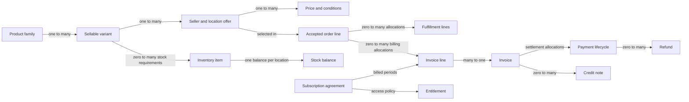
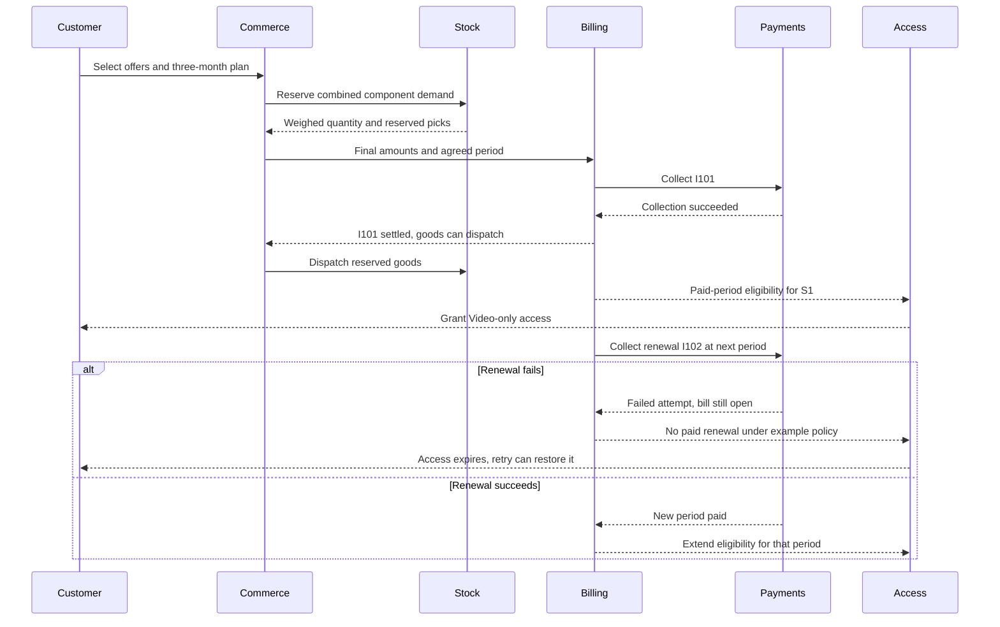

# How commerce platforms model catalogs and billing

Oct 21, 2026 · @Om Srivastava

Conceptual completion: 25 Oct 2026. The company observations retain their original dates; the connected model and its new evidence are dated separately below.

## Summary

Several designs recur in the sources: shared capabilities behind app shells, typed product records, independently identified sellable variants, component recipes for virtual bundles, explicit units, and historical amounts on order or invoice lines. These are alternatives with boundaries, rather than one universal schema. Most of Swiggy, Zomato, Blinkit, Amazon and Flipkart is not public, so for those I say so and name the closest documented analogue. For the complete purchase flow, read [Connecting the pieces](#connecting-the-pieces) after the task sections.

**How to read the tags.** \[Confirmed\] means stated in a primary source I opened (a company statement, official docs, or code at a pinned commit) and linked. \[Inferred\] means my reasoning from confirmed facts, with the reasoning stated; it also covers anything that rests only on press coverage. \[Unknown\] means I found no public evidence.

**Corrections to the brief.** Bolt launched as a tile on the Food page, not a tab. Toing is a standalone app positioned on affordability, not daily deals. Instamart also has its own app, in addition to its place in the main app. Instamart's 10 to 15 minute promise is not confirmed by any primary source I found.

**Key takeaways**

- **Task 1a, shared or separate:** Swiggy describes shared commerce primitives in a 2021 engineering article. Toing later reuses existing capabilities, and Bolt orders are indistinguishable to couriers. The App Store listings share a publisher. None of this establishes shared databases or login \[Unknown\]. Grab and Uber describe shared platforms; DoorDash documents retail fulfillment without establishing sharing with restaurants.
- **Task 1b, one table or many:** the inspected code combines core records, types, attributes and specialized models. The mix differs by platform. Amazon's generic public API does not establish its storage design. Restaurant menus add customization and timed availability; grocery catalogs separate product content from store-level commercial facts.
- **Task 2a, variants:** a sellable variant has its own identity; grouping and independent existence depend on the platform. Shopify, Saleor, Medusa, Spree and Odoo use product/variant models; Magento and the marketplace APIs expose item relationships or groups. API nesting alone does not prove a database table layout.
- **Task 2b, combos:** virtual kits map a sellable to component requirements. Commercial grouping, pricing and inventory expansion are separate decisions: expansion can happen at cart creation or during fulfillment. A prepacked physical bundle can instead have its own stock identity.
- **Task 2c, units:** distinguish stock conversion, pack content, displayed price per unit, and actual charged quantity. Odoo implements conversions; a decimal flag or text unit alone does not. Weighted items can have different ordered, fulfilled and charged quantities.
- **Task 3, billing:** preserve the amounts and descriptions required to explain a past transaction. An order, invoice, payment and subscription agreement have different lifecycles. A recurring price identifies the charge for an interval; its amount is not necessarily monthly price multiplied by months. The inline example demonstrates snapshots, not a complete recurring billing implementation.

## Product facts check

Bolt, Toing and Instamart all exist, but the brief's picture needs three corrections: Bolt was announced as a tile on the Food page rather than a third tab, Instamart is also a standalone app, and Toing is pitched on low prices rather than rotating daily deals. Checked on 22 and 23 Oct 2026. Company statements are tagged \[Confirmed\]; anything resting only on press reports is tagged \[Inferred\] and says so.

| Brief says | What I found | Tag | Source |
| --- | --- | --- | --- |
| The name is “Bolt” | Swiggy calls its quick-delivery food offering “Bolt”. At launch it meant quick-to-prepare meals from nearby restaurants and quick-service chains, delivered in about 10 minutes within roughly 2 km, in 6 cities. | \[Confirmed\] | [Swiggy press release, Oct 2024](https://www.swiggy.com/corporate/press-release/swiggy-launches-bolt-delivering-your-favorite-food-in-just-10-minutes/) |
| Bolt is a tab next to Food and Instamart | The launch release says a “Bolt – Food in 10 mins” tile would be featured on the Food page of the Swiggy app. The May 2025 expansion release again calls it a tile on the Food section, and the Jul 2026 letter calls it “our faster Food delivery proposition”. I found no source for where it sits in the app today (it may have moved). | \[Confirmed\] for the 2024 to 2026 statements; \[Unknown\] for today | [May 2025 release](https://nsearchives.nseindia.com/corporate/SWIGGY_02052025162900_CoveringLetter_Press_Release_Bolt_Expansion.pdf), [Jul 2026 letter](https://nsearchives.nseindia.com/corporate/SWIGGY_30072026154100_Covering_Letter_Letter_to_Shareholders_-_signed.pdf) |
| (not in the brief) Bolt's footprint | 6 cities at launch, 500+ cities in the May 2025 release, 700+ cities in the Jul 2026 letter. | \[Confirmed\] | The releases and letter above |
| Instamart is a tab in the main app | It is, and a standalone Instamart app also exists, published by Swiggy Instamart Private Limited. Business Today dates the standalone launch to Jan 2025 and quotes Swiggy's CEO saying Instamart remains inside the Swiggy app. | \[Confirmed\] that the standalone app exists; \[Inferred\] for the launch date and the CEO quote (press only) | [App Store listing](https://apps.apple.com/in/app/instamart-10-mins-grocery-app/id6738619733), [Business Today, 13 Jan 2025](https://www.businesstoday.in/amp/technology/news/story/swiggy-launches-instamart-as-a-standalone-app-available-on-android-and-ios-460547-2025-01-13) |
| Instamart delivers in roughly 10 to 15 minutes | Not confirmed. The current App Store listing states no delivery time. | \[Unknown\] | [App Store listing](https://apps.apple.com/in/app/instamart-10-mins-grocery-app/id6738619733) |
| Toing is a standalone Swiggy app | Yes. The same letter calls it a standalone app for affordable meals, live in about 50 cities, run as a separate app so Swiggy can test the affordability model. Swiggy's food marketplace CEO called it a clean experiment on the marketplace model. | \[Confirmed\] | Shareholder letter above; [Business Today interview, 31 Dec 2025](https://www.businesstoday.in/amp/magazine/interview/story/trying-multiple-ways-to-succeed-swiggy-food-marketplace-ceo-rohit-kapoor-508841-2025-12-31) |
| Toing is for aggressive daily restaurant deals | The sources describe affordability and lowest price, not daily deals. A Sep 2025 press report says the app was serving select locations in Pune, claimed meals under Rs 99 and promised free delivery above Rs 99. | \[Confirmed\] for affordability; \[Inferred\] for Pune and the Rs 99 figures (press only); “daily deals” is unsupported | [Storyboard18, 15 Sep 2025](https://www.storyboard18.com/brand-makers/-80944.htm) |
| Toing shares code, database and identity with the main app | The letter says Toing launched by leveraging existing tech and execution capabilities, with restaurant and delivery infrastructure already in place. Nothing I found says whether it shares logins, user accounts or databases. | \[Confirmed\] that it reuses existing capabilities; \[Unknown\] for login, accounts and database | Shareholder letter |

One more hint on the app question: Swiggy's engineering blog says the company runs several business lines and shell apps on Android and iOS with tooling shared across all of them, but it names none of the apps ([Swiggy Bytes, Jul 2026](https://medium.com/swiggy-bytes/how-we-made-all-swiggy-apps-operations-ai-native-1343612ec228)). \[Confirmed\] as a statement; it says nothing about backends or databases.

## Task 1a: Shared versus separate backends

Swiggy's own statements show several consumer apps sitting on shared capabilities, but the sources here do not establish whether Food, Instamart, Bolt and Toing share databases \[Unknown\]. Grab and Uber document shared order or fulfillment platforms; DoorDash documents a retail fulfillment service without establishing whether restaurants share it. Shared capability, shared service and shared database are different claims.

### Swiggy: what the sources say

| Surface | What the sources say | Tag and source |
| --- | --- | --- |
| Bolt | Featured as a tile on the Food page at launch (Oct 2024) and again as a tile on the Food section in the May 2025 expansion release, which describes a “curated menu of quick-serve, high-demand items that have minimal or no preparation time”. The Jul 2026 letter calls it “our faster Food delivery proposition”. Delivery partners “are not informed of the distinction between Bolt and regular orders” (2024) and “are not informed that an order is a Bolt one” (2025). | \[Confirmed\] [Oct 2024 release](https://www.swiggy.com/corporate/press-release/swiggy-launches-bolt-delivering-your-favorite-food-in-just-10-minutes/), [May 2025 release](https://nsearchives.nseindia.com/corporate/SWIGGY_02052025162900_CoveringLetter_Press_Release_Bolt_Expansion.pdf), [Jul 2026 letter](https://nsearchives.nseindia.com/corporate/SWIGGY_30072026154100_Covering_Letter_Letter_to_Shareholders_-_signed.pdf) |
| Instamart | A standalone Instamart app exists, published by Swiggy Instamart Private Limited. Business Today reported its Jan 2025 launch and quoted Swiggy's CEO saying the standalone app “will be an add-on” and that Instamart “will remain a key offering within the Swiggy app”. | \[Confirmed\] that the app exists ([App Store listing](https://apps.apple.com/in/app/instamart-10-mins-grocery-app/id6738619733)); \[Inferred\] for the launch date and the CEO's remarks (press only: [Business Today](https://www.businesstoday.in/amp/technology/news/story/swiggy-launches-instamart-as-a-standalone-app-available-on-android-and-ios-460547-2025-01-13)) |
| Toing | A standalone app that “runs on a separate app”, called a “separate platform” in another answer, housed in “Platform Innovations”, which the letter calls a “deliberate sandbox”. Launched “without any significant incremental fixed costs” by “leveraging our existing tech and execution capabilities”, with the “restaurant/delivery infrastructure” already built. | \[Confirmed\] [Jul 2026 letter](https://nsearchives.nseindia.com/corporate/SWIGGY_30072026154100_Covering_Letter_Letter_to_Shareholders_-_signed.pdf) |
| Other apps | Business Today calls Snacc a separate Swiggy app that delivers food in 15 minutes. Swiggy Bytes says the “Swiggy Apps” ecosystem spans multiple business lines and shell apps on Android and iOS, with tooling shared across them. | \[Inferred\] for Snacc (press only); \[Confirmed\] for the Swiggy Bytes statement ([post](https://medium.com/swiggy-bytes/how-we-made-all-swiggy-apps-operations-ai-native-1343612ec228)) |
| Shared backend capabilities, historical | Vijay Seshadri's 15 Mar 2021 article describes shared hyperlocal commerce primitives and the need for multi-tenant order management, promotions, pricing and logistics, with different workflows for food, inventory-backed goods and Genie tasks. It does not name database boundaries or describe Bolt and Toing. | \[Confirmed\] [Engineering challenges at Swiggy](https://medium.com/swiggy-bytes/engineering-challenges-at-swiggy-430dea6c86a3), read 25 Oct 2026 |

What that suggests about the backend:

- **Bolt shares the Food pipeline.** Couriers cannot tell a Bolt order from a regular one, which points to one order and dispatch flow \[Inferred\]. Whether Bolt listings are rows in the Food catalog, a copy, or a separate catalog is \[Unknown\]; see below.
- **A vertical can sit behind more than one app shell.** Instamart is both a tab in the main app and its own app, so its backend has to serve two clients \[Inferred\]. Whether it shares order, catalog or user stores with Food is \[Unknown\].
- **Toing reuses supply and tech.** Swiggy says so directly \[Confirmed\]. The letter's metrics (two in three new Toing users are new to the platform or dormant; some Toing restaurants do more than half their Swiggy-platform volume there) imply Toing users and restaurants are matched to Swiggy's existing identities, at least for analytics \[Inferred: my reading of the letter\]. Whether Toing shares logins, accounts or databases is \[Unknown\].

### How one app can present several verticals

Swiggy does document part of the presentation layer: Sarthak Mishra's 22 Mar 2024 Dynamic Widget article describes a JSON-driven UI engine, then used experimentally for some Track and Search widgets. It does not establish how Food, Instamart or Bolt appear together on the home page. The historical evidence below describes mechanisms, rather than the app's current layout.

| Pattern | Public evidence | Tag and source |
| --- | --- | --- |
| Server-driven UI | Swiggy's Dynamic Widget lets clients render widgets from a generic JSON schema; the documented rollout was limited to some Track and Search widgets | \[Confirmed\] [Swiggy, Dynamic Widget](https://medium.com/swiggy-bytes/a-deep-dive-into-dynamic-widget-swiggys-server-driven-ui-system-92cdc3b16ec6); original reading recorded in the log, indexed article text checked 25 Oct 2026 |
| API gateway or edge layer | Uber groups services into domains and domains into five layers (infrastructure, business, product, presentation, edge); layers depend only on the layers below, and a gateway is “a single entry-point into a collection of underlying services” | \[Confirmed\] [Uber, domain-oriented architecture](https://www.uber.com/us/en/blog/microservice-architecture/) |
| Modular client in one app | Grab's app has feature modules that do not depend on each other, kit modules for communication between them, core modules (networking, analytics, experimentation, storage, config), shared library modules, and an app module that wires them together with dependency injection; how Food or Mart plug in is not described | \[Confirmed\] [Grab, app modularisation](https://engineering.grab.com/app-modularisation-at-scale) |
| Backend-for-frontend, micro-frontends | no public description found at any company I checked | \[Unknown\] |
| Service per vertical | not documented for Swiggy; the companies below describe a shared order or fulfillment platform instead | \[Unknown\] for Swiggy |

### Analogues: how a new vertical attaches to a shared platform

| Company | Shared piece | How the new vertical attaches | Tag and source |
| --- | --- | --- | --- |
| Grab | One Order Platform processes GrabFood and GrabMart orders; DynamoDB serves the OLTP queries and MySQL RDS the OLAP queries | GrabMart was built by “leveraging the GrabFood platform”: it began as a category within GrabFood, then the order management system was changed “to account for the new mart order type” and allocation was changed to assign the right type of driver; browsing became item-first rather than merchant-first | \[Confirmed\] [order platform](https://engineering.grab.com/how-we-store-millions-orders), [GrabMart](https://engineering.grab.com/grabmart-product-team-experience) |
| Uber | One fulfillment platform that, per its engineers, powers physical fulfillment for all Uber verticals, built on fulfillment entities (for example an order entity and a job entity), each defined statically through a statechart configuration, with Google Cloud Spanner as storage; every Uber product and city was migrated to it | a vertical is configuration plus product-layer services on the shared platform | \[Confirmed\] for the platform and storage; \[Inferred\] for the last column ([Uber](https://www.uber.com/us/en/blog/fulfillment-platform-rearchitecture/)) |
| DoorDash | For grocery and convenience (“new verticals” in its wording) a facade service, Retail Fulfillment Data Service, fronts a `store_items` table holding catalog, inventory and pricing data; storage moved from PostgreSQL to CockroachDB | whether restaurants use the same service or database is not stated | \[Confirmed\] [DoorDash](https://careersatdoordash.com/blog/how-we-scaled-new-verticals-fulfillment-backend-with-cockroachdb/); \[Unknown\] for restaurants |
| Gojek | All driver partners had GoPay e-wallets, and the GoResto merchant app gave GoFood merchants the same kind of wallet; GoResto evolved into GoBiz, which the post calls “merchant SuperApp”; Gojek had deprecated its legacy codebase in favour of microservices | whether Food and Mart share services is not stated | \[Confirmed\] [Gojek](https://blog.gojek.io/the-road-to-a-merchant-superapp) |

### Bolt and the Food catalog

No source says how Bolt's listings are stored. The evidence narrows the options: Bolt items come from restaurant chains already on Swiggy (the releases name KFC, McDonald's and Burger King, among others), the menu is described as curated, and delivery partners cannot tell a Bolt order from a regular one. The simplest design consistent with that is a filtered view of the Food catalog, a flag on existing menu items plus rules on distance and preparation time \[Inferred\]. A curated copy or a separate catalog would also fit the statements \[Unknown\].

```sql
-- Illustration of the filtered-view option, not Swiggy's schema
restaurant (restaurant_id PK, name, lat, lng)
menu_item  (item_id PK, restaurant_id FK, name, price, prep_time_sec, is_bolt_eligible BOOLEAN)

-- a Bolt listing is the Food listing narrowed by rules
SELECT i.* FROM menu_item i JOIN restaurant r USING (restaurant_id)
WHERE i.is_bolt_eligible AND i.prep_time_sec <= :max_prep AND distance_km(r, :customer) <= 2;
```

### Toing: code, database and identity

| Question in the brief | Answer | Tag |
| --- | --- | --- |
| Separate codebase and database from the main app? | It is a separate app; whether it is a separate repository or database is not stated | \[Confirmed\] for the app; \[Unknown\] for the rest |
| Does it reuse restaurant, menu and order systems? | Swiggy says it reuses existing tech and its restaurant and delivery infrastructure; menu and order systems are not named | \[Confirmed\] for the statement; \[Unknown\] for the specifics |
| One account and identity across both? | Not stated; the new-user metrics suggest identities are matched to the Swiggy platform | \[Unknown\]; \[Inferred\] for the matching |

The [Toing](https://apps.apple.com/in/app/toing-food-delivery/id6748918399) and [main Swiggy](https://apps.apple.com/in/app/swiggy-food-instamart-dineout/id989540920) App Store listings both identify BUNDL TECHNOLOGIES PRIVATE LIMITED as developer \[Confirmed, read 25 Oct 2026\]. The earlier reading recorded the same seller and Toing's “© 2025, Swiggy”; that copyright text was not exposed in this continuation's readable page. These are publisher facts, not evidence of a common login, account store, code repository or database. Those remain \[Unknown\].

### Zomato and Blinkit

Eternal's Q4 FY25 letter describes moving the going-out offering to the District app \[Confirmed: [Eternal letter](https://b.zmtcdn.com/investor-relations/d9c290cd23764a09789769c39682276a_1746094084.pdf)\]. That establishes an app boundary, rather than a database boundary.

Blinkit has primary engineering material: its [Debezium article](https://lambda.blinkit.com/how-integer-and-int-produced-different-schemas-in-debezium-9c98e8a80aa2) describes MySQL change capture into Hudi; its [Trino/Hudi deadlock article](https://lambda.blinkit.com/how-a-deadlock-froze-blinkits-supply-chain-4b7c4d6d4a3f) concerns analytical jobs for replenishment; its [OpenSearchCon account](https://lambda.blinkit.com/blinkit-at-opensearchcon-india-2026-37fd0046c318) describes moving to multiple search clusters \[Confirmed; the first reading is preserved in the log, the latter two were read again on 25 Oct\]. None establishes how transactional catalog, order and service boundaries fit together \[Unknown\].

An older company post, [Grofers v3.2.1, 24 Apr 2017](https://blinkit.com/blog/grofers-v321-revolutionising-your-shopping-experience-technology/), describes moving from a marketplace to an inventory-led model and building warehousing tools \[Confirmed, read 25 Oct 2026\]. This helps explain why stock ownership matters, but does not establish Blinkit's current schema. UrbanPiper adds menu-integration evidence for Zomato below; it does not publish Zomato's internal tables. Grab's GrabMart and DoorDash's retail path remain documented architecture analogues.

## Task 1b: One table or many for things you can buy

The inspected code uses combinations of core product records, types, attribute models and specialized tables. The rows below show which mechanism is evidenced in each platform; they do not establish that every platform implements every mechanism. Public API shapes, including Amazon's, establish contracts rather than physical storage.

### The patterns and who is documented using them

| Pattern | What it looks like | Documented examples | Tag and source |
| --- | --- | --- | --- |
| Single table with a type column | one product row whose `type` decides which rules apply | Odoo: `product.template.type` is goods (`consu`), `service` or `combo`. Magento: `catalog_product_entity.type_id`, with types such as simple, bundle, virtual and downloadable. Saleor: `ProductType.kind` is normal or gift card | \[Confirmed\] [Odoo](https://github.com/odoo/odoo/blob/807b2abc274e7497ce93747ba2d3759f32e88250/addons/product/models/product_template.py#L63), [Magento table](https://github.com/magento/magento2/blob/16f4fa211bfdecda84c3e7d475f1514780b170c6/app/code/Magento/Catalog/etc/db_schema.xml#L10), [Magento types](https://github.com/magento/magento2/blob/16f4fa211bfdecda84c3e7d475f1514780b170c6/app/code/Magento/Catalog/Model/Product/Type.php), [Saleor](https://github.com/saleor/saleor/blob/5acd08ffe7389d7323344dd3e1398d8a46367919/saleor/product/models.py#L134) |
| Base table plus extension tables | the core row stays generic and type-specific data sits in side tables | Magento: bundle options and selections, `downloadable_link`, configurable super-attribute and super-link tables. Odoo: `product.combo` and `product.combo.item`, and `mrp.bom` for kits | \[Confirmed\] [Magento bundle](https://github.com/magento/magento2/blob/16f4fa211bfdecda84c3e7d475f1514780b170c6/app/code/Magento/Bundle/etc/db_schema.xml#L10), [Odoo combo](https://github.com/odoo/odoo/blob/807b2abc274e7497ce93747ba2d3759f32e88250/addons/product/models/product_combo.py) |
| EAV (entity, attribute, value) | attributes are rows, not columns | Magento: `eav_attribute` plus value tables such as `catalog_product_entity_varchar` and `catalog_product_entity_decimal` (`value_id`, `attribute_id`, `store_id`, `entity_id`, `value`). Saleor: attributes are attached to a product type and values are stored in assignment tables (`AttributeProduct`, `AttributeVariant`, `AssignedProductAttributeValue`, `AssignedVariantAttributeValue`) | \[Confirmed\] [Magento EAV](https://github.com/magento/magento2/blob/16f4fa211bfdecda84c3e7d475f1514780b170c6/app/code/Magento/Eav/etc/db_schema.xml#L274), [Saleor attribute models](https://github.com/saleor/saleor/tree/5acd08ffe7389d7323344dd3e1398d8a46367919/saleor/attribute/models); calling Saleor's design EAV-like is my label \[Inferred\] |
| JSON or metadata columns | free-form data in a JSON column | Medusa: `metadata` on inventory items and `variant_option_values` as json on order lines. Saleor: `ModelWithMetadata` on product types, products and order lines. DoorDash: `store_items` columns grouped into JSONB columns | \[Confirmed\] [Medusa inventory item](https://github.com/medusajs/medusa/blob/f7add009dd2f142d98090a5194750e71b2147ddf/packages/modules/inventory/src/models/inventory-item.ts), [Medusa line item](https://github.com/medusajs/medusa/blob/f7add009dd2f142d98090a5194750e71b2147ddf/packages/modules/order/src/models/line-item.ts), [Saleor](https://github.com/saleor/saleor/blob/5acd08ffe7389d7323344dd3e1398d8a46367919/saleor/order/models.py#L567), [DoorDash](https://careersatdoordash.com/blog/how-we-scaled-new-verticals-fulfillment-backend-with-cockroachdb/) |
| Separate model for behavior that differs | its own tables, linked from the order line | Saleor has a `GiftCard` model; Spree has `Spree::GiftCard` and a digital-asset model for downloads | \[Confirmed\] [Saleor](https://github.com/saleor/saleor/blob/5acd08ffe7389d7323344dd3e1398d8a46367919/saleor/giftcard/models.py), [Spree models](https://github.com/spree/spree/tree/a0e5b66419569d1e91d3b1eaf180444b73c65cd1/spree/core/app/models/spree) |

I found no platform using a full table per product kind for the core catalog \[Inferred: from the code I read; Amazon's internal storage is unknown\].

### Amazon

Amazon's public catalog API returns one `Item` shape for every product, with the fields `asin`, `attributes`, `classifications`, `dimensions`, `identifiers`, `images`, `productTypes`, `relationships`, `salesRanks`, `summaries` and `vendorDetails` \[Confirmed: [Catalog Items reference](https://developer-docs.amazon/sp-api/docs/catalog-items-api-v2022-04-01-reference)\]. A separate Product Type Definitions API serves the attribute and data requirements for items in the catalog as JSON schemas that extend JSON Schema 2019-09 \[Confirmed: [Product Type Definitions](https://developer-docs.amazon/sp-api/docs/product-type-definitions-api)\]. So the public contract is one generic item record plus a per-product-type schema for its `attributes` \[Inferred: a description of the API, not of Amazon's storage\]. Amazon's bundling guidance lists gift cards, digital items and subscription products as ineligible for virtual bundles \[Confirmed: [Amazon selling blog](https://sell.amazon.com/blog/product-bundling)\], which suggests they are catalog products excluded by a rule rather than things held in a different system \[Inferred\]. How Amazon stores any of this internally, and how Prime plans are modeled, is \[Unknown\]. The closest documented analogues are Magento's EAV with `type_id` and Saleor's product types.

### Blinkit: an ambulance beside groceries

What is public is thin, and all of it is press coverage of a Jan 2025 launch in Gurugram; I found no primary Blinkit page \[Inferred: press only\]. [Business Today](https://www.businesstoday.in/amp/india/story/profit-is-not-a-goal-here-blinkit-rolls-out-10-minute-ambulance-service-starting-in-gurugram-459361-2025-01-02), [MediaNama](https://www.medianama.com/2025/01/223-demand-and-scalability-questions-around-blinkits-10-min-ambulance-service/) and [YourStory](https://yourstory.com/2025/01/blinkit-launches-ten-minute-ambulance-service-gurugram) agree that users can book a Basic Life Support (BLS) ambulance through the Blinkit app, staffed by a paramedic, an assistant and a driver; Business Today quotes Blinkit's CEO saying profit is not a goal. Two details come from one outlet each: YourStory says the option appears in the app only once the service reaches a customer's area, and that it was in a testing phase in selected parts of Gurugram; MediaNama says the price starts at Rs 2,000, but from a sample image Blinkit posted on X rather than an official price list. Neither MediaNama nor YourStory says who operates the ambulances. Whether the booking goes through the cart, how payment works and how the service is modeled in the catalog are \[Unknown\]. Two designs for a service beside goods are documented elsewhere:

- **A catalog item of a service type** that skips shipping and stock: Odoo's `service` type, a Saleor product type with shipping turned off, Shopify's `requiresShipping` flag, Magento's `virtual` type \[Confirmed: fields in the code and docs linked above\].
- **A separate booking domain** that reuses only checkout and payment: the layered split in Uber's DOMA post, where product-layer services sit on shared business and infrastructure layers \[Inferred: my mapping\].

Which one Blinkit uses is \[Unknown\].

### Restaurant menus versus grocery catalogs

The structures differ because a restaurant item is customized and a grocery item is a stocked product.

| Dimension | Restaurant menu (Uber Eats Menu API) | Grocery catalog (Instacart, DoorDash) |
| --- | --- | --- |
| Shape | menus group categories, categories group items; an item can be a parent item or a modifier option | a product carries name, description, photos, nutrition and size or weight, plus store-specific attributes such as availability and location-by-location pricing |
| Add-ons | modifier groups attach to an item, with `min_permitted` and `max_permitted` quantities; modifier options are items themselves and the same item can sit in several groups; an item's price can be overridden in the context of a modifier group | no add-on concept in what I read; shoppers suggest replacement items from the catalog when something is out of stock |
| Availability | menus carry `service_availability` by day and time; items carry `visibility_info` | availability is a store-level attribute; DoorDash's `store_items` holds catalog, inventory and pricing together |
| Identity | merchant-defined ids with `external_data` | UPC and SKU (Instacart); each SKU is a list of product attributes with a brand taxonomy (DoorDash) |

&#91;Confirmed\] for both columns. Restaurant side: [Uber Eats menu guide](https://developer.uber.com/docs/eats/guides/menu-integration) and [example menu payloads](https://developer.uber.com/docs/eats/references/api/v2/example-menu-payloads). Grocery side: [Instacart catalog story](https://company.instacart.com/tech-innovation/the-story-behind-an-instacart-order-part-1-building-a-digital-catalog), [Instacart catalog docs](https://docs.instacart.com/connect/fulfillment_guide/concepts/catalog/), [DoorDash retail fulfillment](https://careersatdoordash.com/blog/how-we-scaled-new-verticals-fulfillment-backend-with-cockroachdb/) and [DoorDash knowledge graph](https://careersatdoordash.com/blog/building-doordashs-product-knowledge-graph-with-large-language-models/). The “add a Coke to your burger” case maps to a modifier option in a modifier group on the burger \[Inferred: my mapping onto the Uber Eats structure\].

### Simplified schemas

Illustrations of the patterns, not any company's schema:

```sql
-- 1. single table with a type column
product (product_id PK, type CHECK (type IN ('GOODS','SERVICE','COMBO','GIFT_CARD')),
         name, price, requires_shipping BOOLEAN, track_stock BOOLEAN, attributes JSON)

-- 2. base table plus extension tables
product          (product_id PK, type, name, price)
bundle_component (bundle_id FK, component_id FK, qty)
digital_asset    (product_id FK, file_url, max_downloads)

-- 3. EAV
attribute       (attribute_id PK, code, value_type)
attribute_value (product_id FK, attribute_id FK, value_text, value_number, PRIMARY KEY (product_id, attribute_id))
```

The restaurant-menu shape, simplified from the Uber Eats structure:

```sql
menu                (menu_id PK, store_id FK)
category            (category_id PK, menu_id FK, title)
item                (item_id PK, store_id FK, title, price)
category_item       (category_id FK, item_id FK)
modifier_group      (group_id PK, title, min_permitted, max_permitted)
item_modifier_group (item_id FK, group_id FK)
modifier_option     (group_id FK, item_id FK, price_override)     -- the option is itself an item
```

### Which pattern to pick

My reading \[Inferred\], not a documented rule: a core `product` table with a type, schema-validated attributes in JSON or EAV, and side tables only where fulfillment or billing behaves differently (bundles, downloads, gift cards, subscriptions). That is where Odoo, Magento and Saleor converge.

## Task 2a: Variants

The sources identify sellable variants separately and group them through a product, key or relationship. A barcode, price or tracked stock is not mandatory for every kind of sellable. The inspected code shows distinct product and variant models in Saleor, Medusa, Spree and Odoo, and ordinary product rows joined by links in Magento. Shopify and the marketplace docs establish their public object relationships; they do not prove an internal table layout. Whether an item can exist independently depends on the platform's rules, rather than how a response happens to be nested.

| Platform | Parent → variant | How they are tied | Tag and source |
| --- | --- | --- | --- |
| Shopify | product → variant | variants belong to a product; the limit is 2,048 variants per product | \[Confirmed\] [Shopify developer community announcement](https://community.shopify.dev/t/the-product-variant-limit-is-now-2048-for-all-merchants/23938) |
| Saleor | `Product` → `ProductVariant` | `ProductVariant.product` foreign key and a unique `sku`; `Product.default_variant` is a one-to-one pointer to the default variant; variant attributes are declared per product type (`AttributeVariant`) and stored as `AssignedVariantAttributeValue` rows | \[Confirmed\] [Product](https://github.com/saleor/saleor/blob/5acd08ffe7389d7323344dd3e1398d8a46367919/saleor/product/models.py#L183), [ProductVariant](https://github.com/saleor/saleor/blob/5acd08ffe7389d7323344dd3e1398d8a46367919/saleor/product/models.py#L362), [attribute models](https://github.com/saleor/saleor/tree/5acd08ffe7389d7323344dd3e1398d8a46367919/saleor/attribute/models) |
| Medusa v2 | `Product` → `ProductVariant` | `product` relation; option values attach through the pivot `product_variant_option` | \[Confirmed\] [product-variant.ts](https://github.com/medusajs/medusa/blob/f7add009dd2f142d98090a5194750e71b2147ddf/packages/modules/product/src/models/product-variant.ts) |
| Spree | `Product` → `Variant` | `option_values` through `option_value_variants`; the product has a `default_variant`, called the “face” of the product in the code | \[Confirmed\] [product.rb](https://github.com/spree/spree/blob/a0e5b66419569d1e91d3b1eaf180444b73c65cd1/spree/core/app/models/spree/product.rb), [variant.rb](https://github.com/spree/spree/blob/a0e5b66419569d1e91d3b1eaf180444b73c65cd1/spree/core/app/models/spree/variant.rb) |
| Odoo 19 | `product.template` → `product.product` | `product_tmpl_id`; the variant stores `product_template_attribute_value_ids` and a `combination_indices` string; the template lists its axes in `attribute_line_ids` | \[Confirmed\] [product\_product.py](https://github.com/odoo/odoo/blob/807b2abc274e7497ce93747ba2d3759f32e88250/addons/product/models/product_product.py), [product\_template.py](https://github.com/odoo/odoo/blob/807b2abc274e7497ce93747ba2d3759f32e88250/addons/product/models/product_template.py) |
| Magento 2 | configurable product row → child product rows | `catalog_product_super_attribute(product_id, attribute_id, position)` names the varying attributes; `catalog_product_super_link(product_id, parent_id)` joins each child to its parent, and both columns are foreign keys into `catalog_product_entity`, so a child is an ordinary product row | \[Confirmed\] [db\_schema.xml](https://github.com/magento/magento2/blob/16f4fa211bfdecda84c3e7d475f1514780b170c6/app/code/Magento/ConfigurableProduct/etc/db_schema.xml#L60) |
| Amazon | parent ASIN → child ASINs | relationship attributes are set on each child; the catalog API returns `relationships` per marketplace, each with a `type` (for example VARIATION), `parentAsins`, `childAsins` and a `variationTheme` such as COLOR\_NAME/STYLE\_NAME; size, color and style are the core themes that remain after Sep 2025; the Product Type Definitions page refers to `parentageLevel` values CHILD, PARENT and NONE | \[Confirmed\] [Catalog Items reference](https://developer-docs.amazon/sp-api/docs/catalog-items-api-v2022-04-01-reference), [SP-API changelog](https://developer-docs.amazon/sp-api/changelog/upcoming-removal-of-unused-variation-themes-in-the-listings-items-api), [Product Type Definitions](https://developer-docs.amazon/sp-api/docs/product-type-definitions-api) |
| eBay | inventory item group → inventory items | the group has a key, title, description and `variesBy.specifications`; members are listed in `variantSKUs` and must already exist as inventory items | \[Confirmed\] [eBay docs](https://developer.ebay.com/api-docs/sell/static/inventory/inventory-item-groups.html) |
| Walmart | variant group → items | every item in a group shares a `variantGroupId` and `variantAttributeNames`; exactly one item is the `isPrimaryVariant`; up to three variant attributes; an item can belong to only one group | \[Confirmed\] [Walmart docs](https://developer.walmart.com/us-marketplace/docs/setting-up-multiple-variants-of-an-item) |
| Etsy | listing → products | inside a listing's inventory each product is one combination of property values with its own `sku` and `offerings` (price and quantity) | \[Confirmed\] [Etsy docs](https://developers.etsy.com/documentation/tutorials/listings/) |

### Separate listings or child records?

Both exist.

- **Product/variant ownership** (Shopify's public model; inspected Saleor, Medusa, Spree and Odoo models): variants belong to a product/template, with shared content on the parent \[Confirmed: table above\]. Shopify's API ownership does not prove a separate physical child table.
- **Independently identified items with grouping** (Magento code; Amazon, eBay and Walmart APIs): group membership connects item identities. Amazon's changelog specifically says unchanged children of a deleted parent become standalone buyable listings \[Confirmed\]. Independent sale for every item in every platform does not follow from the existence of a grouping key \[Inferred\].
- **Marketplace contracts differ.** Amazon, eBay and Walmart expose item groups or relationships, while Etsy exposes products inside listing inventory \[Confirmed\]. Seller-managed SKU identity is a useful reason to distinguish an item from its grouping, but is my interpretation rather than evidence of the marketplaces' internal storage \[Inferred\].

### Zomato: integration rules for variants and modifiers

UrbanPiper's undated [Zomato constraints](https://api-docs.urbanpiper.com/downstream/aggregator-constraints/zomato) describe two levels of nested option groups. Its [menu publishing guide](https://help.urbanpiper.com/ordering-channels/zomato/manage-and-publish-your-menu) says that an item with zero base price needs a priced variant, and documents modifier-group selection errors. The guide describes publishing a POS menu through UrbanPiper to Zomato. \[Confirmed as UrbanPiper's own integration documentation, read 25 Oct 2026; Zomato's internal representation is Unknown.\]

The useful distinction is semantic: selecting a large portion can choose a priced variant, while adding cheese can be a modifier selection with its own constraints. Both can use option-group mechanisms in an API. Therefore an API field named “option” does not by itself identify a stock-keeping variant \[Inferred\].

### A simplified schema

```sql
product              (product_id PK, title, description, brand_id)                  -- shared content
option               (option_id PK, product_id FK, name)                            -- Size, Flavor
option_value         (option_value_id PK, option_id FK, value)                      -- M, Masala
variant              (variant_id PK, product_id FK, sku UNIQUE, barcode, price, weight)   -- the sellable unit
variant_option_value (variant_id FK, option_value_id FK, PRIMARY KEY (variant_id, option_value_id))
stock                (variant_id FK, warehouse_id FK, on_hand, reserved, PRIMARY KEY (variant_id, warehouse_id))
```

This is simplified from Medusa (the `product_variant_option` pivot) and Spree (`option_value_variants`); Odoo and Saleor use the same join idea under other names. The brief's SPU/SKU split maps onto it as product = SPU and variant = SKU. That mapping is mine \[Inferred\]: SPU/SKU is marketplace shorthand, and the platforms above say product/variant, template/product or parent/child.

### Chips flavors, shirt sizes, phone storage

A shirt in S/M/L and a phone in 128/256 GB are the textbook case: one product, one or two option axes, one variant per combination, each with its own price and stock \[Inferred: how the schema above is normally used\]. Chips flavors are a catalog decision rather than a schema one: flavors can be options of one product (one page with a flavor picker) or separate products with their own barcodes and pages, grouped by a link if at all \[Inferred\]. Which choice Swiggy Instamart or Blinkit made is \[Unknown\]; I found no public catalog documentation for either.

Flipkart's own variant documentation: I found only third-party integration guides (for example [Fynd](https://documentation.fynd.com/commerce/docs/openapi/listings-management/flipkart/faq-flipkart) and [Streamoid](https://streamoid.com/resources/guides/flipkart-seller-guide)), so its variant model is \[Unknown\]; Amazon and Walmart are the nearest documented analogues.

## Task 2b: Combos versus plain quantity

The documented bundle mechanisms separate commercial identity and pricing from component requirements. Their expansion points differ: Medusa's custom bundle recipe creates component cart lines, Odoo kits create component stock moves, and a physical prepacked bundle is a stock item of its own. I found no public description of how Swiggy, Blinkit or Instamart expand virtual bundles in their dark stores \[Unknown\]; Odoo, Medusa and Shopify supply documented alternatives.

### Separate SKU or recipe?

Both. The combo is a record with its own price, and the recipe is a list of component-and-quantity rows attached to it.

| Platform | Combo identity and price | Recipe | Where it is expanded | Tag and source |
| --- | --- | --- | --- | --- |
| Shopify fixed bundle | modeled as a product; the parent variant's price determines the price | `bundleComponents` (product, quantity, option selections) and, on the variant, `productVariantComponents`; at most 30 components and 3 options, no nested bundles | the component variants' inventory determines the bundle's inventory; on an order the component lines reference a `LineItemGroup` that carries the bundle's quantity, title and variant | \[Confirmed\] [fixed bundle guide](https://shopify.dev/docs/apps/build/product-merchandising/bundles/add-product-fixed-bundle), [LineItemGroup](https://shopify.dev/docs/api/admin-graphql/2024-10/objects/LineItemGroup), [ProductVariant](https://shopify.dev/docs/api/admin-graphql/latest/objects/ProductVariant) |
| Odoo kit | the kit product | a `mrp.bom` of type phantom (shown as “Kit”) with component lines | when the stock move is confirmed: the kit's own move is dropped and one move per component is created, each labelled with the kit's name for the picker | \[Confirmed\] [mrp\_bom.py](https://github.com/odoo/odoo/blob/807b2abc274e7497ce93747ba2d3759f32e88250/addons/mrp/models/mrp_bom.py#L29), [action\_explode](https://github.com/odoo/odoo/blob/807b2abc274e7497ce93747ba2d3759f32e88250/addons/mrp/models/stock_move.py#L378) |
| Odoo combo | a product of type combo (`combo_ids`) | `product.combo` (name, items, `base_price`) and `product.combo.item` (product, `lst_price`, `extra_price`) | at the sale line: the combo line and its item lines are linked through `linked_line_id` and `combo_item_id` | \[Confirmed\] [product\_combo.py](https://github.com/odoo/odoo/blob/807b2abc274e7497ce93747ba2d3759f32e88250/addons/product/models/product_combo.py), [product\_combo\_item.py](https://github.com/odoo/odoo/blob/807b2abc274e7497ce93747ba2d3759f32e88250/addons/product/models/product_combo_item.py) |
| Magento bundle | a product with `type_id` bundle | options (`required`, position, type), each with selections (product, default flag, price type and value, quantity, can-change-quantity) | order rows carry a `parent_item_id` column | \[Confirmed\] for the schema ([options](https://github.com/magento/magento2/blob/16f4fa211bfdecda84c3e7d475f1514780b170c6/app/code/Magento/Bundle/etc/db_schema.xml#L10), [selections](https://github.com/magento/magento2/blob/16f4fa211bfdecda84c3e7d475f1514780b170c6/app/code/Magento/Bundle/etc/db_schema.xml#L54)); \[Inferred\] that child order rows use `parent_item_id` |
| Medusa inventory kit | the variant | `required_quantity` (decimal, default 1) on the link between a variant and each inventory item | on purchase, the linked inventory items' quantities are updated | \[Confirmed\] [inventory kit docs](https://docs.medusajs.com/resources/commerce-modules/inventory/inventory-kit), [link definition](https://github.com/medusajs/medusa/blob/f7add009dd2f142d98090a5194750e71b2147ddf/packages/modules/link-modules/src/definitions/product-variant-inventory-item.ts#L11) |
| Medusa bundle recipe | a product for the bundle, whose variant has `manage_inventory` off | custom `Bundle` and `BundleItem` (quantity) models linked to products | at add-to-cart: one line item per component, each carrying the bundle id in metadata | \[Confirmed\] [bundled products recipe](https://docs.medusajs.com/resources/recipes/bundled-products/examples/standard) |
| Amazon virtual bundle | 2 to 5 different complementary products sold together as a set, at a total no higher than the items bought separately; the sets are not packaged as one unit | not described | Amazon packs and ships the sets; the announcement says bundles use existing FBA inventory; how counts are tracked against the individual products is not stated | \[Confirmed\] [selling blog](https://sell.amazon.com/blog/product-bundling), [announcement](https://sellercentral.amazon.com/seller-forums/discussions/t/aeff34dfb538fbb69e2f2af22af23fec); \[Unknown\] for the counting |
| Amazon physical bundle | the seller packages the items as one unit and creates a new listing with its own ASIN | none, because it is a new physical product | stock is counted as that new product | \[Confirmed\] [selling blog](https://sell.amazon.com/blog/product-bundling) for the listing and ASIN; \[Inferred\] for the stock |

Saleor and Spree have no bundle concept in the code I searched: no match for “bundle” or “subscription” in Saleor's product, order and warehouse models, and no bundle-, kit- or assembly-named files in Spree's core app, lib and db folders \[Confirmed for the folders searched\].

### From combo quantity to loose packets

Ordering two of a combo multiplies the recipe. Odoo computes a factor (the ordered quantity converted to the BoM's unit, divided by the BoM's quantity), scales each component line by it, and labels the component moves with the kit's name \[Confirmed: [stock\_move.py](https://github.com/odoo/odoo/blob/807b2abc274e7497ce93747ba2d3759f32e88250/addons/mrp/models/stock_move.py#L378)\]. Medusa's inventory kit does the same job with `required_quantity`; its docs use a bicycle that consumes two wheel items per bicycle sold \[Confirmed: docs\]. Medusa's bundle recipe sets each component line's quantity to the bundle item's quantity times the bundle quantity \[Confirmed: docs\].

```sql
sellable         (sku PK, name, price, is_bundle)
bundle_component (bundle_sku FK, component_sku FK, qty, PRIMARY KEY (bundle_sku, component_sku))   -- the recipe
order_line       (order_id, sku, qty, unit_price)                                                    -- one line for the combo
pick_task        (order_id, component_sku, qty, source_bundle_sku)                                   -- derived, one row per component
```

```text
Combo CHIPS-X3 = 3 x CHIPS-52G, priced Rs 55 (three singles would be Rs 60)
Customer orders CHIPS-X3 with quantity 2
Bill:  one line, 2 x Rs 55 = Rs 110
Pick:  CHIPS-52G, qty = 2 x 3 = 6, source = CHIPS-X3
Stock: CHIPS-52G on hand minus 6; CHIPS-X3 availability = floor(CHIPS-52G available / 3)
```

This is an illustration built from the Odoo and Medusa mechanics above, not any company's implementation.

### Why not offer only quantity?

1. **The price is not quantity × the single price.** A Shopify bundle takes its price from the parent variant; Magento selections carry a price type and value; Odoo combos carry a `base_price` and a per-item `extra_price` \[Confirmed: docs and fields\]. The combo needs somewhere to hold its own price rule \[Inferred\].
2. **The combo is something customers find and buy.** Shopify models a fixed bundle as a product \[Confirmed\], which gives it its own page, image and options \[Inferred\].
3. **Discounts and promotions.** Amazon's selling guide says a bundle typically costs less than buying the items individually, that bundles encourage customers to buy more in one transaction, and that sellers can run bundle promotions; for virtual bundles the total must be equal to or less than the items' combined individual prices \[Confirmed: [selling blog](https://sell.amazon.com/blog/product-bundling)\]. Amazon's [announcement](https://sellercentral.amazon.com/seller-forums/discussions/t/aeff34dfb538fbb69e2f2af22af23fec) likewise describes complementary items bought together at a discount \[Confirmed\].
4. **Moving slow stock.** The same guide calls bundling an effective way to move slow-selling items \[Confirmed\].
5. **Choices inside a combo.** Magento options have a required flag and selections a can-change-quantity flag; Odoo combos list the allowed items with an extra price each \[Confirmed: fields\]. A plain quantity cannot express “pick 3 of these 5” \[Inferred\].
6. **Stock stays at component level.** Shopify derives bundle inventory from the components, Amazon's virtual bundles reuse existing FBA inventory, and Medusa's kit links the variant to the component inventory items \[Confirmed\]. That is what lets a warehouse pick loose packets while the customer buys one combo \[Inferred\].
7. **Known limits.** Medusa's docs say the inventory-kit approach does not support custom bundle pricing or separate fulfillment of a bundle's items \[Confirmed: docs\]; Shopify caps a bundle at 30 components and has no nested bundles \[Confirmed: docs\].

For identical items there is a quantity-only alternative, a pack unit. Odoo's product template carries a list of packagings (`uom_ids`) \[Confirmed: [product\_template.py](https://github.com/odoo/odoo/blob/807b2abc274e7497ce93747ba2d3759f32e88250/addons/product/models/product_template.py)\], so “pack of 3” can be a unit of the same item. It avoids a recipe but cannot mix different items \[Inferred\].

## Task 2c: Units of measure

The sources expose different unit capabilities. Odoo implements conversion relationships; Magento's decimal-quantity flag and Medusa's free-text unit do not establish equivalent conversion engines. Shopify's pack measurement describes unit-price display. Instacart distinguishes ways of ordering and charging weighted items. I found no public description of how Swiggy, Blinkit or Instamart store units \[Unknown\].

### Base-unit conversion

| Platform | How units are stored | Conversion | Tag and source |
| --- | --- | --- | --- |
| Odoo 19 | a `uom.uom` table: `name`, `relative_uom_id` (the reference unit), `relative_factor` (labelled “Contains”) and a computed, stored `factor`; default units include a dozen and a pack of 6; a product has a default stock unit `uom_id` and extra units in `uom_ids`; sale and invoice lines carry their own `product_uom_id` | `factor = relative_factor × relative_uom_id.factor`; one global rounding precision (“Product Unit”) shared by all units | \[Confirmed\] [uom\_uom.py](https://github.com/odoo/odoo/blob/807b2abc274e7497ce93747ba2d3759f32e88250/addons/uom/models/uom_uom.py#L34), [product\_template.py](https://github.com/odoo/odoo/blob/807b2abc274e7497ce93747ba2d3759f32e88250/addons/product/models/product_template.py) |
| Medusa v2 | `InventoryItem.unit_of_measure`, a nullable free-text column; the variant-to-inventory-item link has a decimal `required_quantity` | none in the inventory models I read | \[Confirmed\] [inventory-item.ts](https://github.com/medusajs/medusa/blob/f7add009dd2f142d98090a5194750e71b2147ddf/packages/modules/inventory/src/models/inventory-item.ts#L13); the missing conversion is \[Inferred\] from what I read |
| Magento 2 | no unit table in the eight module schemas I checked; stock quantity can be decimal (`is_qty_decimal`) with `qty_increments` and `enable_qty_increments`; the order item repeats `is_qty_decimal` | none | \[Confirmed\] [stock item](https://github.com/magento/magento2/blob/16f4fa211bfdecda84c3e7d475f1514780b170c6/app/code/Magento/CatalogInventory/etc/db_schema.xml#L23), [order item](https://github.com/magento/magento2/blob/16f4fa211bfdecda84c3e7d475f1514780b170c6/app/code/Magento/Sales/etc/db_schema.xml#L465) |
| Shopify | a variant carries a `unitPriceMeasurement` | five fields: `measuredType`, `quantityUnit`, `quantityValue`, `referenceUnit`, `referenceValue` | \[Confirmed\] [ProductVariant](https://shopify.dev/docs/api/admin-graphql/latest/objects/ProductVariant), [UnitPriceMeasurement](https://shopify.dev/docs/api/admin-graphql/latest/objects/UnitPriceMeasurement) |
| Instacart | each product has a `cost_unit` of each, lb or kg | weighted items add a catalog `par_weight` (see below) | \[Confirmed\] [Instacart docs](https://docs.instacart.com/connect/fulfillment_guide/concepts/product_quantity) |

### Price per unit

Shopify's pair of measurements is the cleanest public model. One half says what is in the pack (`quantityValue` and `quantityUnit`), the other says what to show the price per (`referenceValue` and `referenceUnit`) \[Confirmed: field names\]. The displayed price is then price × referenceValue ÷ quantityValue after converting both to one unit, so Rs 100 for 500 g shown per 100 g is Rs 20 \[Inferred: the formula and the example are mine\].

GS1's data-sync network has a matching attribute, `netContent`, defined as “the amount of the trade item contained by a package, usually as claimed on the label” and written as a value with a unit, for example 750 MLT or 20 ea. Its rules: use the label claim for fixed-content items, the average quantity for variable-quantity items, and the total for multi-packs \[Confirmed: [GS1 Germany attribute page](https://gdsn.gs1-germany.de/BMSattribute?id=3733)\].

### Weighted items

Instacart documents three modes, which is the clearest public treatment of “sold by kg, charged by actual weight”:

| Mode | `cost_unit` | Quantity field | Docs wording |
| --- | --- | --- | --- |
| Per each | `each` | `count` | “Items of a fixed size and price per unit.” |
| By weight | `lb` or `kg` | `weight` | “Loose items purchased and priced by weight.” |
| Variable weight | `lb` or `kg`, plus `par_weight` in the catalog | `count` or `weight` | “Items purchased as a unit, but priced by weight.” If `count` is missing, the system calculates it from `par_weight`. |

&#91;Confirmed: [Instacart product quantity docs](https://docs.instacart.com/connect/fulfillment_guide/concepts/product_quantity)\]. GS1 calls the general case a variable measure trade item: one that is “priced, ordered or invoiced in quantities which can vary”, such as fruit and vegetables, meat, cheese or fabric; for retail items either the price or the quantity must be encoded in the barcode \[Confirmed: [GS1 support article](https://support.gs1.org/support/solutions/articles/43000734396-what-is-a-variable-measure-trade-item-)\].

Ordered, fulfilled and charged quantities are kept apart. An Odoo sale line has `product_uom_qty`, `qty_delivered`, `qty_invoiced` and `qty_to_invoice`; a Magento order item has `qty_ordered`, `qty_shipped`, `qty_invoiced`, `qty_refunded` and `qty_canceled` \[Confirmed: columns\]. Separate counters are what let a line be ordered at 1 kg and invoiced at 1.07 kg \[Inferred: none of the docs I read walks through a weighed example\].

```text
Order:    1 kg tomatoes at Rs 40 per kg  ->  qty_ordered 1.000 kg, unit_price Rs 40.00 per kg
Picking:  the picker weighs 1.07 kg     ->  qty_fulfilled 1.070 kg
Invoice:  charge the actual weight       ->  qty_charged 1.070 kg x Rs 40.00 = Rs 42.80
```

That is an illustration, not any company's flow. How Blinkit or Instamart price loose produce is \[Unknown\].

### Standards

UN/CEFACT Recommendation 20 provides three-character alphabetic and alphanumeric codes for units of measurement, meant for systems that exchange trade information \[Confirmed: [UNECE](https://unece.org/trade/documents/2021/06/uncefact-rec20-0)\]; for example C62 is “one”, a synonym for unit \[Confirmed: [UNECE vocabulary](https://service.unece.org/trade/uncefact/vocabulary/rec20/)\]. GS1 supplies `netContent` and the variable-measure rules above.

Odoo is the one open-source core where I found UN/CEFACT codes inside the commerce code itself. Its accounting module keeps a dictionary from unit-of-measure records to Recommendation 20 codes (`unit` → `C62`, `dozen` → `DZN`, `kg` → `KGM`, `g` → `GRM`, `litre` → `LTR` … 28 units in all). A unit with no entry falls back to `C62` (“one”), and a reverse lookup, `_get_uom_from_unece_code`, falls back to the plain `unit` record. The values Odoo prepares for an invoice line include `unece_uom_code`, taken from the product's own unit. \[Confirmed\] [uom\_uom.py#L6](https://github.com/odoo/odoo/blob/807b2abc274e7497ce93747ba2d3759f32e88250/addons/account/models/uom_uom.py#L6), [account\_move\_line.py#L3550](https://github.com/odoo/odoo/blob/807b2abc274e7497ce93747ba2d3759f32e88250/addons/account/models/account_move_line.py#L3550). I searched only Odoo's code for UN/CEFACT codes, so whether Saleor, Medusa, Magento or Spree map their units to them is \[Unknown\].

### A simplified schema

```sql
uom        (uom_id PK, code, name, base_uom_id FK, factor_to_base NUMERIC)               -- g -> kg 0.001, dozen -> piece 12
item       (item_id PK, name, base_uom_id FK, net_content_value, net_content_uom_id FK)   -- a 500 g pack
order_line (line_id PK, item_id FK, uom_id FK, qty_ordered, qty_fulfilled, qty_charged, unit_price)
```

Simplified from Odoo's unit table and the ordered, delivered and invoiced counters on its sale lines.

## Task 3: Billing across physical items and subscriptions

The inspected systems preserve commercial amounts on order or invoice lines, but they differ in copied fields and tax representation. Spree's inspected line model, for example, still reads name and SKU through its retained variant. A cart or draft invoice can be recalculated; preservation matters at the relevant order commitment or invoice finalization boundary. Pricing is applied again for a later subscription period, without rewriting a finalized earlier invoice. The evidence below concerns code or public objects, not Amazon's billing internals \[Unknown\].

### 3.1 How lines point at different kinds of items

There are two shapes. Most commerce platforms use one line table with a nullable pointer to the catalog plus a set of copied columns. Stripe splits billing out: an invoice line points at whatever generated it, either a one-off invoice item or a subscription item.

| Platform | Pointer back to the catalog | What the line stores itself | Tag and source |
| --- | --- | --- | --- |
| Saleor | `variant` foreign key, nullable, `on_delete=SET_NULL` | product and variant names, SKU, product-type id, `is_shipping_required`, `is_gift_card`, currency, unit and total price (net and gross), undiscounted prices | \[Confirmed\] [OrderLine](https://github.com/saleor/saleor/blob/5acd08ffe7389d7323344dd3e1398d8a46367919/saleor/order/models.py#L567) |
| Medusa v2 | `variant_id` and `product_id` as nullable text ids | titles, `variant_sku`, `variant_barcode`, option values (json), `requires_shipping`, `is_giftcard`, `unit_price`; tax lines and adjustments are separate rows | \[Confirmed\] [line-item.ts](https://github.com/medusajs/medusa/blob/f7add009dd2f142d98090a5194750e71b2147ddf/packages/modules/order/src/models/line-item.ts#L11) |
| Magento 2 | `product_id`, `product_type`, `product_options`; invoice items point at `order_item_id` | `sku`, `name`, `description`, `price`, `original_price`, tax and discount columns, `row_total`, `is_virtual`, `is_qty_decimal` | \[Confirmed\] [sales\_order\_item](https://github.com/magento/magento2/blob/16f4fa211bfdecda84c3e7d475f1514780b170c6/app/code/Magento/Sales/etc/db_schema.xml#L465), [sales\_invoice\_item](https://github.com/magento/magento2/blob/16f4fa211bfdecda84c3e7d475f1514780b170c6/app/code/Magento/Sales/etc/db_schema.xml#L1156) |
| Odoo 19 | `product_id` on both the sale line and the invoice line; the invoice line links back through `sale_line_ids` | `name`, `quantity`, `product_uom_id`, `price_unit`, `discount`, `tax_ids`, stored `price_subtotal` and `price_total` | \[Confirmed\] [account.move.line](https://github.com/odoo/odoo/blob/807b2abc274e7497ce93747ba2d3759f32e88250/addons/account/models/account_move_line.py), [\_prepare\_invoice\_line](https://github.com/odoo/odoo/blob/807b2abc274e7497ce93747ba2d3759f32e88250/addons/sale/models/sale_order_line.py#L1529) |
| Spree | `belongs_to :variant`, loaded `with_deleted` | price and tax category are copied when the line is created; name and SKU are read through the variant | \[Confirmed\] for the code ([line\_item.rb](https://github.com/spree/spree/blob/a0e5b66419569d1e91d3b1eaf180444b73c65cd1/spree/core/app/models/spree/line_item.rb#L18)); \[Inferred\] that nothing else is copied, because I did not read the database schema |
| Shopify | `variant` and `product` are nullable | `title` as of order creation, `variantTitle`, `originalUnitPriceSet`, `taxLines` | \[Confirmed\] [LineItem](https://shopify.dev/docs/api/admin-graphql/latest/objects/LineItem) |
| Stripe | `parent.type` is `invoice_item_details` or `subscription_item_details` | `amount`, `quantity`, `description`, `period.start` and `period.end`, `pricing`, `taxes`, `discount_amounts` | \[Confirmed\] [Invoice line item](https://docs.stripe.com/api/invoice-line-item/object) |

The pointer is nullable on purpose in at least two of these. Saleor's `SET_NULL` lets a variant be deleted while old order lines keep their copied name and SKU \[Confirmed: code\]; the code does not say why, and I read it as a design choice that lets the catalog change without rewriting history \[Inferred\]. Shopify's docs mark `variant` and `product` as nullable without giving a reason \[Confirmed: docs\]; a [community answer](https://community.shopify.com/t/graphql-admin-api-orders-query-null-lineitem-variant/366644) says the field is null when the product was deleted \[Inferred: secondary source\]. Spree goes the other way: variants are soft-deleted (`acts_as_paranoid`, see [variant.rb](https://github.com/spree/spree/blob/a0e5b66419569d1e91d3b1eaf180444b73c65cd1/spree/core/app/models/spree/variant.rb#L5)) and the line loads them `with_deleted`, so the pointer keeps resolving \[Confirmed: code; the intent is my reading\].

Odoo also shows how a bundle looks on an invoice: when the sale line is a combo product, its invoice line becomes a section header titled with the product name and quantity (`<name> x <qty>`) \[Confirmed: `_prepare_invoice_line`\]. The chosen items then follow as ordinary priced lines \[Inferred: only the combo product takes the section branch in that method\].

### 3.2 How each type's amount is computed and reconciled

The line does not need to know the pricing rule, only its result. What differs by type is the rule that runs while the line is being created:

| Item type | Rule that produces the line amount | Where the inputs live | Tag and source |
| --- | --- | --- | --- |
| Physical goods | quantity × unit price, then discounts, then tax | the line keeps quantity, unit price and the resulting totals (Saleor keeps unit and total price in net and gross, plus undiscounted values) | \[Confirmed\] for the columns; \[Inferred\] for the order of operations |
| Subscription | one price per plan and billing interval; amount = unit amount × quantity for that period; the line carries the period start and end | Stripe Price has `recurring.interval` and `interval_count`; `interval=month` with `interval_count=3` bills every 3 months | \[Confirmed\] [Prices](https://docs.stripe.com/api/prices/object), [Invoice line item](https://docs.stripe.com/api/invoice-line-item/object) |
| Tiered or metered | quantity runs through tiers (`graduated` or `volume`) or comes from reported usage | Stripe `billing_scheme`, `tiers_mode`, `usage_type` | \[Confirmed\] [Prices](https://docs.stripe.com/api/prices/object) |

Your Prime example maps onto that model as two plans × four intervals, eight price rows, not one monthly price multiplied by the number of months \[Inferred: my mapping onto Stripe's documented fields; the docs do not use this example\]. The worked example below stores one price per plan and duration for the same reason: longer terms are usually discounted.

A subscription does not have to share the product line table. The three systems below document three different ways of attaching one to an order.

| System | What the subscription is | How it reaches the order or invoice | Tag and source |
| --- | --- | --- | --- |
| Stripe Billing | A `Subscription` over recurring `Price`s (`recurring.interval`, `recurring.interval_count`). The same `Price` object also prices one-time goods: its `type` is `one_time` or `recurring` | An invoice line's `parent` (nullable) names “the parent that generated this line item”, and its `period` is “the subscription period” for subscription lines | \[Confirmed\] [Price](https://docs.stripe.com/api/prices/object), [Invoice line item](https://docs.stripe.com/api/invoice-line-item/object) |
| Shopify | A `SellingPlan` (“How a product can be sold and purchased through recurring billing or deferred purchase options.”) whose `billingPolicy` can be recurring, with `interval` (day, week, month or year), `intervalCount`, `minCycles` and `maxCycles` | The order line item has a nullable `sellingPlan` field (“The selling plan details associated with the line item.”), so a subscription purchase is an ordinary order line plus those plan details | \[Confirmed\] [SellingPlan](https://shopify.dev/docs/api/admin-graphql/latest/objects/SellingPlan), [SellingPlanRecurringBillingPolicy](https://shopify.dev/docs/api/admin-graphql/latest/objects/SellingPlanRecurringBillingPolicy), [LineItem](https://shopify.dev/docs/api/admin-graphql/latest/objects/LineItem) |
| Medusa (a documented recipe, not the core) | A custom `Subscription` data model with an `interval` (monthly or yearly) and a `period`: “For example, if period is 3 and interval is monthly, then a new order is created every three months.” | A scheduled job hands each due subscription to a workflow that builds the order from “the cart originally used to make the subscription purchase” and captures its payment; the model is linked to the cart, the customer and the order | \[Confirmed\] [Subscriptions recipe](https://docs.medusajs.com/resources/recipes/subscriptions/examples/standard) |

&#91;Inferred\] In Shopify and Medusa the subscription is a layer around orders: the Shopify line item only holds the plan's details, and the Medusa workflow creates a new order each cycle. In Stripe it is a billing object whose output is invoice lines. In all three the paid line still stores its own amount (Stripe's invoice line has `amount`, `period` and `pricing`), so the worked example below also copies plan, duration, period and price onto its line.

Mixed baskets work by accepting both kinds of price in one request. Stripe Checkout in subscription mode takes recurring and one-time prices together; the one-time items “will be on the initial invoice only”, with limits of 20 recurring and 20 one-time lines \[Confirmed: [Checkout Sessions](https://docs.stripe.com/api/checkout/sessions/create)\]. I found no public description of how Amazon combines a Prime plan and a physical item in one charge \[Unknown\].

In the example, header net and tax sum the stored line amounts, and gross is net plus tax. That is a chosen reconciliation policy, rather than a universal tax algorithm. Invoice-level rounding can differ from summing independently rounded line taxes; see [Rounding has three separate questions](#rounding-has-three-separate-questions).

None of the open-source cores I read model subscriptions. Searching Saleor's product, order and warehouse models for “subscription” and “bundle” found nothing, Spree's core app, lib and db folders have no files named for subscriptions or bundles, and the Odoo 19 community checkout has no subscription addon \[Confirmed for the folders searched\]. That fits subscriptions living in a separate billing system, as in Stripe \[Inferred\].

### 3.3 Why the invoice copies data instead of reading the live catalog

1. **Tax law lists what an invoice must show.** India's [CGST Rule 46](https://taxinformation.cbic.gov.in/content/html/tax_repository/gst/rules/cgst_rules/active/chapter6/rule46_v1.00.html) requires, among other particulars, the description of goods or services (clause h), quantity and unit (i), total value (j), taxable value after discount (k), tax rate (l) and HSN code (g) \[Confirmed\]. The rule says what must appear, not how to store it; treating that as a reason to copy the values onto the invoice is my reading \[Inferred\].
2. **Stripe locks an invoice once it is finalized.** Invoices are editable only as drafts; after finalization “you can’t change most of its details, including fields related to the amount or customer”, to satisfy the tax-compliance requirement that finalized invoices be kept as they were finalized, and amount changes go through credit notes \[Confirmed: [Stripe docs](https://docs.stripe.com/invoicing/integration/workflow-transitions)\].
3. **Catalog rows get renamed, re-priced and deleted.** The nullable pointers and soft deletes in 3.1 are how three platforms keep history intact while the catalog changes \[Confirmed: code; the motive is Inferred\].
4. **Re-pricing from the live catalog gives the wrong total.** The example below shows it with numbers.

### 3.4 Worked example: 3 packets of chips plus a 3-month video plan

This illustration was reported as run in SQLite on 22 Oct 2026; the original `worked_example.py` is absent from this checkout. The inline arithmetic is checked separately in the continuation. It is not a description of any company's system or a complete subscription engine. Money is stored in paise and tax in basis points; the prices, plans and tax rates are invented and tax-exclusive.

```sql
CREATE TABLE product    (product_id INTEGER PRIMARY KEY, sku TEXT UNIQUE, name TEXT, unit_price INTEGER, tax_bp INTEGER);
CREATE TABLE plan       (plan_id INTEGER PRIMARY KEY, code TEXT UNIQUE, name TEXT, tax_bp INTEGER);
CREATE TABLE plan_price (plan_id INTEGER REFERENCES plan, duration_months INTEGER, price INTEGER,
                         PRIMARY KEY (plan_id, duration_months));
CREATE TABLE invoice    (invoice_id INTEGER PRIMARY KEY, issued_on TEXT, net INTEGER, tax INTEGER, gross INTEGER);
CREATE TABLE invoice_line (
  line_id INTEGER PRIMARY KEY, invoice_id INTEGER REFERENCES invoice,
  item_type TEXT CHECK (item_type IN ('PRODUCT','SUBSCRIPTION')),
  item_id INTEGER,                          -- polymorphic pointer, deliberately no foreign key
  description TEXT, quantity INTEGER, unit_price INTEGER,
  period_months INTEGER, period_start TEXT, period_end TEXT,   -- NULL for goods
  tax_bp INTEGER, net INTEGER, tax INTEGER, gross INTEGER);
```

The generic `item_type`/`item_id` pair deliberately cannot enforce a foreign key to either source table. A missing product or plan could therefore be referenced. That is a limitation of this billing illustration, not a recommendation: typed references or a common sellable identity are alternatives with different integrity guarantees. The schema also omits agreement, renewal and payment records; the connected model below supplies those concepts without pretending they exist in this example.

The two pricing rules run when the cart is turned into lines:

```text
goods:         net = quantity * product.unit_price
subscription:  net = quantity * plan_price(plan_id, months).price     -- looked up by plan and duration
both:          tax = (net * tax_bp + 5000) // 10000                   -- integer paise, round half up
               gross = net + tax
subscription:  period_start = today, period_end = today + months
```

Prices: chips Rs 20.00 at 12% tax. StreamPlus Video-only is Rs 149, 399, 749, 1399 for 1, 3, 6, 12 months; Full is Rs 299, 799, 1499, 2799; both at 18%. The cart is 3 chips and 1 Video-only for 3 months, issued 2026-10-21.

| Line | Qty | Rate | Net | Tax | Gross |
| --- | --- | --- | --- | --- | --- |
| Chips 52 g, Classic Salted | 3 | Rs 20.00 | Rs 60.00 | Rs 7.20 (12%) | Rs 67.20 |
| StreamPlus Video-only, 3 months (2026-10-21 to 2027-01-21) | 1 | Rs 399.00 | Rs 399.00 | Rs 71.82 (18%) | Rs 470.82 |
| **Invoice total** |  |  | **Rs 459.00** | **Rs 79.02** | **Rs 538.02** |

The assertion gross = net + tax = sum of line gross passes. Then the catalog changes: chips go from Rs 20 to Rs 22 and the 3-month Video-only price from Rs 399 to Rs 449. The stored invoice still reads Rs 538.02. Re-pricing the same lines from the live catalog would give a net of Rs 515.00 instead of the Rs 459.00 actually charged, which is exactly the error the copied columns prevent.

### 3.5 What I couldn't establish for Task 3

- How Amazon bills a subscription next to a physical item, and what its invoice lines look like internally. \[Unknown\]
- How Swiggy, Zomato or Blinkit bill mixed carts. \[Unknown\]
- A jurisdiction-by-jurisdiction rounding policy. The continuation establishes documented calculation alternatives and the text of India's CGST Section 170; it does not establish a complete compliance policy for every invoice.

## Connecting the pieces

Added 25 Oct 2026. This section is a teaching model \[Inferred\], assembled from the evidence above and the additional primary sources linked here. Its names, relationships and policies are explicit choices for understanding a purchase; they are not a reconstruction of any one company's system. Completion means being able to reason through this model and its alternatives, even where private company details remain \[Unknown\].

### Start with the meaning of each record

Instacart's 11 Jan 2022 [catalog localization article](https://company.instacart.com/tech-innovation/catalog-localization-more-than-just-a-translation) supplies the missing bridge between product identity and place: parent product, retailer-level product, and store-level product, with price, availability and promotion at the store level \[Confirmed\]. Its [minimum catalog requirements](https://docs.instacart.com/catalog/catalog_inventory_file/specifications/minimum-catalog-requirements/) identify `location_code`, `lookup_code`, `cost_price_per_unit` and `cost_unit` \[Confirmed, read 25 Oct 2026\]. This is evidence for separating meanings, not a requirement to copy those exact entities.

| Record in this model | One record means | Owner and relationships | What can change, and what must be retained |
| --- | --- | --- | --- |
| Product and variant | A product family; one identifiable sellable configuration within it | Catalog owns products; a product has one or more variants in this model, including a default variant for an item with no choices | Descriptive content can change. A barcode or merchant SKU identifies something within its defined namespace; neither is automatically a global database key |
| Listing or offer | A seller offers a variant in a location/channel context | Seller owns the commercial offer; one variant can have many offers | Publication, availability rules and commercial terms vary independently of product identity |
| Price | An amount in a currency for an offer or plan under stated conditions | Pricing owns prices; an offer/plan can have multiple prices by interval, time or context | Retain the selected price identity and agreed amount on the transaction; changing a future price must not rewrite a finalized invoice |
| Inventory item and balance | A physical resource; its stock at one location | Inventory owns resources and balances; variants map to resources through quantity requirements | A simple item requires one resource; a kit may require several; variants can share a resource. Services may require none. On-hand, reserved and available are different quantities |
| Cart and order line | A proposed selection; an accepted commercial commitment | Checkout owns the cart; order management owns the accepted order and its lines | Cart quotes may expire. Accepted quantity, selected options, agreed unit rate and later adjustments must remain explainable |
| Fulfillment line | A quantity picked, dispatched or delivered against a commitment | Fulfillment owns operational records; an order line can have zero or several fulfillment allocations | Physical quantity and status change. Preserve the link to the originating order line, including when a bundle becomes component picks |
| Invoice and invoice line | A bill and one part of the billed amount | Billing owns documents; a bill has lines; an order line may be billed in multiple allocations, and recurring lines may originate from an agreement | Drafts may change. Finalized commercial values are retained; subsequent credits are linked adjustments |
| Payment and refund | A collection lifecycle; a return of collected money | Payments owns collection records and their allocation to bills; a collection may involve several attempts | Attempted, authorized, collected and refunded are different facts. A refund is not proof that goods were physically returned |
| Subscription agreement and entitlement | A customer's continuing terms; permission to use a feature | Subscription management owns the agreement and billed periods; access control owns grants derived from current policy | Plan, interval, period and status are separate facts. One agreement can produce many invoices; access can end without deleting those invoices |

The stock mapping is documented directly in [Medusa's inventory kits](https://docs.medusajs.com/resources/commerce-modules/inventory/inventory-kit): a variant may link to multiple inventory items, and inventory items may be shared across variants \[Confirmed, checked 25 Oct 2026\]. Thus “SKU = stock row” fails for kits and shared stock \[Inferred\]. The compact schemas earlier intentionally omit these additional boundaries.



Edges describe logical references or allocations, not mandatory direct foreign keys. A requirement linking a variant to a resource carries quantity and unit; an allocation linking a fulfillment or invoice line to an order line carries the attributable quantity or amount. The diagram's offer is scoped to one location for simplicity; a warehouse network can separate selling location from fulfillment location. It also omits customer links: each cart/order/agreement belongs to a customer in this example. Different sellers, currencies or legal issuers can require separate documents even when the UI shows one basket. One basket therefore does not prove one order, invoice, payment or database \[Inferred\].

### Choose a boundary by the behavior it must preserve

These are design trade-offs derived from the documented mechanisms \[Inferred\], not claims that a named company uses the preferred column.

| Question | Choose this when | Alternative and consequence |
| --- | --- | --- |
| Is this a variant or a modifier? | A separately identified sellable configuration needs its own commercial or stock treatment | A selection such as extra cheese can be a modifier with selection limits and a price effect; it may still consume inventory. “Modifier” does not mean “untracked” |
| Is three packets a quantity, pack unit or bundle? | Quantity buys three singles; a pack unit converts three pieces of the same resource; a bundle carries commercial identity and component requirements | A quantity discount can price three singles without creating a bundle SKU. A physical sealed multipack may instead be its own stocked item. Price alone does not determine the stock model |
| Is the combo fixed or configurable? | Fixed components can use a recipe | A configurable combo needs allowed choices and selected components on the order. Retain the selection or recipe version so a later recipe change cannot alter an earlier pick requirement |
| Where do extra attributes belong? | Stable fields that need strong relational checks fit columns or typed extension records | JSON suits variable attributes but needs validation; EAV makes attributes independently managed but adds joins and type-validation work. A type column does not replace validation of each type's behavior |
| Common sellable or typed references? | A common identity lets lines reference goods and services uniformly | Separate nullable foreign keys can preserve type-specific integrity with an exactly-one rule. A generic type/id pair loses ordinary FK enforcement; see the inline billing example |
| How much infrastructure should verticals share? | Share capabilities with common semantics, such as identity or payment collection | Separate behavior where lifecycles differ, such as a restaurant preparation versus an ambulance booking. A shared capability can be in one application or behind an API; it does not imply one database |

The earlier Odoo service and Uber layering examples establish alternatives for the ambulance case; neither establishes Blinkit's implementation. Whether a company chooses one table or several is a later physical-design decision. First establish the entity's identity, ownership, constraints and lifecycle.

Unit conversion also needs a boundary: kilograms and grams measure compatible dimensions; kilograms and litres need additional information such as density. A packet's declared 52 g content is not a promise that every packet's actual weight is exactly 52 g. Preserve the unit attached to each quantity and the conversion used; a bare number or free-text label cannot enforce those distinctions \[Inferred\].

### Trace one purchase from offer to settlement

This synthetic merchant sells goods and a digital plan in INR under one issuer. The purpose is to connect the existing examples, not to assert that a real delivery app accepts such a basket. All amounts are tax-exclusive, rates are invented, there are no delivery fees or extra discounts, and tax rounds half up per line to paise. The merchant collects only after weighing, locks the accepted unit rates, and permits the explicitly approved weight change below. A different payment or repricing policy needs a different trace.

**1. Catalog and offer.** `CHIPS-52G` is the identified salted packet; 52 g is package content, while the stock unit is one packet. Store A offers it at Rs 20 with 20 packets on hand and none reserved. Store B offers the same variant at Rs 22 but has zero available. Changing store changes the offer, not the packet's identity. A catalog page alone does not guarantee available stock.

Store A also offers `CHIPS-X3` at Rs 55, requiring three `CHIPS-52G` packets per combo. Tomatoes cost Rs 40/kg. The Video-only plan has a distinct three-month price of Rs 399; its agreement preserves that selected price until an explicit terms change. Its 18% tax and the chips' 12% tax are the same invented rates used above; tomatoes use an invented 0% rate here.

**2. Cart and accepted order.** Order `O101`, dated 2026-10-21, accepts three single packets, two combos, an estimated 1.000 kg of tomatoes, and one three-month plan. Its estimated gross is Rs 701.22. The order records the selected combo and subscription price, agreed rates, ordered quantity and the weight-adjustment permission; the cart remains the proposal from which it was accepted. A stale quote or a changed selection would require revalidation rather than silent use of the old total.

**3. Reserve and prepare fulfillment.** The chip requirement is `3 + (2 × 3) = 9` packets. In this model, reserving changes Store A from `(on_hand=20, reserved=0)` to `(20, 9)`; available becomes 11. After successful collection in step 5, dispatch changes it to `(11, 0)`, still 11 available. Do not subtract the same nine once for singles, again for combos, and again for the reservation. The reservation decision must protect the combined component demand against competing orders; a displayed bundle count alone cannot guarantee it.

The picker weighs 1.070 kg of tomatoes. Preserve `ordered=1.000`, `fulfilled=1.070`, `charged=1.070` kg; the final net is `1.070 × 40 = Rs 42.80`. Given 10.000 kg initially and no other claims, the reservation increases from 1.000 to 1.070 kg before dispatch; afterward on-hand is 8.930 kg and reserved is zero. This assumes stock and customer permission cover the extra 0.070 kg. Otherwise it needs a quantity or approval decision before billing.

A sealed `CHIPS-X3` multipack would be a different inventory policy: dispatch two pack resources, unless an explicit assembly/repacking operation had first consumed six singles to create them. It would not silently share both balances. The video plan produces access for an agreed period, not a warehouse pick.

**4. Finalize the bill.** After weighing, invoice `I101` copies the commercial descriptions, quantities, rates, taxes and subscription period. The bundle remains one priced line here; component picks still reference its order line. A component-line invoicing design would need to allocate the bundle amount without billing the parent amount again.

| Invoice line | Quantity and rate | Net | Tax | Gross |
| --- | --- | --- | --- | --- |
| Chips 52 g, salted | 3 × Rs 20 | Rs 60.00 | Rs 7.20 | Rs 67.20 |
| CHIPS-X3 virtual combo | 2 × Rs 55 | Rs 110.00 | Rs 13.20 | Rs 123.20 |
| Tomatoes, actual weight | 1.070 kg × Rs 40/kg | Rs 42.80 | Rs 0.00 | Rs 42.80 |
| Video-only, three months | 1 × Rs 399; 2026-10-21 to 2027-01-21 | Rs 399.00 | Rs 71.82 | Rs 470.82 |
| **I101** | | **Rs 611.80** | **Rs 92.22** | **Rs 704.02** |

`611.80 + 92.22 = 704.02`; the change from the estimate is Rs 2.80 for actual weight. Changing tomorrow's chips offer to Rs 22 and the plan's new-customer price to Rs 449 leaves `I101` unchanged. The earlier two-line invoice remains a separate example totaling Rs 538.02.

**5. Collect, dispatch and activate.** Payment lifecycle `P101` collects Rs 704.02, is allocated to `I101`, and permits its paid state. The prepared goods are then dispatched using the stock movements calculated in step 3. Agreement `S1` records the customer, selected three-month price, billing interval, period boundaries and renewal choice. An entitlement grants Video-only access for the paid period; shipment state remains independent. A bill can be issued before it is paid, and a payment can succeed before physical delivery.

If initial collection fails, the example leaves the bill open and holds dispatch/access; abandoning the order releases its reservations and requires a recorded billing disposition. If collection succeeds but dispatch fails, retain the successful payment and resolve fulfillment or issue an appropriate credit/refund. Neither failure can be repaired by relabeling the whole purchase with a single ambiguous status \[Inferred: example policies\].

Stripe documents a [PaymentIntent](https://docs.stripe.com/payments/payment-intents) as a payment lifecycle that can include multiple charge attempts \[Confirmed\]. Its [invoice workflow](https://docs.stripe.com/invoicing/integration/workflow-transitions) distinguishes finalizing a draft from paying the resulting open invoice \[Confirmed\]. These support retaining independent identities and states; they do not prescribe the synthetic merchant's order of collection and fulfillment \[Inferred\].

### Renewal, failure, cancellation and correction

A plan is a definition of what is offered; an interval price is how much one period costs; an agreement is the customer's continuing arrangement. A three-month access pass can instead be a one-time sale with an expiry, with no automatic renewal. The original invoice schema cannot tell these apart without additional agreement behavior \[Inferred\].

Stripe's [subscription overview](https://docs.stripe.com/billing/subscriptions/overview) documents invoices for recurring periods and distinct subscription, invoice and payment states. Failure handling is configurable, and `active` does not establish that every invoice has been paid \[Confirmed\]. Its [Entitlements API guide](https://docs.stripe.com/billing/entitlements?dashboard-or-api=api) separately models feature access and notifies an application when grants change \[Confirmed\]. In our illustration the access policy is stricter: only paid periods grant access, with no grace period. This is a teaching choice, not a statement of Stripe's default behavior.

| Event or branch from S1 | Agreement and bill | Payment and access | Preserved facts |
| --- | --- | --- | --- |
| Initial purchase succeeds | S1 active; I101 paid | P101 collected; access until 2027-01-21, exclusive | Goods, combo and initial subscription charge stay on I101 |
| Automatic renewal on 2027-01-21 | S1 continues on its agreed Rs 399 interval price; new I102 is Rs 470.82 for 2027-01-21 to 2027-04-21 | A new collection is needed; no physical items recur | I101 is not reused; later new-customer catalog prices do not silently change these agreed terms |
| Renewal payment fails | I102 remains open; the example agreement is past due | Failed attempt does not collect money; access expires under the example's no-grace policy | Previously paid access and I101 are not erased |
| Retry succeeds on 2027-01-22 | I102 paid; S1 returns to active | Successful collection settles I102; access resumes through 2027-04-21 | The billed period remains anchored to 2027-01-21; a retry does not create a second renewal invoice |
| Alternative: cancellation requested on 2026-11-21 for period end | S1 scheduled to end on 2027-01-21 | Already paid access continues until then; no I102 for the next cycle in this fixed-price example | Cancellation request time and effective end time differ; I101 stays in history |
| One paid single packet is credited | Link C101 to the relevant I101 line: Rs 20 net + Rs 2.40 tax = Rs 22.40 credit | A separate successful R101 refund returns Rs 22.40; collected less refunded is Rs 681.62 | Original invoice gross stays Rs 704.02. Restock only after the physical return is received and accepted as sellable under the example policy |

Stripe's [cancellation guide](https://docs.stripe.com/billing/subscriptions/cancel) supports immediate or period-end cancellation, with refund/proration choices rather than an automatic refund \[Confirmed\]. Its [credit-note guide](https://docs.stripe.com/invoicing/dashboard/credit-notes) distinguishes reducing a finalized bill from recording payment: a credit can reduce an unpaid invoice, become customer credit, or be associated with a refund. A fully credited open invoice can even become `paid` without money being collected \[Confirmed\]. Thus credit note, refund, cancellation and return cannot be synonyms \[Inferred\].



This diagram is the synthetic policy's sequence. It does not imply that billing directly controls every production entitlement service, that collection always precedes dispatch in other systems, or that the steps are one atomic transaction. Payment, stock and access systems can complete at different times; retain their identities and reconcile their outcomes. For example, payment success with a failed access update requires restoring the grant from paid-period facts, rather than collecting again. Stripe's entitlement guide provides a retrieval API for reconciliation after missed updates \[Confirmed\].

### Rounding has three separate questions

1. **Calculation:** at what precision is tax calculated, and is the price inclusive or exclusive of it? **Presentation:** which rounded amounts appear on lines and totals? **Settlement or statutory payment:** what amount is finally payable under the applicable rules? These stages need explicit policies; they need not use the same rounding boundary \[Inferred\].
2. **Documented platform alternative:** Stripe's [tax-rate rounding documentation](https://docs.stripe.com/tax/tax-rates#rounding) lets manual-tax invoices round each line or aggregate taxable amounts per tax rate before rounding. Automatic Stripe Tax uses invoice-level rounding \[Confirmed, checked 25 Oct 2026\]. This is product behavior, not a worldwide legal rule.
3. **Indian statutory text:** CGST Section 170 on the [CBIC Act page](https://cbic-gst.gov.in/hindi/CGST-bill-e.html) rounds amounts payable or due under the Act to the nearest rupee, with fifty paise rounded upward \[Confirmed as the published statutory text\]. The passage does not specify a line-versus-invoice tax-calculation algorithm. Treating it as an instruction to round every product line, or every retail checkout total, would go beyond this evidence \[Inferred\].

An invented example exposes the difference: two separate Rs 0.05 lines at 10% exclusive tax each produce Rs 0.005 unrounded tax. Half-up rounding per line gives Rs 0.01 + Rs 0.01 = Rs 0.02; rounding the combined Rs 0.10 base at 10% gives Rs 0.01. Record the selected method and any allocated rounding remainder so totals reconcile. This example illustrates arithmetic only; it does not choose a jurisdiction's legally applicable method. A whole-rupee rounding adjustment, where actually required, belongs to that separately identified payable amount rather than a silent change to the historical unit price.

### Check the model by changing the requirement

Try each prediction before reading its explanation. These checks establish what the report explains; they do not claim that a reader has already demonstrated mastery.

| Change | Prediction and explanation | Evidence or boundary |
| --- | --- | --- |
| Switch from Store A to B | Same chips variant, different offer and price; B cannot supply it from zero available stock | Instacart's documented product/retailer/store distinction; exact availability policy here is synthetic |
| Change shirt size, then add cheese to a burger | Size can select a different variant; cheese is a modifier selection. Both require valid allowed choices; either may affect price and resource consumption | Task 2a and UrbanPiper integration rules; labels alone do not determine storage |
| Order two CHIPS-X3 combos and three singles | Nine packets required, not two, six or eleven. With 20 unreserved packets, 11 remain after dispatch | Odoo/Medusa mechanics plus the worked reservation policy; prepacked bundles need a different resource mapping |
| Pick 1.070 kg against a 1.000 kg order | Retain both quantities; bill Rs 42.80 only under the stated permission and quantity policy | Task 2c; a packet's printed weight is a different concept from weighed quantity |
| Rename or reprice tomorrow's catalog | Retain finalized I101 at Rs 704.02 and the original two-line example at Rs 538.02 | Task 3's snapshots and Stripe finalization boundary; drafts can still change |
| Decline renewal, retry, or cancel at period end | A failed attempt does not erase a bill; retry settles the same period; scheduled cancellation preserves paid access until its effective end | Subscription and payment sources above; no-grace access is the example policy |
| Refund one packet without a physical return | Rs 22.40 refund can follow a credit, while stock remains unchanged until an accepted return; S1 is unaffected | Credit-note evidence plus the example's stock policy |

The model is complete for these learning questions: each has record meanings, relationships, a worked consequence, alternatives and a failure boundary. Payment-network internals, warehouse optimization, a worldwide tax policy and private company schemas remain separate research subjects. They are unnecessary to explain these transitions.

## What I couldn't find

Most gaps are company internals: Swiggy, Zomato, Blinkit, Amazon and Flipkart publish little about their schemas. Where that happened I used the closest documented analogue and said so in the section.

| Gap | What I found instead | Closest analogue used |
| --- | --- | --- |
| Whether Swiggy's Food, Instamart, Bolt and Toing share databases, and how the app presents them together | 2021 shared-primitives article; Bolt's launch placement; distinct app shells and common publisher; Dynamic Widget covers some Track/Search widgets, not the home-page vertical composition | Grab (modular client and shared order platform), Uber (edge and fulfillment); none establishes Swiggy's database layout |
| How Bolt listings relate to the Food catalog | press releases describing a curated menu from restaurants already on Swiggy | a filtered view of Food (my inference, Task 1a) |
| Toing's shared login, accounts and database | letter statements, user metrics and shared App Store publisher; none establishes account or database sharing | conceptual distinction between publisher, identity matching and shared account storage |
| Zomato and Blinkit transactional catalog, order and service boundaries | Eternal's app statement; Blinkit engineering articles cover CDC, analytics and search; Grofers' 2017 post covers its inventory-led business; UrbanPiper documents menu integration | Grab, DoorDash and the connected model; external contracts do not establish internal tables |
| Where Bolt and Instamart sit in the Swiggy app today (Oct 2026) | launch-time placement and the standalone Instamart app | none |
| Instamart's delivery-time promise (the brief says 10 to 15 minutes) | the current App Store listing states no delivery time | none |
| Blinkit's ambulance: operator, payment, cart flow, data model, any official price | Jan 2025 press reports (Business Today, MediaNama, YourStory): bookable in the app, staffed by a paramedic, an assistant and a driver, with an unofficial price starting at Rs 2,000 | Odoo's service type, Uber's layering |
| Amazon's internal catalog storage; how gift cards, Prime plans and digital items are modeled; invoice line internals | the public catalog and product-type APIs and the bundling rules | Magento and Saleor product types; Stripe billing |
| Flipkart's variant model | only third-party integration guides; the Flipkart seller API page I opened covers sign-up and OAuth only | Amazon and Walmart variant groups |
| How dark stores expand combos into picks and deduct stock | nothing public | Odoo kits, Medusa inventory kits, Shopify bundles |
| How quick-commerce platforms price and charge loose items | nothing public | Instacart's weighted-item modes |
| Odoo's subscription implementation | the community code has no subscription addon, and the docs page I opened did not return its body | Stripe, Shopify selling plans, Medusa's subscription recipe |
| A complete tax rounding policy for each jurisdiction | Stripe documents line/invoice calculation alternatives; CGST Section 170 establishes nearest-rupee rounding for amounts under the Act, without selecting a per-line algorithm | the connected model separates calculation, presentation and payable-amount rounding; worldwide compliance remains outside this research |

### How the evidence was gathered, and its limits

Open-source code was read from local clones at the commits linked in each citation. Web pages were read through a fetch tool that returns summaries, so I quote only short phrases and link every claim so you can check it. A few pages were unusable: Swiggy Bytes' serviceability post blocks automated readers (I did not work around that), Amazon Seller Central help pages need a login, the GS1 Navigator page needs JavaScript (I used GS1 Germany's copy of the GDSN attribute instead), and Amazon's Orders API model page would not load.

Those are the original collection limits. The 25 Oct continuation used primary-page text and indexed excerpts for the specifically recorded additions; it did not reopen the whole register or rerun the historical 38-permalink check. Where a page failed, the log distinguishes inherited evidence from a new reading. Conceptual relationships and synthetic policies are tagged as inference rather than attributed to a private company. See the [research log](Research%20log%20how%20the%20catalog%20and%20billing%20report%20was%20built.md#continuation-on-25-oct-2026) for sources, lead dispositions and verification.
