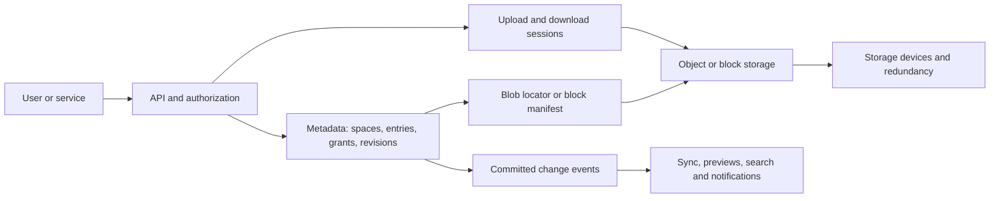

# How file platforms store, transfer and isolate data

Research dated 5 Nov 2026. For source inspection, verification and the coverage audit, see the [research log](Research%20log.md).

Teaching connections revised 11 Nov 2026. SQL and reproduction code retain the 5 Nov execution evidence; no new provider or concurrent-session experiment is implied by this revision.

## Summary

A file platform connects several kinds of state: a named item in a namespace, versions of its contents, stored bytes, permissions, transfer progress, and copies on devices. A folder tree describes organization; it need not describe the placement of bytes on disks. Completing a transfer, publishing a file, allowing a download, retaining a version and reclaiming storage are different operations.

This report follows those connections across Google Drive, OneDrive, Box, Nextcloud, Dropbox, Telegram, Proton Drive, Syncthing, tus/tusd, Magic Wormhole, WeTransfer, Amazon S3 and Ceph. Each comparison has a specific purpose. Their architectures are not interchangeable, and the teaching database near the end is not anyone's private schema.

**Evidence labels:** [Confirmed] identifies a bounded fact in an opened primary source or inspected code. It means the source establishes the statement, not that we independently observed production. [Inferred] identifies reasoning or an explicitly synthetic design. [Unknown] identifies a limit of the evidence. Historical posts and pinned releases retain their dates; rolling documentation is read as of the research date.

The most useful distinctions to keep while reading:

| Visible action | Questions underneath |
| --- | --- |
| Rename or move | Did identity change, or just metadata? Must descendant paths or inherited permissions be recomputed? |
| Upload | Which bytes arrived, who can resume, and when is a validated revision published? |
| Share | Is access attached to a person, group, parent folder, bearer link or encryption key? |
| Download | Who authorized the request, which revision is pinned, and where are bytes served from? |
| Sync | What did each device previously know, and are changes causally ordered or concurrent? |
| Delete | Was a reference hidden, a revision purged, a blob made unreachable, or disk space actually reclaimed? |

Read sections 1–3 for representation, 4–6 for transfer and access, 7–10 for sync and lifecycle, and 11–12 for the connected stored-record walkthrough and failure timelines.

Keep Alice's `proposal.pdf` in mind through those comparisons: its name locates it for a person, its entry ID locates its history, and a revision points to exact bytes. [Alice's project](#11-connected-database-walkthrough-alices-project) works through that distinction in depth, including publication, access and retained references. Protocols, hardware placement, messaging, encryption and live collaboration explain surrounding choices; this report does not implement a complete client, storage cluster or collaborative editor. Use the comparisons to answer a particular question in Alice's journey rather than treating them as successive parts of one provider's architecture.

## 1. A file is several identities connected together

[Confirmed] Drive exposes an opaque file ID that survives a rename. Its API distinguishes ordinary binary/text content, folders, Workspace documents and shortcuts. A folder has metadata without an ordinary content body; a shortcut points elsewhere. Individual and shared-drive ownership differ. These are public resource semantics, not Google's SQL tables. [Drive file model](https://developers.google.com/workspace/drive/api/guides/about-files).

[Inferred — teaching model] Use these distinct records to reason about an uploaded PDF:

| Record | Example | Meaning |
| --- | --- | --- |
| Principal | Alice, Bob, Studio team | A person or group that can own resources or receive access |
| Space | S1, Alice's project workspace | Boundary for organization, ownership and accounting |
| Entry | F42, `proposal.pdf`, parent P7 | Stable logical file identity and location |
| Revision | F42 revision 3 | One accepted state of this file's contents |
| Blob or manifest | B19 | Stored content, or an ordered description of constituent blocks |
| Storage locator | bucket K, key `content/B19`, object version V | How the backend fetches that exact content |
| Grant | Bob can read P7 | An authorization relationship; not a second PDF |
| Upload session | U9, received offset, expiry | Work in progress; not necessarily a published revision |
| Device state | laptop last applied change 891 | What a particular replica has synchronized |

The logical file can remain F42 while its name, parent, owner and head revision change. A copy can receive another entry ID while sharing immutable bytes, if policy allows. A shortcut can have its own name and parent while requiring permission on its target. Sharing a file does not inherently require copying it into each recipient's storage.

Do not collapse an entry ID, a content hash, an upload ID and a signed URL into one identifier. Equal content does not imply equal ownership or access. An address tells the system what is being requested; authorization decides whether the caller may obtain it.



This is a teaching architecture. A real deployment may combine components, use different databases, or transfer bytes directly between clients and storage. None of those choices removes the responsibilities represented here.

## 2. Folders, paths and the database

### A folder can be a row

[Inferred — teaching model] An adjacency-list hierarchy stores `entry(id, space_id, parent_id, name, kind)`. Listing a folder selects entries with its ID as parent. An empty folder still has a row. A displayed path is reconstructed by following parents. A materialized-path design additionally stores paths for fast prefix queries, at the expense of more work when moving a subtree. A closure table stores ancestor/descendant relationships for faster ancestry queries, with additional maintenance. These are alternative representations, not a universal schema.

| space | entry | parent | name | kind |
| --- | --- | --- | --- | --- |
| S1 | P0 | none | My workspace | folder |
| S1 | P7 | P0 | Project | folder |
| S1 | F42 | P7 | proposal.pdf | file |
| S1 | P8 | P7 | Empty assets | folder |
| S2 | F42 | Q0 | proposal.pdf | file |

Here `(space, entry)` is the identifier. The last row belongs to another space even though its local ID and name match. Composite foreign keys can prevent a row in S1 from naming an S2 parent. They do not themselves verify user access, that the parent is a folder, or that the hierarchy is acyclic.

### What Nextcloud actually stores

[Confirmed, Nextcloud v31.0.0] The inspected migration defines `filecache` with a numeric `fileid`, storage ID, path, path hash, parent and name, plus content metadata. The cache reader lists children using both parent and storage. Its move implementation updates paths of descendants as well as the moved entry's name and parent. Consequently, a subtree move is not necessarily one SQL row update even when it copies no file contents. [Initial schema](https://github.com/nextcloud/server/blob/051e46a7a272300cf7c90b3e330fd1501fd6a996/core/Migrations/Version13000Date20170718121200.php#L154), [folder reads and cache moves](https://github.com/nextcloud/server/blob/051e46a7a272300cf7c90b3e330fd1501fd6a996/lib/private/Files/Cache/Cache.php#L203).

[Confirmed] With Nextcloud primary object storage, directory structure and filenames belong to the application database; the object store contains content identified independently. The ordinary filesystem backend is a different configuration, and external-storage integration is different again. Losing the database while retaining the bucket therefore does not leave a directly browsable ordinary folder tree. [Primary storage documentation](https://docs.nextcloud.com/server/31/admin_manual/configuration_files/primary_storage.html).

### Product rules must be stated explicitly

[Confirmed] Drive's v3 file reference and folder guide specify one parent, using shortcuts for additional placements. The overview fetched on the same date still says My Drive items can have multiple parents. This is a documentation discrepancy; the examples here follow the specific v3 contract rather than repeat the broader overview. [Files reference](https://developers.google.com/workspace/drive/api/reference/rest/v3/files), [folder operations](https://developers.google.com/workspace/drive/api/guides/folder).

[Inferred] A tree's uniqueness policy belongs to the product. A database can allow two sibling entries named `proposal.pdf`; a local filesystem or transfer destination may not. Case folding, Unicode normalization, reserved names and maximum path lengths also differ. Preserve identity independently of a display name, and define deterministic conflict handling during export. Do not silently overwrite an unrelated destination file because its name matches.

Recent, starred and shared-with-me screens need not be additional parents. They can be queries over view timestamps, user preferences and access relationships. A star normally belongs to a user/item relationship, not necessarily to the item for everyone. Shortcuts must not bypass checks on their targets.

A move into a descendant would create a cycle. Checking ancestry without coordinating competing moves is insufficient: A can move X under Y while B moves Y under X. A teaching implementation can serialize hierarchy mutations per space, recheck ancestry under that lock, and commit the new parent with its change event. Larger systems may use narrower locks or other concurrency strategies. Also validate destination permissions, name conflicts, retained links and access changes; moving bytes is only one possible part of the operation.

## 3. Where the bytes actually live

### Database, filesystem and object store are different choices

[Confirmed] PostgreSQL can store raw binary strings in `bytea` and offers a separate large-object facility with streaming interfaces. Therefore, "databases store only file paths" is false. [Binary types](https://www.postgresql.org/docs/17/datatype-binary.html), [large objects](https://www.postgresql.org/docs/17/largeobjects.html).

[Inferred] Keeping small content and metadata in one transactional database simplifies some consistency and backup operations. Large blobs increase database I/O, replication traffic and backup volume. External object storage separates that load and supports direct delivery, but introduces a consistency boundary: a database transaction cannot roll back an independently accepted object upload. A filesystem supplies directory and file operations, but a single server's filesystem alone does not supply geographic redundancy or application-level sharing semantics.

[Confirmed] For the general-purpose S3 model described in its naming guide, object keys form a flat namespace. Slash-separated prefixes can be displayed as folders; a console-created folder marker can be a zero-byte object. An application folder tree therefore need not equal S3's key-prefix presentation. This statement is not a claim about every S3 bucket type or every storage product. [S3 object keys](https://docs.aws.amazon.com/AmazonS3/latest/userguide/object-keys.html).

[Confirmed, Nextcloud v31.0.0] `ObjectStoreStorage.getURN` maps a file ID to an object prefix plus that ID; the default prefix is `urn:oid:`. Its read path uses the resulting key. The rename path moves cache metadata. The new-file write path creates a temporary `.part` cache entry, writes the object, and then promotes the entry after its configured validation. This is a concrete code path, not a guarantee covering every Nextcloud wrapper, versioning backend or storage configuration. [Object-store implementation](https://github.com/nextcloud/server/blob/051e46a7a272300cf7c90b3e330fd1501fd6a996/lib/private/Files/ObjectStore/ObjectStoreStorage.php#L248).

### Below object storage are machines and drives

[Confirmed, Dropbox, 6 May 2016] Magic Pocket separates content from file/user metadata. Its published architecture uses immutable encrypted blocks, an index mapping a block hash to cell/bucket/checksum, and another mapping from storage volumes to devices. The index was backed by sharded MySQL. Storage nodes persist blocks on drives; higher layers coordinate placement and repair. This is dated evidence of the route from an identifier to hardware, not a reconstruction of today's whole Dropbox service. [Inside Magic Pocket](https://dropbox.tech/infrastructure/inside-the-magic-pocket).

[Confirmed] Ceph supplies a contrasting mechanism: RADOS stores objects through OSDs, while clients and OSDs use CRUSH and a cluster map to calculate placement. CephFS additionally has metadata servers. Object, block and filesystem interfaces can sit over the same storage substrate. The cited page describes a development documentation version. [Ceph storage architecture](https://docs.ceph.com/en/latest/architecture/storage-cluster/).

[Confirmed] Erasure coding splits content into K data fragments and M coding fragments. Ceph documents reconstruction from sufficient surviving fragments and the additional protocol work needed when writes are interrupted. Mathematical reconstructability and the cluster's configured availability policy are different questions. [Ceph erasure coding](https://docs.ceph.com/en/latest/architecture/erasure-coding/).

[Inferred — illustrative arithmetic] Three full replicas of 8 MiB consume 24 MiB before metadata and filesystem overhead. A 4+2 code needs approximately 12 MiB before padding and other overhead. Neither figure describes a provider's actual bill. Replica placement must consider common failures: three copies on one machine do not protect against that machine failing. Repair, integrity scrubbing, spare capacity, regional replication and capacity rebalancing consume network, CPU and I/O too.

Encryption and isolation are separate from placement. Two tenants may have bytes on the same physical disk while remaining logically and cryptographically separated. A separate bucket also does not protect data if application credentials or permission checks are overbroad. The inspected sources do not reveal Google Drive's or Telegram's current disk placement, database partitions or replication factors [Unknown].

## 4. Uploading is a recoverable workflow

[Inferred — teaching model] A useful state machine is `created → receiving → bytes_complete → verified → published`, with separate failed, cancelled and expired outcomes. Some products combine states. The distinctions matter whenever validation, scanning, permission checks or database publication can fail after the bytes arrive.

1. Authenticate the caller and resolve the destination by stable ID. Check upload permission and reserve quota.
2. Create an upload session tied to the caller, space, destination, expected size and intended revision. Allocate an unguessable storage key that cannot overwrite another tenant's object.
3. Transfer bytes through the app or directly to storage using narrowly scoped credentials. Record authoritative progress.
4. Verify size and integrity using trusted evidence; run required processing. An arbitrary client claim that an upload succeeded is insufficient.
5. Recheck authorization and the expected destination revision. Commit revision metadata, accounting and a durable change event together.
6. Publish success. Repeated completion requests return the already-published revision. Abandoned sessions release reservations and schedule safe content cleanup.

The database transaction is short and does not remain open for the duration of a multi-gigabyte upload. The system must tolerate bytes without a committed file record and retries after a committed record's response was lost.

### Resumable protocols differ

| Source | Confirmed mechanism | Consequence |
| --- | --- | --- |
| [Drive uploads](https://developers.google.com/workspace/drive/api/guides/manage-uploads) | A resumable session accepts byte ranges; status requests report accepted bytes. Incomplete responses use 308, while an expired session can require a restart. | Resume from server progress, not the client progress bar. |
| [OneDrive upload sessions](https://learn.microsoft.com/en-us/graph/api/driveitem-createuploadsession?view=graph-rest-1.0) | An upload URL, expiry and expected ranges describe the session. Fragments must be uploaded sequentially. | Splitting a file does not automatically permit parallel fragment uploads. |
| [S3 multipart upload](https://docs.aws.amazon.com/AmazonS3/latest/userguide/mpuoverview.html) | Parts can arrive independently and out of order; completion assembles them. Unfinished multipart work requires completion or abortion, including lifecycle cleanup where configured. | Parallelism and cleanup belong to the protocol and storage lifecycle. |
| [tus 1.0](https://tus.io/protocols/resumable-upload) | HEAD retrieves an offset; PATCH must match it. Optional extensions cover expiration, checksums, termination and concatenation. | Resume is explicit; extension support must be negotiated. |

These rows are [Confirmed] protocol contracts, not claims that one provider implements another provider's protocol. HTTP multipart metadata/content uploads, S3 multipart object assembly and HTTP chunked transfer encoding are different concepts.

### A small protocol trace

[Inferred — constructed example conforming to tus core semantics, not a recorded network session] Suppose a 12-byte upload has accepted four bytes. The client reads `Upload-Offset: 4` using HEAD, then sends:

```http
PATCH /uploads/U9 HTTP/1.1
Tus-Resumable: 1.0.0
Upload-Offset: 4
Content-Type: application/offset+octet-stream
Content-Length: 4

efgh
```

The server accepts the bytes and advances to offset 8, but its response is lost. Repeating the same PATCH with offset 4 must not append another `efgh`. The offset mismatch is rejected; HEAD discovers 8, and the client continues there. Headers represent byte offsets, not character counts in arbitrary text. A checksum detects damage; it does not authorize the uploader or prove that the content is harmless.

### What tusd stores and checks

[Confirmed, tusd v2.8.0] `FileInfo` separates upload identity, intended size, current offset, client metadata and storage details. The filesystem implementation stores JSON information separately from the bytes, derives resumed progress from the data file's actual size, and appends accepted chunks. [Upload data interface](https://github.com/tus/tusd/blob/0e52ad650abed02ec961353bb0c3c8bc36650d2c/pkg/handler/datastore.go#L12), [filesystem store](https://github.com/tus/tusd/blob/0e52ad650abed02ec961353bb0c3c8bc36650d2c/pkg/filestore/filestore.go#L104).

[Confirmed, same release] `PatchFile` acquires an upload lock when a locker is configured, loads current information and rejects a mismatched offset before writing. Completion calls the datastore's finish operation before emitting finish callbacks/notifications. This does not prove atomicity with an application's separate catalog database. Nor does the existence of optional locking prove every tusd deployment has suitable distributed locking. [Handler and completion path](https://github.com/tus/tusd/blob/0e52ad650abed02ec961353bb0c3c8bc36650d2c/pkg/handler/unrouted_handler.go#L721).

[Inferred] A restartable client must retain a session reference safely and verify that it is resuming the same local file. If the source file changed, blindly sending its later bytes can produce a hybrid. Use file snapshots, immutable source handles or revalidation appropriate to the client. Expired upload permissions may be renewable without preserving an expired upload session; the two lifetimes are independent.

## 5. Downloading, temporary transfers and migration

### The download path

[Inferred — teaching model] Resolve the requested entry and revision, evaluate current authorization, then either stream bytes through a trusted service or grant a bounded storage/CDN capability. Pin the revision before fetching pieces. Otherwise a resumed request could combine the beginning of revision 1 with the end of revision 2. Treat thumbnail, preview and export endpoints as additional content-access paths.

[Confirmed] Drive supports byte ranges for ordinary file downloads, including retained revisions, while Workspace exports use a different operation and do not support partial export downloads. A Google document exported as a PDF is a generated representation, not proof that the native document is stored as that PDF. [Downloads and exports](https://developers.google.com/workspace/drive/api/guides/manage-downloads).

[Confirmed] S3 presigned URLs are reusable bearer capabilities until applicable expiry or credential restrictions intervene. Expiry is checked when the request begins: a started download can continue past the deadline, but a new retry after expiry fails. Changing an application ACL alone is not described as revoking such an already-issued URL. [Presigned URL behavior](https://docs.aws.amazon.com/AmazonS3/latest/userguide/using-presigned-url.html).

[Inferred] Consequently, “revoke now” needs a defined scope: stop future API authorizations, stop future byte requests, terminate active streams, or make existing local copies unreadable. These are increasingly stronger promises. Short-lived links bound exposure; an authorization gateway can recheck new requests; already-delivered plaintext cannot be recalled by deleting a server row. CDN cache keys, cache-control policy and authorization at the delivery edge must preserve the intended boundary.

Range requests enable resume and seeking, but media containers also need usable indexes or a streaming representation. A service can generate multiple video encodings and choose segments based on bandwidth. It must account for generated storage and delivery traffic, invalidate obsolete derivatives, and avoid serving previews under a weaker permission policy.

### A folder download is a generated artifact

[Confirmed] Box exposes ZIP creation for selected files/folders, returning a download URL, status URL, expiry and possible name-conflict mappings. This makes archive generation and delivery explicit operations rather than treating a folder as one stored blob. [Box ZIP downloads](https://developer.box.com/guides/downloads/zip-archive).

[Inferred] For a large export, record the selected item IDs and revisions, archive names, job progress and failures. Define whether the result is a snapshot or a best-effort view while files change. Check access when scheduling and again at the required delivery boundary. A folder manifest preserves empty folders and handles duplicate destination names; a flat list of blobs cannot fully reconstruct the original tree. A partial archive needs an honest status, not an unconditional success response.

### Three different meanings of transfer

| Mode | Illustrative stored state | Recovery and isolation question |
| --- | --- | --- |
| Persistent drive share | Existing entry plus grants/link | Is access revocable independently of the owner's copy? |
| Temporary hosted transfer | Transfer ID, files/manifest, expiry, recipients or token, retention state | Has the link expired, or have all recovery copies also been removed? |
| Direct/relayed device transfer | Pairing state, encrypted channel, offer, progress, receipt | Can both endpoints rendezvous, and who retains a durable copy? |

[Confirmed] WeTransfer's availability documentation, updated 30 September 2026, makes expiry dependent on transfer settings and plan; some expired transfers can be recovered when the relevant feature was enabled. Link expiry therefore does not universally establish immediate physical destruction. Its private retention jobs and storage schema remain [Unknown]. [Transfer availability](https://wetransfer.com/help-center/how-to/transfer-availability).

[Confirmed] Magic Wormhole's protocol negotiates an offer containing filename/size or directory archive details, then uses a separate Transit connection for file bytes. Peers advertise direct TCP and relay abilities; the receiver acknowledges receipt. Directory mode describes a compressed archive with original and transmitted sizes. These protocol roles differ from keeping a permanent personal drive. [File-transfer protocol](https://magic-wormhole.readthedocs.io/en/latest/file-transfer-protocol.html).

[Inferred — temporary-transfer example] `T5 → {F42@r1, F43@r4}` freezes the delivered versions. `link_disabled_at`, `recoverable_until` and `purged_at` have different meanings. A download-count limit needs an atomic claim and a definition of what counts: starting, finishing, resuming, or each range request. A retry should not unexpectedly consume several “downloads.” Expiring T5 need not delete the owner's original files.

[Inferred — direct-transfer example] Alice and Bob pair, negotiate an encrypted connection, exchange an offer, and stream an archive. A relay transports the connection if a direct path fails. If Alice disconnects before completion, the existence of a pairing server does not imply it holds a downloadable full copy. Receiver acknowledgement, durable local persistence and source deletion are separate policy decisions.

### Moving between providers

[Inferred] A migration worker can read from the source and upload to the destination without routing all bytes through the user's browser. Keep a mapping of source IDs/revisions to destination IDs, per-item status, retry keys and verified size/hash. Preserve or explicitly translate names, folders, timestamps and permissions; provider identities, shortcuts, native document formats and sharing rules may not map directly. Re-encryption may be necessary. Verify a stable source revision before marking an item complete, and make a final change pass if the source remains writable. Copy-verify-switch is distinct from deleting the source. No cross-provider atomic transaction is assumed.

## 6. Isolation, sharing and ownership

### Isolation is enforced along every route to data

[Inferred] One API can serve many users because authenticated identity and request context differ. The backend resolves which space the operation targets and checks the caller's relationship to that space/item. A client-supplied `owner_id` or folder path is a request, not proof of ownership. The download service must resolve a trusted object locator from authorized metadata rather than accept an arbitrary bucket key supplied by the caller.

| Boundary | What must remain scoped |
| --- | --- |
| Database | Entries, parents, revisions, blobs, grants and upload sessions cannot accidentally join across spaces. |
| Storage credentials | Grant only the required key, operation and time; avoid user-wide bucket listing when serving one file. |
| Cache | Include the relevant identity/access context, or cache content only behind an authorization boundary. |
| Search | Filter candidates by access and recheck before returning sensitive names/snippets. |
| Background work | Carry tenant, entry and revision identity; handle permission changes and tombstones. |
| Operations | Administrative tooling, backups and logs have their own access boundaries and audit requirements. |

Database row policies can add protection, but they do not automatically protect an object URL, search index or preview cache. Conversely, opaque IDs reduce guessing but do not replace authorization. Physical separation may serve operational or regulatory requirements; application authorization remains necessary either way. These are design consequences, not claims about Google's internal enforcement architecture.

### Grants, inheritance and effective actions

[Confirmed] Drive permissions identify principal types and roles; inherited access propagates down folders, while moves re-evaluate inheritance. Its API exposes user-specific capabilities such as whether the current user can share or delete, rather than requiring a client to infer every action from one role string. An identity-restricted link does not need a different URL for each recipient. [Drive sharing](https://developers.google.com/workspace/drive/api/guides/manage-sharing).

[Confirmed] Drive's limited-access folders are an explicit exception to expansive inheritance. Users can see a restricted folder through inherited access without being able to open it; designated owner/organizer roles retain special access. This is not equivalent to treating every child ACL as an arbitrary override. [Limited-access folders](https://developers.google.com/workspace/drive/api/guides/limited-expansive-access).

[Confirmed, Nextcloud v31.0.0] The inspected share provider persists relationships including file source, recipient, permissions and owner/initiator information. Link shares also have token, password-related and expiration fields. The provider is storage evidence; reading it alone does not establish the entire effective-access algorithm or password-verification path. [Share persistence](https://github.com/nextcloud/server/blob/051e46a7a272300cf7c90b3e330fd1501fd6a996/lib/private/Share20/DefaultShareProvider.php#L85).

[Inferred — teaching example] Alice owns S1; Bob has `reader` on Project/P7 and `editor` directly on F42. Bob can edit F42 but cannot automatically delete every sibling, change quota or transfer ownership. A group grant depends on current membership, including membership revocation. A role should expand into action rules: read contents, list children, create, update, move, delete, share and administer are distinguishable. The rules for combining direct and inherited grants must be explicit; “strongest role wins” does not implement restricted folders by itself.

An access checker should return both a decision and its reason: Bob → Designers group → P7 inherited reader, plus direct editor on F42. Support tools can then explain access and which relationship must be removed. A cached yes/no answer without its policy version or invalidation mechanism can outlive the grant that justified it.

### Upload-only requests and public links

[Confirmed] Box file requests accept files and associated form metadata without adding uploaders as folder collaborators, including uploaders without Box accounts. Its API creates requests by copying an existing template request. This documents a separate intake capability rather than ordinary folder membership. [Box file requests](https://developer.box.com/guides/file-requests).

[Inferred] A teaching upload-only link maps to a destination and a narrow `create` capability, with quotas, expiry and abuse controls. It need not permit listing or reading previous submissions. A public download link can instead refer to a specific revision or the current head; changing the head has very different consequences in those two designs. Store a verifier for the link secret, not an unnecessarily exposed plaintext token, and avoid putting that secret into logs or analytics.

### Ownership is not just another share

[Confirmed] Drive distinguishes transfer between eligible individual accounts from shared-drive ownership by an organization. Consumer ownership transfer requires the prospective owner's consent; when transferred, the previous owner becomes a writer. The cited contract does not support transferring individual ownership of an item already owned by a shared drive. [Ownership transfers](https://developers.google.com/workspace/drive/api/guides/transfer-file).

[Inferred] Therefore, “transfer this project to the team” may mean changing a workspace's owner, moving items to a team namespace, or copying them through a migration flow. Choose the mechanism explicitly. Re-evaluate grants, quota payer, encryption keys, retention, external links and unfinished uploads. An employee leaving should trigger membership removal and ownership review rather than blindly deleting every item they ever created. Organizational policy may retain the data while removing the person.

Disabling download in a UI or an API permission can restrict supported operations. It cannot erase a plaintext copy already obtained, and viewing content necessarily discloses some representation of it. End-to-end encryption adds key distribution to access changes; it does not make a recipient forget an already-received key or plaintext [Inferred].

## 7. Versions, offline synchronization and competing changes

### File identity, revisions and device knowledge

[Inferred — teaching model] F42 stays the same file while head revisions change r1 → r2 → r3. Restoring r1 can create r4 that references r1's content, preserving the fact that a restore happened. A filename alone cannot tell whether an entry was renamed, deleted/recreated, or replaced with another item. A content hash alone cannot distinguish two intentionally separate files with identical contents.

[Confirmed] Drive gives blob revisions explicit retention controls, including `keepForever`; retained revisions count toward storage. Automatically purgeable history and the history returned through APIs are not necessarily identical to everything visible in the product UI. Therefore, a version ID is not a promise that every revision will remain available forever. [Drive revisions](https://developers.google.com/workspace/drive/api/guides/manage-revisions).

[Confirmed] Drive's changes API uses page tokens and returns current file state for detected changes. OneDrive's delta API uses continuation/delta links and explicit deleted items. These APIs help maintain a local replica; they should not be assumed to be immutable, exhaustive business audit trails. [Drive changes](https://developers.google.com/workspace/drive/api/guides/manage-changes), [OneDrive delta](https://learn.microsoft.com/en-us/graph/api/driveitem-delta?view=graph-rest-1.0).

[Confirmed] Drive push notifications have an empty body; clients fetch resource details or enumerate changes separately. Notification channels expire and must be replaced, with possible overlap between old and new channels. [Push notifications](https://developers.google.com/workspace/drive/api/guides/push). [Inferred] A notification can therefore wake the synchronizer, while its persisted change cursor controls progress. Receiving a notification is not itself evidence that the client has applied the change.

[Inferred] The client stores a cursor plus its local base state and pending edits. Apply a fetched page durably before advancing the cursor, and tolerate replay if the client crashes between those steps. Distinguish content missing because it was deleted, because access was lost, or because it is deliberately offline-only. If a provider invalidates the cursor, follow its resynchronization contract; do not silently assume no changes occurred.

### Syncing can reuse blocks

[Confirmed] Syncthing describes filesystem scans/watchers, an index of local and remote versions, and block lists containing offset, size and SHA-256. It compares desired and local blocks, reuses matching local data, requests missing data and checks received hashes. Case-sensitive paths can cause problems on destinations that treat case differently. [Synchronization documentation](https://docs.syncthing.net/users/syncing.html).

[Confirmed, Syncthing v1.29.0] `scanner.Blocks` computes the block sequence; `protocol.Vector` represents per-device counters and compares their causal ordering. The database update code maintains local/remote file information and global-version metadata. These paths establish more than “the latest timestamp wins.” [Scanner](https://github.com/syncthing/syncthing/blob/13d7881b8014cc5078140689198d43fd7829d8a6/lib/scanner/blocks.go#L27), [version vectors](https://github.com/syncthing/syncthing/blob/13d7881b8014cc5078140689198d43fd7829d8a6/lib/protocol/vector.go#L19), [index updates](https://github.com/syncthing/syncthing/blob/13d7881b8014cc5078140689198d43fd7829d8a6/lib/db/lowlevel.go#L139).

[Confirmed, same release] The receive path tests vector concurrency and may rename the local file to a conflict copy. The configured maximum conflicts affects retention; disabling conflict copies is possible. This inspected version's delete handling and current rolling documentation should not be flattened into one universal delete-versus-edit rule. [Conflict code](https://github.com/syncthing/syncthing/blob/13d7881b8014cc5078140689198d43fd7829d8a6/lib/model/folder_sendrecv.go#L1825).

[Inferred — causal example] Both devices know `{A:4,B:2}`. A edits offline and produces `{A:5,B:2}`; B independently produces `{A:4,B:3}`. Neither contains knowledge of the other's edit. They are concurrent even if one laptop's clock is ahead. An application can preserve both, request a merge or apply a documented resolution policy. Block reuse reduces traffic; it does not resolve semantic conflicts inside a PDF.

[Confirmed, Dropbox, 9 March 2020] Dropbox's Nucleus article describes offline clients as a normal condition and explains why representing a move as an independent delete/add pair could expose a missing file after partial failure. Its rewrite introduced a clearer model and testing strategy. This is evidence for the importance of move identity and failure modeling, not proof that Dropbox uses the SQL example below. [Sync-engine account](https://dropbox.tech/infrastructure/rewriting-the-heart-of-our-sync-engine).

[Inferred] Selective sync excludes chosen subtrees; on-demand files can keep metadata locally and hydrate bytes when opened. Local eviction must not be translated into a remote deletion. Also account for disk-full errors, locked files, permission changes, interrupted temporary-file replacement, path collisions, symlinks and long-offline devices returning after retention has expired.

### Why live documents are different

| Uploaded-file versioning | Live collaborative document |
| --- | --- |
| Replace or publish a byte sequence | Apply structured edits to shared document state |
| Resolve concurrent whole-file versions | Resolve/merge edits according to the collaboration algorithm |
| File revision is the central unit | Updates, document versions and snapshots can coexist |
| Preview/export is derived from bytes | Export is derived from the native document model |

[Confirmed] Yjs provides shared CRDT data types, synchronization and persistence integrations. It is a documented analogue for structured collaborative state, not evidence that Google Docs uses Yjs. [Yjs introduction](https://docs.yjs.dev/).

[Inferred] A focused document model can store updates and periodic snapshots, while comments, cursor presence and access control have their own lifecycles. A convergent text algorithm does not itself authorize edits, enforce retention or determine whether a user's change is desirable. Detailed OT/CRDT algorithms remain outside the selected scope.

## 8. Telegram: an attachment is connected to a message

[Confirmed] Telegram's file API documents temporary numbered upload parts, followed by a separate media operation. `messages.uploadMedia` can obtain reusable media without immediately sending a message; eligible non-protected media can later be sent without reuploading its bytes. Some attribute changes, including the documented filename case, require a full reupload. These API rules differ from a drive's ordinary metadata rename. [Uploading and downloading files](https://core.telegram.org/api/files), read through its official Markdown representation after HTML retrieval failed.

[Inferred — schematic API journey, not a captured session] Alice selects `proposal.pdf`, assigns a temporary upload identifier, saves the parts, then submits an uploaded-document media object to `messages.sendMedia`. The resulting message references media metadata. Bob loads the chat, obtains the media reference and asks for the relevant file bytes. Resending eligible media can reuse that reference; it does not prove that Telegram creates one physical copy per chat or globally deduplicates identical uploads.

| Conceptual record | Example | Evidence boundary |
| --- | --- | --- |
| Upload work | temporary file ID plus numbered parts | Public upload protocol |
| Media resource | document identifier and metadata | Public API object |
| Message | chat identity, message identity, attached media | Public message/media relationship |
| Client reference cache | media ID → file reference and known sources | Documented client-side bookkeeping |
| Server blob placement | disks, replicas and reference ownership | Not established by those API objects |

[Confirmed] Telegram's file-reference documentation explicitly describes client mappings from file IDs to references and sources. References can expire; the client retains a source from which to refresh them. This is unusually concrete database guidance, but it concerns the client reference cache, not Telegram's private server schema. [File references](https://core.telegram.org/api/file-references).

[Confirmed] Telegram documents a CDN path for certain popular public-channel media. The client obtains decryption information and trusted hashes through the main service, then verifies downloaded CDN fragments. The CDN's inability to decrypt those files does not mean the main Telegram service lacks the keys. [Encrypted CDNs](https://core.telegram.org/cdn).

[Confirmed] Secret Chats use a separate end-to-end encryption model. Their file payloads use independent one-time keys; the decryption key travels inside the encrypted message, while encrypted file contents are uploaded separately. Cloud Chats use the cloud messaging model. Telegram also distinguishes clearing a device's media cache from removing cloud content. [Secret Chat protocol](https://core.telegram.org/api/end-to-end), [Telegram FAQ](https://telegram.org/faq).

[Inferred] A drive folder can therefore not be substituted directly for a chat. Access may depend on the conversation and media-reference context; message identity, forwarding restrictions and media lifetime add separate rules. A “Saved Messages” collection is useful for the user, but does not by itself establish drive-style ownership, folder inheritance, quotas or revision restoration.

Deleting a local cache releases local disk space. Deleting a message changes a conversational reference. Expiring an access reference changes how a client can retrieve media. Physically reclaiming server bytes is yet another operation. Whether another forwarded message, retention rule or backend reference still keeps those bytes alive is [Unknown] from the inspected APIs. We do not infer physical erasure time from a disappearing message.

## 9. Encryption and deduplication change the model

| Protection | Who can normally obtain plaintext? | What it does not establish |
| --- | --- | --- |
| Transport encryption | Authorized endpoints of the connection | That the storage service cannot read content |
| Server-side encryption | Services authorized to use the storage keys | That the provider is cryptographically excluded |
| End-to-end encryption | Clients/recipients holding the necessary keys | That metadata is entirely hidden or former recipients forget old keys |

This table is a conceptual distinction [Inferred], not a security certification of a provider.

[Confirmed, published 31 August 2020, updated 22 September 2022] Proton Drive describes volumes, nodes for metadata/content, links for parent/name relationships, and shares carrying permissions and decryption material. Names and content are encrypted client-side; its hierarchy connects child key material to parents. Sharing can add recipient access to key material without reencrypting the entire payload. The article includes historical roadmap language, so it is used for the described design rather than current feature availability. [Proton Drive security model](https://proton.me/blog/protondrive-security).

[Inferred] End-to-end encryption shifts work to clients. Server-side OCR, full-text search, previews and malware scanning need plaintext or a specialized alternative; a server that sees only ciphertext cannot simply run the ordinary plaintext pipeline. Device recovery requires recoverable key material as well as file bytes. Losing keys can make intact storage unreadable. Revocation can prevent future service access and new key distribution, but old ciphertext plus an already-held key remains a separate concern.

### Equal bytes do not mean one logical file

[Inferred — design alternatives] Whole-file deduplication compares full-content identifiers; block deduplication can share unchanged portions across revisions. A manifest preserves block order and length: having the right blocks without their arrangement does not reconstruct the file. Compression and encryption order affect what can be compared. Independent randomized encryption normally produces different ciphertext for equal plaintext, so ciphertext equality cannot be assumed.

Cross-user deduplication also creates an information boundary: an observable “already present” response can disclose that someone else possesses particular content. Never treat a guessed hash as authorization to download or claim an existing blob. Designs can limit deduplication to a space or encryption domain, require actual content submission, or use a more specialized protocol. This report does not establish global deduplication policies for Drive, Telegram or Proton [Unknown].

Reference counting is one reclamation strategy, not magic. If a copied entry and two retained revisions reference B19, deleting one entry must not remove B19 while the others need it. Creating a reference and deciding a blob is unreferenced must coordinate. A mark-and-sweep approach instead traces reachable content from durable roots, including active uploads or retention holds as appropriate. Either needs protection against races, crashes and partial storage deletions.

## 10. Derived features, deletion, quotas and operations

### A preview is another stored representation

[Confirmed] Nextcloud documents separate preview generation with configurable providers and resource limits; some formats are disabled by default for security and performance reasons. Its antivirus integration separately scans uploads with an installed scanner. These are product features, not proof that every deployment enables them. [Preview configuration](https://docs.nextcloud.com/server/31/admin_manual/configuration_files/previews_configuration.html), [antivirus integration](https://docs.nextcloud.com/server/stable/admin_manual/configuration_server/antivirus_configuration.html).

[Inferred — teaching pipeline] Committing F42@r2 can also commit `event(file_changed,S1,F42,r2)`. Workers consume that event to make previews, extract text/OCR, scan content, update search and send notifications. Store job identity with entry, revision and processor version. If the same event is delivered twice, reuse or replace the same output deterministically. Do not attach r1's late preview to r2 simply because its job finished later.

An OCR result can reveal everything in the source; a search snippet can reveal a sentence from a private document. Indexing is therefore part of access control, not only performance. Recheck access before returning names/snippets, process deletions and permission changes, and prevent revoked users from reading cached derivative URLs. A stale search index should not become the authority for access. Also avoid leaking restricted filenames through autocomplete or notification content.

[Confirmed] Drive exposes distinct search predicates for names, full text, parents, sharing, starred state and trash. That public query contract does not reveal its index engine, OCR pipeline or authorization-cache implementation. [Search API guide](https://developers.google.com/workspace/drive/api/guides/search-files). [Inferred] The teaching pipeline above explains one way to maintain such derived views; it is not a reconstruction of Google's implementation.

Scanning failure and confirmed malware are distinct states. A synthetic policy can quarantine until a required scanner succeeds, report the reason, and retry transient failures. Do not label unreadable/encrypted content “clean” merely because the scanner did not inspect it. With client-side encryption, articulate which checks can actually be performed.

### Trash, retention and physical deletion

[Confirmed] Drive exposes separate trash, restore and permanent-delete operations; the cited guide describes a 30-day trash restoration window and notes that bulk changes can take time to appear. This is a product-level lifecycle, not a statement about overwriting every physical replica. [Trash and deletion](https://developers.google.com/workspace/drive/api/guides/delete).

[Confirmed, Dropbox, 2 April 2026] Dropbox distinguishes garbage collection, which identifies unreferenced blobs, from compaction, which copies live data and retires old volumes to reclaim physical space. Immutable storage can retain unused capacity after a logical delete. The article also reports how a storage-placement change increased fragmentation. [Storage efficiency and reclamation](https://dropbox.tech/infrastructure/improving-storage-efficiency-in-magic-pocket-our-immutable-blob-store).

[Inferred — teaching lifecycle] `active → trashed → eligible_for_purge → references_removed → blob_unreachable → storage_deleted → capacity_reclaimed` is a useful decomposition. Retention holds, backups and replication can introduce additional lifetimes. An expired public link is an access state, not necessarily any of those deletion states. Restore must also decide what happens if the original parent is gone or a name has been reused.

A garbage collector should claim a candidate durably, recheck reachability under the same coordination used by new references, delete the precise immutable object/version, and record completion. Retried deletion must be safe. A collector using a stale “zero references” count while another transaction creates a reference can destroy live content.

### Quota accounting and transfer limits

[Inferred] Quota is a policy over logical usage, not a direct measurement of allocated disk sectors. Define whether retained revisions, trash, duplicates, derivatives and shared files count, and whose account pays. A shared file need not charge every viewer. Restoring history or copying an entry can change logical charges even if no bytes are physically copied.

For concurrent uploads, reserve capacity atomically: `used + reserved + requested <= limit`. Publish converts a reservation into committed usage; cancellation and expiry release it exactly once. Unknown-length uploads need bounded incremental reservations or another explicit admission policy. A maximum file size, per-account storage quota, request-rate limit and bandwidth allowance are four different controls.

Cost drivers include durable bytes, redundancy, old versions, temporary parts, derivatives, requests, metadata/index capacity, egress, cross-region traffic and background repair/compaction. A tiny file downloaded a million times can be dominated by delivery cost. This report uses no unverified provider-price assumptions.

### Backup and recovery must reconnect metadata and bytes

[Confirmed] Nextcloud's backup guide includes configuration, data and database and uses maintenance mode to avoid inconsistent changes during backup. Its primary-object-storage guide explains why that backend needs an appropriate backup strategy too. [Backup guidance](https://docs.nextcloud.com/server/31/admin_manual/maintenance/backup.html).

[Inferred] If metadata is restored to 10:05 but storage to 10:00, a row may reference content that does not exist. Reversing the times can leave orphan blobs or unintended newer objects. A valid recovery point needs compatible metadata, content versions and encryption keys. Record a checkpoint or manifest, retain referenced immutable objects, and verify restores by reading content—not just by counting rows. A filesystem replica that mirrors a deletion is not automatically a backup.

Monitor incomplete-session age, reserved-versus-published usage, metadata/object mismatches, checksum failures, rejected access, preview/index lag, sync conflicts, expired grants, cleanup backlog and restore success. Audit events should identify actor, tenant, entry/revision, operation and result without logging file content, bearer secrets or decryption keys. User-visible activity and durable security audit records may have different retention and completeness requirements. These are proposed operating requirements, not measured provider internals.

## 11. Connected database walkthrough: Alice's project

### Explicit choices for the example

[Inferred — synthetic teaching model] Alice owns space S1, which contains Project/P7, Empty assets/P8 and `proposal.pdf`/F42. Bob receives inherited access to Project. Alice later publishes an offline edit, transfers the space to Studio, and Studio removes Bob's access. An older version is restored and another entry shares its bytes. All identifiers, policies and sizes below are invented.

The setup rows represent the completed initial folder upload. A real folder import creates entries from a manifest and tracks each file's upload separately; it does not require one atomic multi-gigabyte request. Sizes are reduced for the readable example, while the same identity and failure questions apply to a larger project.

To reach that starting point, Alice chooses Project and an 8 MiB PDF. The API derives Alice's identity from credentials, checks creation permission on P7, and reserves space. Before publication, a prospective F42 can have no head revision while its upload owns a staged blob B1; a folder listing must not present that as a readable completed file. A verifier checks the exact stored object, length and required integrity/scan results. Publication then associates F42/r1 with ready B1, turns the 8 MiB reservation into usage and commits a change event. Only then can Alice and an authorized reader open r1. If transfer succeeds but publication fails, bytes can remain staged without a visible revision. Resume publication or expire the upload under a cleanup policy; do not tell Alice the file is safely published merely because the progress bar reached 100%.

That initial-upload sequence is conceptual. The setup deliberately seeds its final rows and omits its upload/event history; it does not execute an initial transfer. The next edit, U2, is where the SQL demonstrates reservation and publication. This distinction keeps “we have bytes” separate from “we have committed a readable version.”

- Tenant identity is part of every file/blob relationship. One-level group membership is supported; nested groups and limited-access exceptions are discussed above but not implemented here.
- Names are case-sensitive and unique among non-trashed siblings. The examples use ASCII names. A full cross-platform filename policy is not implemented.
- Published versions are immutable references to immutable blobs. Upload size and storage verification are trusted inputs from a hypothetical storage verifier; the SQL does not upload or scan bytes.
- Quota charges the size of every retained logical revision, including trash and restored revisions, even when bytes are shared. This deliberately simple policy makes logical and physical totals visibly different; it is not a provider's billing policy.
- All mutating workflows acquire the space row first. This coarse lock gives a comprehensible serialization point for quota, grants, ownership, hierarchy and publication. It trades throughput for clarity.
- Access-check parameters represent an already authenticated identity. The routines run as invoker, with no exposed HTTP endpoint or production RLS configuration. They demonstrate decisions, not a complete security perimeter.

```mermaid
sequenceDiagram
    participant C as Alice's client
    participant A as File API
    participant DB as Metadata database
    participant O as Object storage
    participant W as Background worker
    C->>A: Begin revision, expected head r1
    A->>DB: Reserve quota and record upload U2
    A-->>C: Session and scoped upload capability
    C->>O: Transfer bytes; resume as needed
    A->>O: Verify exact object, length and checksum
    A->>DB: Mark verified; publish r2 with quota and event
    DB-->>A: Committed revision r2
    A-->>C: Published r2
    W->>DB: Read committed event
    W->>O: Generate derivative for r2
```

The event row is an outbox record in the same database transaction as publication. Workers can retry; that does not imply exactly-once external delivery. The diagram's storage verification and worker actions are conceptual, while the SQL publication mechanism is executable.

### Setup and stored relationships

Run the SQL blocks in order in a disposable PostgreSQL database. They create only the `file_research` schema. No real credentials, user files or storage objects are included.

Three counters below have different jobs. `head` selects the file's current content revision; `metadata_version` detects stale operations on its name/location/state; `access_epoch` records a change to space access context. None is an upload offset. The composite keys keep references inside a space, while `expected_head` asks whether Alice is still editing the version she started from. `published_revision` preserves U2's result for retry even if F42 later advances again. `used_bytes` and `reserved_bytes` account for different obligations, so an upload does not disappear from quota simply because it has no published revision yet.

```sql
CREATE SCHEMA file_research;
SET search_path = file_research, public;

CREATE TABLE principal (
    id text PRIMARY KEY,
    kind text NOT NULL CHECK (kind IN ('user', 'group'))
);
CREATE TABLE membership (
    group_id text REFERENCES principal(id),
    user_id text REFERENCES principal(id),
    PRIMARY KEY (group_id, user_id)
);
CREATE TABLE space (
    id text PRIMARY KEY,
    owner_id text NOT NULL REFERENCES principal(id),
    limit_bytes bigint NOT NULL CHECK (limit_bytes >= 0),
    used_bytes bigint NOT NULL DEFAULT 0 CHECK (used_bytes >= 0),
    reserved_bytes bigint NOT NULL DEFAULT 0 CHECK (reserved_bytes >= 0),
    access_epoch bigint NOT NULL DEFAULT 1,
    CHECK (used_bytes + reserved_bytes <= limit_bytes)
);
CREATE TABLE entry (
    space_id text REFERENCES space(id),
    id text,
    parent_id text,
    name text COLLATE "C" NOT NULL,
    kind text NOT NULL CHECK (kind IN ('file', 'folder')),
    state text NOT NULL DEFAULT 'active' CHECK (state IN ('active', 'trashed')),
    head integer,
    metadata_version integer NOT NULL DEFAULT 1,
    PRIMARY KEY (space_id, id),
    FOREIGN KEY (space_id, parent_id) REFERENCES entry(space_id, id),
    CHECK (parent_id IS DISTINCT FROM id),
    CHECK (kind = 'file' OR head IS NULL)
);
CREATE UNIQUE INDEX sibling_name ON entry(space_id, parent_id, name)
    WHERE state = 'active' AND parent_id IS NOT NULL;
CREATE UNIQUE INDEX space_root ON entry(space_id) WHERE parent_id IS NULL;
CREATE TABLE blob (
    space_id text REFERENCES space(id),
    id text,
    object_key text NOT NULL UNIQUE,
    bytes bigint NOT NULL CHECK (bytes >= 0),
    state text NOT NULL CHECK (state IN ('staged', 'ready', 'deleting', 'deleted')),
    PRIMARY KEY (space_id, id)
);
CREATE TABLE revision (
    space_id text,
    entry_id text,
    number integer CHECK (number > 0),
    blob_id text NOT NULL,
    PRIMARY KEY (space_id, entry_id, number),
    FOREIGN KEY (space_id, entry_id) REFERENCES entry(space_id, id),
    FOREIGN KEY (space_id, blob_id) REFERENCES blob(space_id, id)
);
ALTER TABLE entry ADD FOREIGN KEY (space_id, id, head)
    REFERENCES revision(space_id, entry_id, number);
CREATE TABLE grant_rule (
    space_id text,
    entry_id text,
    principal_id text REFERENCES principal(id),
    role text NOT NULL CHECK (role IN ('reader', 'editor')),
    expires_at timestamptz,
    PRIMARY KEY (space_id, entry_id, principal_id),
    FOREIGN KEY (space_id, entry_id) REFERENCES entry(space_id, id)
);
CREATE TABLE upload_session (
    space_id text,
    id text,
    actor_id text NOT NULL REFERENCES principal(id),
    entry_id text NOT NULL,
    expected_head integer,
    blob_id text NOT NULL,
    bytes bigint NOT NULL CHECK (bytes >= 0),
    state text NOT NULL CHECK (state IN ('receiving', 'verified', 'published', 'cancelled')),
    published_revision integer,
    PRIMARY KEY (space_id, id),
    FOREIGN KEY (space_id, entry_id) REFERENCES entry(space_id, id),
    FOREIGN KEY (space_id, blob_id) REFERENCES blob(space_id, id),
    FOREIGN KEY (space_id, entry_id, published_revision)
        REFERENCES revision(space_id, entry_id, number),
    CHECK ((state = 'published') = (published_revision IS NOT NULL))
);
CREATE TABLE change_event (
    id bigint GENERATED ALWAYS AS IDENTITY PRIMARY KEY,
    space_id text NOT NULL,
    entry_id text NOT NULL,
    revision_number integer,
    kind text NOT NULL,
    FOREIGN KEY (space_id, entry_id) REFERENCES entry(space_id, id)
);
CREATE UNIQUE INDEX published_event ON change_event(space_id, entry_id, revision_number)
    WHERE kind = 'revision_published';

INSERT INTO principal VALUES ('alice', 'user'), ('bob', 'user'),
    ('carol', 'user'), ('studio', 'group');
INSERT INTO membership VALUES ('studio', 'alice');
INSERT INTO space(id, owner_id, limit_bytes, used_bytes)
VALUES ('S1', 'alice', 67108864, 8388608), ('S2', 'carol', 67108864, 0);
INSERT INTO entry(space_id, id, parent_id, name, kind) VALUES
    ('S1', 'P0', NULL, 'Workspace', 'folder'),
    ('S1', 'P7', 'P0', 'Project', 'folder'),
    ('S1', 'P8', 'P7', 'Empty assets', 'folder'),
    ('S1', 'F42', 'P7', 'proposal.pdf', 'file'),
    ('S2', 'Q0', NULL, 'Other workspace', 'folder');
INSERT INTO blob VALUES ('S1', 'B1', 'S1/content/B1-v1', 8388608, 'ready');
INSERT INTO revision VALUES ('S1', 'F42', 1, 'B1');
UPDATE entry SET head = 1 WHERE space_id = 'S1' AND id = 'F42';
INSERT INTO grant_rule VALUES ('S1', 'P7', 'bob', 'reader', NULL);
```

The prefix on an object key is organizational here. Isolation comes from trusted lookups, composite relationships and authorization; a string starting with `S1/` is not itself an access-control system. Object versions and verified cryptographic hashes would be additional fields in a real integration.

### Read decisions and publication

The access function climbs the parent chain, includes the actor's one-level group memberships, and denies access through a trashed ancestor. The owner or its group members can read/write; other actors need an unexpired ancestor or direct grant. The function supports only the two named actions.

For Bob's initial read, the inputs are `(S1,F42,authenticated Bob,read)`. The lookup finds F42 → P7 → P0 and Bob's reader grant on P7. There is no grant copied onto each descendant and no second PDF made for Bob. The same traversal cannot authorize his write because `reader` is insufficient. Removing the grant changes the next decision, but does not automatically invalidate a previously issued storage capability. The S3 comparison in section 5 matters precisely at that second boundary.

That grant represents Alice having chosen “share Project with Bob as reader.” A real sharing request supplies the destination principal and requested role; the backend resolves Bob's identity and checks authenticated Alice's authority to share P7 before writing the grant. The fixture starts after this action, with the grant already present. Its read/write function is not a sharing-authority implementation. A concurrent revoke must coordinate with later publication using the stated space lock; an earlier successful access check is not a permanent permission ticket.

Read `publish_upload` as three checks followed by one commit: **who may publish, what base they edited, and whether the referenced content is ready**. The space lock makes these checks coordinate with cooperating access and quota writers. The session lookup binds U2 to its actor and F42; the entry lookup compares the expected head; the blob lookup verifies the ready marker and size. The final writes create the revision, move the head, transfer the quota charge, remember the result and emit the event together. A worker can process that event later without holding Alice's transaction open.

```sql
CREATE FUNCTION can_access(p_space text, p_entry text, p_actor text, p_action text)
RETURNS boolean LANGUAGE sql STABLE
SET search_path = file_research, pg_temp AS $$
    WITH RECURSIVE subjects(id) AS (
        SELECT p_actor
        UNION
        SELECT group_id FROM membership WHERE user_id = p_actor
    ), ancestors AS (
        SELECT id, parent_id, state FROM entry
        WHERE space_id = p_space AND id = p_entry
        UNION
        SELECT e.id, e.parent_id, e.state FROM entry e
        JOIN ancestors a ON e.id = a.parent_id
        WHERE e.space_id = p_space
    )
    SELECT p_action IN ('read', 'write')
       AND EXISTS (SELECT 1 FROM ancestors)
       AND NOT EXISTS (SELECT 1 FROM ancestors WHERE state <> 'active')
       AND (
           EXISTS (SELECT 1 FROM space s JOIN subjects x ON s.owner_id = x.id
                   WHERE s.id = p_space)
           OR EXISTS (
               SELECT 1 FROM grant_rule g
               JOIN subjects x ON x.id = g.principal_id
               JOIN ancestors a ON a.id = g.entry_id
               WHERE g.space_id = p_space
                 AND (g.expires_at IS NULL OR g.expires_at > statement_timestamp())
                 AND (p_action = 'read' OR g.role = 'editor')
           )
       );
$$;

CREATE FUNCTION publish_upload(p_space text, p_upload text, p_actor text)
RETURNS integer LANGUAGE plpgsql
SET search_path = file_research, pg_temp AS $$
DECLARE
    u upload_session%ROWTYPE;
    e entry%ROWTYPE;
    b blob%ROWTYPE;
    next_revision integer;
BEGIN
    PERFORM 1 FROM space WHERE id = p_space FOR UPDATE;
    SELECT * INTO STRICT u FROM upload_session
        WHERE space_id = p_space AND id = p_upload FOR UPDATE;
    IF u.actor_id <> p_actor OR NOT can_access(p_space, u.entry_id, p_actor, 'write') THEN
        RAISE EXCEPTION 'access denied';
    END IF;
    IF u.state = 'published' THEN
        RETURN u.published_revision;
    END IF;
    IF u.state <> 'verified' THEN
        RAISE EXCEPTION 'upload not verified';
    END IF;
    SELECT * INTO STRICT e FROM entry
        WHERE space_id = p_space AND id = u.entry_id FOR UPDATE;
    IF e.kind <> 'file' OR e.head IS DISTINCT FROM u.expected_head THEN
        RAISE EXCEPTION 'stale revision';
    END IF;
    SELECT * INTO STRICT b FROM blob
        WHERE space_id = p_space AND id = u.blob_id FOR UPDATE;
    IF b.state <> 'ready' OR b.bytes <> u.bytes THEN
        RAISE EXCEPTION 'content not ready';
    END IF;
    next_revision := COALESCE(e.head, 0) + 1;
    INSERT INTO revision VALUES (p_space, u.entry_id, next_revision, u.blob_id);
    UPDATE entry SET head = next_revision
        WHERE space_id = p_space AND id = u.entry_id;
    UPDATE space SET reserved_bytes = reserved_bytes - u.bytes,
                     used_bytes = used_bytes + u.bytes WHERE id = p_space;
    UPDATE upload_session SET state = 'published', published_revision = next_revision
        WHERE space_id = p_space AND id = p_upload;
    INSERT INTO change_event(space_id, entry_id, revision_number, kind)
        VALUES (p_space, u.entry_id, next_revision, 'revision_published');
    RETURN next_revision;
END;
$$;
```

`publish_upload` treats the session ID as the publication retry identity. A repeated call by an authorized uploader returns the same revision. A different session targeting an old head fails instead of silently replacing newer contents. An exception rolls back all of that call's database changes; it does not delete the external object.

The schema does not enforce immutability against arbitrary SQL users or maintain every counter automatically. Its invariants require the stated workflow discipline. Creating a session twice with the same ID fails the primary key and rolls back that reservation statement; a real API would compare the existing request and return its state or a conflict. Authentication, upload expiry and cancellation workers are separate integration work.

### Publish an edit, transfer ownership, revoke and restore

The two content objects in this example represent 8 MiB and 10 MiB. No multi-megabyte payload is inserted into PostgreSQL. `ready` represents successful external verification, which the test sets deliberately.

Read the following block in these stages. A transaction's changes become durable/visible to subsequent reads when it commits; the transfer itself happens between short transactions.

1. **Begin U2.** Alice submits S1/F42, expected head 1 and a 10 MiB edit. The service supplies authenticated `alice` and a scoped object locator for B2. Before admission, S1 has 8 MiB used, zero reserved and a 64 MiB limit. A successful guarded update and session insert leave 8 used, 10 reserved, U2 receiving, B2 staged, and head still 1. Bob still reads the old 8 MiB version. The caller must check that the session was inserted: on zero capacity rows this fixture can leave a staged blob row but no session. That is cleanup work, not a successful admission.
2. **Verify B2.** A trusted storage verifier would inspect the exact immutable object and required checks. Here the two `UPDATE`s simulate its result: B2 ready, U2 verified. They do not upload, hash or scan bytes. Head remains 1, because verification is not publication. A client must not be allowed to set either marker merely by saying “done.”
3. **Publish and retry.** `publish_upload` rechecks Alice's current access and head 1, then commits r2 → B2, head 2, 18 MiB used, zero reserved, and one publication event. The repeated call returns 2 without charging another 10 MiB. If this call rolls back, the separately verified object/session remain ready/verified, the reservation remains, and head stays 1; retry can complete publication. If another edit published first, expected head 1 is stale, so preserve Alice's candidate for explicit conflict resolution or expiry instead of overwriting the winner.
4. **Change ownership and access.** The administrative transaction changes S1's owner from Alice to Studio and removes Bob's grant. Alice remains a Studio member. A fresh decision permits Alice and denies Bob; the key and bytes do not move. Actual transfer/share authority must be checked by an administrative API before these statements: the teaching access function only models read/write. `access_epoch` becomes 2, but this SQL does not implement a cache invalidation consumer or revoke external URLs.
5. **Restore old contents.** Alice requests the retained r1 while head is 2. U3 references ready B1, expects head 2 and reserves another 8 MiB under the stated retained-revision policy. Publication creates r3 → B1 and leaves 26 MiB used, zero reserved. r2 remains in history. No new bytes need uploading, yet a new logical revision has been accepted. A deleted/deleting blob marker fails publication. If the physical object is missing while its marker still says ready, this SQL cannot discover that mismatch; storage verification and inventory reconciliation must detect and resolve it. An old revision number alone does not prove that its bytes remain available.

**Predict before running:** after restore, a still-authorized retry of U2 returns 2, not the current head 3. It answers “what did this upload publish?” A fresh file read answers “what is current?” If Alice has lost access, the function denies even that retry because authorization is checked before the stored-result branch. Revocation does not reverse an earlier committed publication.

```sql
SELECT can_access('S1', 'F42', 'bob', 'read') AS bob_reads,
       can_access('S1', 'F42', 'bob', 'write') AS bob_writes,
       can_access('S1', 'F42', 'carol', 'read') AS carol_reads;

BEGIN;
SELECT id FROM space WHERE id = 'S1' FOR UPDATE;
INSERT INTO blob VALUES ('S1', 'B2', 'S1/content/B2-v1', 10485760, 'staged');
WITH capacity AS (
    UPDATE space SET reserved_bytes = reserved_bytes + 10485760
    WHERE id = 'S1' AND used_bytes + reserved_bytes + 10485760 <= limit_bytes
      AND can_access('S1', 'F42', 'alice', 'write')
    RETURNING id
)
INSERT INTO upload_session(space_id, id, actor_id, entry_id, expected_head, blob_id, bytes, state)
SELECT id, 'U2', 'alice', 'F42', 1, 'B2', 10485760, 'receiving' FROM capacity;
COMMIT;

BEGIN;
SELECT id FROM space WHERE id = 'S1' FOR UPDATE;
UPDATE blob SET state = 'ready' WHERE space_id = 'S1' AND id = 'B2';
UPDATE upload_session SET state = 'verified' WHERE space_id = 'S1' AND id = 'U2';
COMMIT;
SELECT publish_upload('S1', 'U2', 'alice') AS first_publication;
SELECT publish_upload('S1', 'U2', 'alice') AS repeated_publication;

SELECT e.name, e.head, b.object_key, b.bytes
FROM entry e JOIN revision r
  ON (r.space_id, r.entry_id, r.number) = (e.space_id, e.id, e.head)
JOIN blob b ON (b.space_id, b.id) = (r.space_id, r.blob_id)
WHERE e.space_id = 'S1' AND e.id = 'F42'
  AND can_access(e.space_id, e.id, 'bob', 'read');

BEGIN;
SELECT id FROM space WHERE id = 'S1' FOR UPDATE;
UPDATE space SET owner_id = 'studio', access_epoch = access_epoch + 1 WHERE id = 'S1';
DELETE FROM grant_rule WHERE space_id = 'S1' AND principal_id = 'bob';
INSERT INTO change_event(space_id, entry_id, kind) VALUES ('S1', 'P0', 'owner_and_access_changed');
COMMIT;

SELECT can_access('S1', 'F42', 'alice', 'write') AS alice_via_studio,
       can_access('S1', 'F42', 'bob', 'read') AS bob_after_revocation;

BEGIN;
SELECT id FROM space WHERE id = 'S1' FOR UPDATE;
WITH capacity AS (
    UPDATE space SET reserved_bytes = reserved_bytes + 8388608
    WHERE id = 'S1' AND used_bytes + reserved_bytes + 8388608 <= limit_bytes
      AND can_access('S1', 'F42', 'alice', 'write')
    RETURNING id
)
INSERT INTO upload_session(space_id, id, actor_id, entry_id, expected_head, blob_id, bytes, state)
SELECT id, 'U3', 'alice', 'F42', 2, 'B1', 8388608, 'verified' FROM capacity;
COMMIT;
SELECT publish_upload('S1', 'U3', 'alice') AS restored_as_new_revision;

SELECT r.number, r.blob_id, b.bytes FROM revision r
JOIN blob b ON (b.space_id, b.id) = (r.space_id, r.blob_id)
WHERE r.space_id = 'S1' AND r.entry_id = 'F42' ORDER BY r.number;
SELECT used_bytes, reserved_bytes FROM space WHERE id = 'S1';
SELECT sum(bytes) AS distinct_content_bytes FROM blob WHERE space_id = 'S1' AND state = 'ready';
```

Expected observations:

| Point | Stored outcome |
| --- | --- |
| Initial access | Bob reads but cannot write; Carol cannot read S1. |
| First and repeated publication | Both return revision 2; only one new revision and one publication event exist. |
| Download metadata | `proposal.pdf`, head 2, object `S1/content/B2-v1`, 10,485,760 bytes. |
| Transfer and revocation | Studio owns S1; Alice writes via membership; Bob's fresh read decision is false. |
| Restore | Head 3 references B1. History remains r1→B1, r2→B2, r3→B1. |
| Logical accounting | 27,262,976 bytes = 26 MiB; zero reserved. |
| Unique stored content | 18,874,368 bytes = 18 MiB, before redundancy, metadata and derivatives. |

This transfers ownership of our synthetic workspace, preserving its identity and storage keys. It does not claim that moving an arbitrary Google personal folder into a shared drive works through the same operation. The SQL verifies a new access decision after revocation; it does not terminate an existing download or invalidate an external bearer URL.

### Hierarchy moves and shared content

[Inferred — transaction procedure] To move P7 under P8, first lock S1, verify destination access/type, and walk P8's ancestors. P7 appears in that walk, so reject the move. For a valid destination, check an expected `metadata_version`, update `parent_id`, increment that version and emit an event in one transaction. Serialize all competing hierarchy writers by the same space lock. Moving P7 under another parent changes its visible path and inherited access without inherently changing F42's blob.

The following extension makes a second logical file refer to B1. Its 8 MiB is charged separately by our chosen policy. B1 is therefore still needed even if the original file and its entire revision history are later purged.

```sql
BEGIN;
SELECT id FROM space WHERE id = 'S1' FOR UPDATE;
UPDATE space SET used_bytes = used_bytes + 8388608 WHERE id = 'S1';
INSERT INTO entry(space_id, id, parent_id, name, kind)
    VALUES ('S1', 'F43', 'P7', 'proposal-copy.pdf', 'file');
INSERT INTO revision VALUES ('S1', 'F43', 1, 'B1');
UPDATE entry SET head = 1 WHERE space_id = 'S1' AND id = 'F43';
COMMIT;

SELECT b.id, count(r.number) AS retained_references
FROM blob b LEFT JOIN revision r
  ON (r.space_id, r.blob_id) = (b.space_id, b.id)
WHERE b.space_id = 'S1' GROUP BY b.id ORDER BY b.id;

BEGIN;
SELECT id FROM space WHERE id = 'S1' FOR UPDATE;
UPDATE entry SET state = 'trashed', metadata_version = metadata_version + 1
    WHERE space_id = 'S1' AND id = 'F42';
SELECT can_access('S1', 'F42', 'alice', 'read') AS hidden_while_trashed;
UPDATE entry SET state = 'active', metadata_version = metadata_version + 1
    WHERE space_id = 'S1' AND id = 'F42';
COMMIT;
```

B1 has three retained references and B2 has one. Trashing does not remove any reference or reduce the retained-revision quota in this model. Restoring visibility does not create a new content revision. Restoring old content with U3 did. The single-file trash example does not implement recursive purge, retention deadlines or restoring into a deleted parent.

The trash and restore statements above occur in **one transaction**: its internal access query sees F42 hidden, but other sessions do not observe a committed interval in trash. Two separate user actions would require separate commits. This example checks the access rule; it does not simulate time spent in a trash screen.

### Follow deletion all the way to reclamation

After copying, the same story has 34 MiB of logical revision charges: F42's 8 + 10 + 8, plus F43's 8. Unique ready content is still B1's 8 plus B2's 10. Alice deleting F42 therefore does not imply that either number instantly becomes zero.

| Transition | Records and action | What Alice can conclude |
| --- | --- | --- |
| Trash F42 | An authorized mutation sets its state and advances metadata version; retained revisions and usage remain | Normal reads hide F42; content/history are still retained |
| Purge F42 after policy permits | Under the space lock, clear its head, retire the session references to its revisions, remove its three revisions and subtract their 26 MiB charge together | F43 still needs B1; logical usage is now 8 MiB |
| Claim B2 for cleanup | Recheck both retained revisions and live upload references under the same coordination used by new references; change an unreferenced ready B2 to deleting | B2 is no longer eligible for publication; B1 must be kept for F43 |
| Delete the storage object | Worker deletes the exact B2 object/version outside the database transaction, then records completion | A lost response requires checking/retrying that same deletion; it does not justify deleting another key |
| Reclaim physical capacity | Storage backend performs its own deletion/compaction/replication work | Provider evidence is needed for when disk capacity or recovery copies are actually gone |

The log's 5 Nov harness executes the synthetic F42 purge and checks the surviving B1 reference/8 MiB charge. Its GC races use separate reset fixtures; the remaining worker/deletion sequence above is reasoning, not an observed object-store deletion. Published session rows are retired in the purge fixture because their foreign keys otherwise retain references to the purged revisions. A real system needs a retention-safe archival policy for retry receipts and audit history as well as a purge policy for content.

This is where the Dropbox reclamation comparison earns its place: finding an unreachable object and reclaiming disk space are different stages. If deletion succeeds but the worker crashes before recording completion, B2 stays `deleting`; a recovery worker reconciles that object rather than reopening it for reuse. If a new reference wins the coordination first, the collector must skip it. Neither a stale reference count nor an entry's absence from a folder listing authorizes physical deletion.

### Change the requirement: charge shared content only once

Suppose S1 should pay once for each unique stored blob, including retained history, instead of once per logical revision. What should happen when Alice restores B1 and copies F42 to F43?

**Hints:** count B1 and B2 before counting entries. Distinguish adding a reference from allocating new bytes. Decide whether an unreachable blob stops counting when references disappear or only after deletion is confirmed.

**Explained answer:** under unique-blob accounting, the edited state uses 18 MiB; restoring B1 and creating F43 add references without adding unique content, so both remain at 18 MiB. The existing SQL would charge 26 then 34 MiB and cannot be reused unchanged. Admission and publication must distinguish a new blob from an authorized reference to an existing one, coordinating with GC. Choose a release boundary explicitly: if this policy charges until confirmed storage deletion, purging F42 alone still leaves 18 MiB charged, and deleting B2 reduces it to 8. A guessed hash must not grant access to another space's bytes. The exercise changes accounting policy, not file ownership, revision history or the need to protect new references. It is not implemented here.

### Implementation decisions for Alice's project

| Concern | Choice here | Evidence needed before production |
| --- | --- | --- |
| Identity and policy | Space-scoped entries/revisions/blobs; case-sensitive names; charge every retained revision including trash | Product rules for names, retention, copying, ownership transfer and quota payer |
| Trust | Actor comes from authentication; verifier controls ready markers; read/write grants are evaluated on current ancestry | Restricted mutation APIs/RLS as appropriate; sharing/admin authorization; secure object credentials and verifier provenance |
| Transactions | All cooperating mutations lock the space first; publication commits head, revision, quota, session result and event together | Every writer follows the protocol; throughput and lock/deadlock behavior measured at real scale |
| Retry and recovery | U2 identifies its publication; stale heads reject; SQL rollback leaves independent bytes; GC has a durable deleting state | Session creation fingerprints, expiry/cancellation workers, receipt retention, orphan cleanup and exact-object deletion recovery |
| Operations | Track reservations, old sessions, events/derivatives, access changes, retained references and missing objects | Reconcile counters with records and storage inventory; test backups with readable content and keys; test delivery revocation separately |

The native tests establish bounded database behavior. They do not establish a complete access perimeter, a successful byte transfer or physical erasure. A learner should now be able to explain why restore can add a revision without uploading bytes, and why deleting F42 must leave B1 alive for F43; that understanding still needs an actual learner attempt.

## 12. Competing transactions and failure recovery

### Two uploads want the remaining capacity

[Inferred — executable experiment] Give a fresh space a 10 MiB limit and 2 MiB used. Two independent PostgreSQL sessions each execute this admission statement with 8 MiB requested, keeping A's transaction open while B starts:

```sql
UPDATE file_research.space
SET reserved_bytes = reserved_bytes + 8388608
WHERE id = 'RACE'
  AND used_bytes + reserved_bytes + 8388608 <= limit_bytes
RETURNING reserved_bytes;
```

| Order | A | B | Outcome |
| --- | --- | --- | --- |
| 1 | BEGIN; guarded update returns 8 MiB; retain lock | BEGIN; same update waits | Only A has provisionally reserved. |
| 2a | COMMIT | Rechecks current row, returns no row | Final reservation is 8 MiB. |
| 2b, separate reset | ROLLBACK | Rechecks current row, reserves 8 MiB | Final reservation is also 8 MiB. |

[Confirmed] PostgreSQL READ COMMITTED re-evaluates an UPDATE's condition against the updated row after waiting for a competing updater. The predicate is doing admission work; a nonnegative counter alone would not do it. [Transaction isolation](https://www.postgresql.org/docs/17/transaction-iso.html).

The admission statement and upload-session insertion must share a transaction, as above. Zero returned rows means denial or a failed prerequisite; the application must not proceed as if it reserved space. The native experiment observes the blocker through a third connection, not just elapsed timing.

### Failure timelines connecting the layers

All response/recovery policies in this table are illustrative unless a provider source is named. The tests validate the SQL portions; no simulated provider interaction is described as a live provider test.

| Failure | Timeline and required recovery | What must not happen |
| --- | --- | --- |
| Interrupted transfer | Server accepts part; reply disappears; client queries authoritative progress and resumes. tus protocol trace in section 4. | Append the same bytes twice because the progress bar was behind. |
| Duplicate completion | A publishes U2 and commits; response is lost; B retries U2 and receives the same revision. Also test B waiting while A is uncommitted. | Two revisions, two quota charges or two publication events. |
| Storage succeeds, metadata fails | B2 is ready; publication transaction rolls back; U2 remains verified/reserved with no published revision. Retry publishes it, or a cancellation workflow releases the reservation and schedules cleanup. | A broken visible head, or claiming SQL rollback removed the object. |
| Two edits from r1 | U2 and Ux both expect head 1. A publishes r2; B waits then detects stale head and fails. Preserve B's candidate until a conflict/expiry policy resolves it. | Silently overwrite A or leak B's reservation indefinitely. |
| Move versus delete | Both use space lock and expected metadata version. If delete commits first, move sees a trashed source/stale version and fails; if move commits first, stale delete is rejected for review/retry. | Act on a path that now names a different entry. |
| Opposing folder moves | A moves X under Y; B then rechecks moving Y under X and detects the cycle. | Two individually plausible prechecks create a cyclic tree. |
| Access revoked mid-upload | Revocation serializes with publication on space lock. Publication after revocation rechecks permission and rejects. Cancel/expire remaining work under the stated policy. | Treat permission at upload initiation as permanent permission to publish. |
| Revoked cached link/result | At t0 a capability or search document exists; at t1 grant is removed; at t2 fresh API access denies. Handle issued bearer links according to their explicit lifetime, and reauthorize before exposing search snippets. | Promise instantaneous recall of already-issued URLs or downloaded plaintext. |
| GC versus new reference | Both coordinate on the space/blob. If a reference commits first, GC sees it and skips; if GC claims `deleting` first, publication rejects the blob. | Delete a live blob using an old reference count. |
| Inconsistent recovery | Restore metadata containing B2 but omit B2 from restored inventory. Referential reconciliation flags the missing object; do not claim recovery succeeded. | Treat a successful database restore as proof that files can be opened. |

### Verification boundary

The executable checks and exact results are recorded in the research log. They cover the illustrative database and controlled competing transactions. The upload protocol, CDN, cryptography, filesystem syncing, provider exports and physical disk repair are source-backed explanations or conceptual traces, not end-to-end integrations exercised here.

## 13. What this establishes and what remains unknown

The sources and inspected code establish concrete alternatives: file metadata can be independent of content storage; folder structure can be relational; upload offsets and final publication are distinct; storage can route through explicit indexes or calculated placement; permissions can inherit; synchronization needs causal state; and physical reclamation can happen after logical deletion. The worked example connects those mechanisms without pretending every provider uses it.

The inspected evidence does not establish Google Drive's or Telegram's complete private schema, exact internal service graph, global deduplication policy, physical deletion deadline, backup topology or current replica placement. For those questions the documented Nextcloud, Dropbox, Ceph and Syncthing mechanisms are analogues, clearly labeled as such.

The report explains the selected features and their engineering consequences. It is not an exhaustive feature inventory of every named product, a deployment design, a security audit, or a recommendation to deploy the historical releases inspected. Full collaborative editing algorithms, custom cryptographic protocol design and implementation of a production storage service remain outside the agreed scope.
