# How business apps personalize offers and prices

Research expanded and checked 2 Nov 2026. This document traces customer-specific commercial decisions from app request to redemption across retail, marketplaces, travel, subscriptions, loyalty, B2B and promotion engines. See the [research log](Research%20log.md) for the source register, coverage and verification. Illustrations below are synthetic unless explicitly attributed to a source.

Teaching connections revised 11 Nov 2026. The SQL and its earlier execution evidence are unchanged. The checkout protocol below explains the work needed around the stored snapshots; it is not an additional tested checkout implementation.

## The question

Two people open the same app and choose the same restaurant and basket. One sees a first-order coupon, another sees a membership delivery benefit, and a third sees an offer that requires a higher basket. How can that happen if the app calls the same API? What is the database storing, what decides the result, and what does checkout actually honor?

One URL can handle different requests because the authenticated subject, session and request context can differ, and the server can obtain more customer-specific facts before deciding the response. An endpoint is an interface, not a promise that all inputs produce identical results \[Inferred: a possible application design; it does not establish Swiggy's actual request path\]. The [OpenFeature evaluation-context specification](https://openfeature.dev/specification/sections/evaluation-context/) documents a targeting key and contextual fields for one kind of decision: feature-flag evaluation \[Confirmed\]. It is an analogy for request context, not evidence that a commerce promotion is necessarily implemented as a feature flag.

### How to read the evidence

\[Confirmed\] means a cited primary source explicitly states the claim; \[Inferred\] means a conclusion or illustrative design and names its basis; \[Unknown\] means this investigation has not established the fact. An API contract does not by itself disclose physical tables, and a company description of a model does not identify the exact code path of every app request.

The earlier [catalog-and-billing report](../catalogs-and-billing/How%20commerce%20platforms%20model%20catalogs%20and%20billing.md) explains product, seller, inventory, order and invoice identities. This report starts from those boundaries and adds the decisions that determine offers and totals.

### What the comparison explains

The evidence below supports several different mechanisms: customer/context-specific rate eligibility; ordered audience-to-package rules; personalized spend/reward selection; seller-defined basket thresholds; external rule engines; loyalty reservations; and negotiated B2B catalogs. Sections 6–12 give the individual code and documentation evidence, and section 13 connects the mechanisms. Swiggy is the motivating example, not the boundary of the investigation. The SQL in sections 5 and 13 is a separate teaching design, not a private company's recovered schema.

Follow customer A through [the worked journey](#5-connected-database-and-api-walkthrough) first if the domain is new. The question to keep asking is: **has the system merely calculated a possible benefit, or has it accepted an obligation?** Sections 2–4 introduce that distinction; section 5 follows the ₹492 purchase through a lost response and cancellation. Return to the company comparisons when a design choice arises: Saleor for largest-benefit selection, RevenueCat for ordered selection, Voucherify for discovery versus redemption, and Square for reserving a balance. Travel, referral progress, learned targeting and B2B catalogs receive comparative coverage; their complete booking, training, settlement and authorization systems are not implemented here.

## 1. What the public evidence already establishes

| Source | Documented fact | What it does not establish |
| --- | --- | --- |
| [Swiggy XP, 12 Oct 2021](https://medium.com/swiggy-bytes/experimentation-platform-xp-at-swiggy-part-1-e50b7dbdc773) | Swiggy described experiments involving promotions and offers, with consumer experiment units including user, device and session IDs. \[Confirmed: historical article\] | It does not describe the complete current offer API, database schema, or why a particular person sees an offer. \[Unknown\] |
| [Swiggy Discount Self Serve, 8 Apr 2024](https://blog.swiggy.com/swiggy-catalyst/empowering-success-how-swiggy-enabled-1-lakh-restaurants-to-take-control-of-their-discounting/) | Swiggy said restaurant partners can configure and manage discounts, target preferred customer segments and track performance. \[Confirmed: company description\] | It does not disclose exact segment predicates, ranking, funder ledger, or database tables. \[Unknown\] |
| [Swiggy WiRa, 16 Jun 2022](https://medium.com/swiggy-bytes/personalising-the-swiggy-homepage-layout-part-i-1048dba5e703) | Swiggy described an experimental homepage widget-ranking endpoint: layout information enters a model; widget scores return to the presentation layer. Candidate widgets included Coupons for You. \[Confirmed: historical account\] | A widget-placement score is not proof of a specific coupon's eligibility or its checkout implementation. \[Inferred\] |
| [DoorDash, 16 Dec 2025](https://careersatdoordash.com/blog/doordash-smarter-promotions-with-causal-machine-learning/) | Engineers describe estimating incremental response to promotions and optimizing targeting or discount depth within constraints. \[Confirmed: company account\] | Its account does not establish that Swiggy uses the same model, or that its described experiment represents every DoorDash promotion. \[Unknown\] |
| [commercetools pricing](https://docs.commercetools.com/api/pricing-and-discounts-overview) | The documented product-price scope can include currency, country, customer groups and channels; discounts are distinct from base prices. \[Confirmed: public contract\] | The public contract does not establish the tables or decision path inside a particular merchant's app. \[Unknown\] |
| [commercetools discount codes](https://docs.commercetools.com/merchant-center/discount-codes) | Codes can have overall and per-customer limits, validity dates and cart conditions; documented usage is counted when an order is created and not restored automatically on cancellation. \[Confirmed: documented behavior\] | That cancellation policy is not a universal rule for other promotion engines. \[Inferred\] |
| [Uber US pricing principles](https://tb-static.uber.com/prod/uber-static/uber-sites/_pdf/ai-on-uber/Pricing_Principles_one-pager.pdf) | Uber states that for the scoped US consumer products whose prices it sets, it does not use personal data to personalize base prices, while it may personalize promotions; location affects factors such as distance and supply/demand. \[Confirmed: Uber's stated policy and its stated scope\] | This does not establish the practice for third-party restaurant prices, enterprise offerings, other markets or other companies. \[Unknown\] |
| [Adobe Commerce coupon tracking, 18 Aug 2026](https://experienceleague.adobe.com/en/docs/experience-cloud-kcs/kbarticles/ka-25898) | Adobe describes a coupon usage discrepancy when its usage-update consumer is not enabled and says the fix applies to future transactions, not historical data. \[Confirmed: support article\] | It does not show that every installation or version has the same failure. \[Unknown\] |

These examples are enough to establish that **price selection, promotional targeting, and redemption accounting are related but distinct questions**. They do not reveal a single universal arrangement of tables and services \[Inferred\].

## 2. One request, several decisions

The following is a working conceptual map \[Inferred\]. The arrows identify questions to research; they are not a verified call graph of Swiggy, DoorDash or any other company.

```mermaid
flowchart LR
    App[App request] --> Context[Identity and request context]
    Context --> Facts[Customer, membership, store and cart facts]
    Facts --> Price[Select base price and fees]
    Facts --> Candidate[Find campaign candidates]
    Candidate --> Eligibility[Check audience and conditions]
    Eligibility --> Choice[Experiment, rules or model choose placement]
    Choice --> Response[Offers shown in response]
    Response --> Checkout[Apply code and revalidate at checkout]
    Checkout --> Order[Accepted order and discount snapshots]
    Order --> Redemption[Usage and funding records]
    Redemption --> Measurement[Exposure and outcome analysis]
```



A campaign may be configured before the request; some audiences and features may be computed in batches, while availability or cart totals may be evaluated in real time. A customer may be eligible but not selected; selected does not prove rendered; rendered does not prove applied; applied in a mutable cart does not prove redeemed on an accepted order \[Inferred: distinctions in the teaching model\].

For example, a nightly job might label customers who have been inactive for 90 days and store the segment and its calculation time. During a request, the backend can fetch that label, combine it with a live cart and location, and consider campaigns configured for that audience. A marketing team may choose the objective, segment, offer, participating restaurants, dates and spending cap; deterministic rules or a model may then prioritize candidates within those bounds. Checkout independently checks the conditions that must still hold. These are plausible divisions of work \[Inferred\], not evidence of Swiggy's feature store, job schedule or exact campaign approval process \[Unknown\].

### Campaign control and customer request

The configuration side specifies the business goal, participating merchant, dates, audience, offer, conditions, code, stacking policy and budget. The request side resolves identity, retrieves relevant facts, selects candidate offers, evaluates eligibility, and decides which to present. Checkout must evaluate the applicable terms again against authoritative cart and customer facts \[Inferred: one possible architecture\]. A platform might combine these operations or distribute them across services; a displayed sequence is not proof of physical service boundaries.

The business control is not merely theoretical: Swiggy's [2024 partner product description](https://blog.swiggy.com/swiggy-catalyst/empowering-success-how-swiggy-enabled-1-lakh-restaurants-to-take-control-of-their-discounting/) says restaurants can create and end discounts, select customer segments and track results \[Confirmed\]. Its [Match Day Mania terms](https://blog.swiggy.com/terms-and-conditions/match-day-mania-mdm-campaign-offer-terms-conditions/) describe a particular historical campaign with voluntary restaurant offers as well as bank or wallet offers \[Confirmed for that campaign\]. This supports distinguishing who configures an incentive and whose terms apply, without establishing an internal funding split or a single current decision pipeline \[Inferred\].

An individual campaign can have a shared code, many unique codes, or no code if the benefit applies automatically. A code identifies or unlocks a rule; a redemption is a separate business event. Shopify distinguishes automatic discounts and code discounts in its [discount documentation](https://shopify.dev/docs/apps/build/discounts) \[Confirmed: public product behavior\]. Stripe's [subscription coupon documentation](https://docs.stripe.com/billing/subscriptions/coupons) explicitly distinguishes the discount definition, a customer-facing promotion code and a resulting Discount object \[Confirmed for Stripe's API\]. How any given merchant stores assignments remains \[Unknown\].

### A concrete historical Swiggy boundary

Swiggy's [2022 homepage-layout account](https://medium.com/swiggy-bytes/personalising-the-swiggy-homepage-layout-part-i-1048dba5e703) describes dynamic homepage slots and candidate widgets. Its model endpoint receives layout information and returns widget scores for a presentation layer to allocate; experimental candidates included a Coupons for You widget \[Confirmed: the published engineering construct\]. This answers part of the original question: a presentation decision can happen after a model endpoint supplies scores. It does **not** establish which coupon is eligible, whether that coupon is redeemable, what exact user features the endpoint used, or how current Swiggy services are arranged \[Unknown\].

An earlier [2020 Swiggy POP account](https://medium.com/swiggy-bytes/pop-faster-how-automated-ops-improved-ux-led-to-17-more-orders-c155af3a169b) describes geo-group and time-slot curation, later automation, and an intermediary business layer between the POP presentation layer and checkout platform \[Confirmed: historical POP system\]. It is evidence that business curation and checkout can involve distinct layers; it does not establish that the 2022 widget-ranking system or a current coupon campaign uses the same pipeline \[Inferred\].

### Different prices do not prove individualized base pricing

The final amount can differ because the selected merchant, store, location, time, item availability, fees, membership, eligible promotion, experiment or payment instrument differs. These are candidate explanations \[Inferred\], not a statement that all are used by a given company. Separate these quantities:

```text
base item amounts → item/cart discounts → fees and eligible fee benefits
                  → tax under the applicable rules → payable total
```

This ordering is an illustration only. Tax-inclusive prices, discount precedence and which amount a threshold tests depend on the relevant system and jurisdiction. Use a fully specified numerical policy in the worked example rather than treating this sketch as a statutory calculation.

## 3. Selecting an offer and measuring whether it helped

### Rules, segments and experiments

A simple rule might make a first-order coupon available to a customer with zero completed orders. A segment can be computed from prior behavior—for example, customers with no order in a chosen period—and reused across campaigns. An experiment may allocate eligible subjects to treatment and holdout groups, compare outcomes, and keep assignment stable over an experiment's chosen unit \[Inferred: illustrative policy, not Swiggy's actual campaign rules\].

Swiggy's 2021 XP account describes consumer, restaurant, delivery and location experiment groups, with different units and allocation strategies \[Confirmed: [Swiggy XP](https://medium.com/swiggy-bytes/experimentation-platform-xp-at-swiggy-part-1-e50b7dbdc773)\]. The fact that a system can assign by device or session does not prove that any particular customer price or coupon was assigned that way \[Inferred\].

### Prediction versus incremental impact

Suppose 100 eligible customers would place 30 orders without an offer and 35 with it. At a population level the illustrative difference is five incremental orders, not 35; the 30 counterfactual orders are an estimate from a comparable control group, not the observable alternate behavior of the same person. If the offer costs Rs 2,000, a simple cost per incremental order is Rs 400 before other costs and uncertainty. Small samples, non-random selection, customer interference and incomplete exposure measurement can invalidate a naive comparison \[Inferred: illustrative arithmetic\].

Predicting who is likely to order estimates a different thing from estimating who is likely to change behavior because of an offer. DoorDash describes estimating incremental lift and choosing promotions under budget and eligibility constraints \[Confirmed: [DoorDash](https://careersatdoordash.com/blog/doordash-smarter-promotions-with-causal-machine-learning/)\]. A model score is an estimate, not proof that an individual order was caused by a coupon. Whether similar tooling is appropriate for a smaller business depends on its data and decision cost \[Inferred\].

## 4. Checkout and correction boundaries

An offer shown on the home page can become ineligible when the cart, location, payment instrument, date, membership, campaign state or remaining budget changes. Show an informative rejection and recompute the payable amount before acceptance \[Inferred: teaching design\]. A client-supplied discount amount is a request, not an authoritative price.

Code usage, budget reservation, order acceptance, payment and refund each need an identity and a transition. A successful payment can arrive after a reservation expires; a retry can arrive after the original response is lost. If external payment and database changes are not one atomic operation, the system needs durable reconciliation and a stated compensation policy \[Inferred\]. Stripe documents parameter comparison and result replay for idempotent API requests in its [idempotency documentation](https://docs.stripe.com/api/idempotent_requests) \[Confirmed for Stripe's API behavior\]; that does not automatically make a separate merchant's database workflow idempotent.

When an order is canceled, a system can choose to restore a promotion use or keep it consumed. Commercetools documents the latter for the behavior described above. A partial return may require allocating a cart-level discount and the corresponding tax and funder shares across lines before calculating a credit \[Inferred: accounting requirement depends on the chosen promotion and applicable rules\].

## 5. Connected database and API walkthrough

Everything in this section is a **made-up teaching system**, including its data, endpoints, promotions, amounts and tax assumptions. It is not a reproduction of Swiggy's schema, prices or policies \[Inferred\]. Its purpose is to join the pieces into a trace that could be implemented, not to prescribe one architecture.

### The commercial setup

One restaurant offers the same two items at ₹300 and ₹200 to everyone in this example. Delivery is ₹30 before benefits. For arithmetic only, assume a 10% tax on discounted item value, calculated to the nearest paise, with no tax on delivery. These assumptions are **not Indian tax advice or a claim about actual app charges**. No other fee applies. The three campaigns are:

| ID | Business intent and rule | Customer-facing effect |
| --- | --- | --- |
| 1 | Acquire customers with zero completed orders; eligible at this restaurant. Code `FIRST20`. | 20% off items, capped at ₹80. Platform funds 60% and restaurant 40%. |
| 2 | Retain active members; eligible at this restaurant. Automatically applied. | Waive the ₹30 delivery fee. Platform funds that benefit in this example. |
| 3 | Re-engage customers with no order for 90 days; eligible at this restaurant. Code `COMEBACK100`. | ₹100 off items when item subtotal is at least ₹600. Below that, show the offer as locked with the shortfall. |

Assume these campaigns are mutually exclusive: choose at most one benefit, and a customer's manually entered eligible code wins over an automatic benefit. The threshold is checked against the **pre-discount item subtotal**, not the final bill. Eligibility includes a valid campaign date, participating restaurant, audience, budget and limits. For this example, the experiment assigns all three customers to treatment, campaigns are active, and budget and usage limits have capacity. A control customer could meet the business rule yet receive no targeted offer because of the experiment assignment. A shown locked offer is **not** currently redeemable.

| Customer | Authoritative facts at request time | Selected presentation | Calculation | Payable |
| --- | --- | --- | --- | ---: |
| A | No completed orders | `FIRST20`, eligible | Items 500 − 80 + tax 42 + delivery 30 | ₹492 |
| B | Active member; prior orders | Automatic delivery benefit | Items 500 + tax 50 + delivery 0 | ₹550 |
| C | Lapsed 90+ days; prior orders | `COMEBACK100`, locked: add ₹100 | Items 500 + tax 50 + delivery 30 | ₹580 |

The cap matters: 20% of ₹500 is ₹100, but the stated maximum is ₹80. A's ₹80 item discount is allocated in proportion to the original item values: ₹48 to the ₹300 line and ₹32 to the ₹200 line. A different rounding and allocation policy would need its own documented rules. If C adds ₹100 in eligible items and all other conditions remain true, the threshold would be met; it does not promise capacity will remain at checkout.

### What happens when the same API is called?

Here are illustrative requests and responses, not a real company's API. Each app calls the same endpoint, but authenticates as a different customer. The body supplies the cart; the backend derives the customer ID from validated credentials and reads membership, order history, restaurant participation and experiment assignment from trusted sources. The client does not get to declare itself a first-time customer or set its own discount.

```http
POST /v1/offer-quotes
Authorization: Bearer <customer-A-token>
Content-Type: application/json

{"restaurant_id": 7, "items": [{"sku": "meal", "qty": 1}, {"sku": "drink", "qty": 1}]}
```

```json
{"decision_id": 101, "quote_id": 1001, "currency": "INR", "offer": {"code": "FIRST20", "status": "eligible", "discount_paise": 8000}, "payable_paise": 49200}
```

With B's token and the same body, the example response instead has `decision_id` 102, an automatic delivery benefit of 3000 paise and `payable_paise` 55000. With C's token it has decision 103, code `COMEBACK100`, status `locked`, `shortfall_paise` 10000 and `payable_paise` 58000. The server can return an expiry and terms with each quote; the example records below use a fixed expiry. Actual fields and endpoint names are invented.

A typical decision can combine: campaign candidates for restaurant 7; audience membership or computed customer facts; current basket and pricing; an experiment assignment; then a business priority or score to decide what fits the available placement. A previously computed segment is a snapshot, so authoritative conditions must be checked again when necessary. A score may decide **which of several eligible messages to show**, while a rule decides whether the customer can actually use the promotion. Both can be simple rules; neither requires machine learning.

### One possible set of records

The following PostgreSQL example is intentionally small and runnable in order. Amounts are integer paise, so ₹1 = 100. It records a campaign version, the subject's audience snapshot and assignment, a presentation decision, a quote, and A's accepted order with line and funding snapshots. It leaves authentication, catalog, payment, capacity enforcement, indexes for production workloads, and full event processing to surrounding systems. The `facts` and `terms` JSON make this example compact; their structure and constraints are not a recommendation to store every rule as unvalidated JSON.

Before reading the DDL, separate three small mechanisms. A **foreign key** connects identities: quote 1001 came from decision 101. A **snapshot** retains a value: the order records 49200 even if a later quote differs. A **transition** authorizes a change: accepting an order must check current facts and claim capacity. The first two appear in this schema; the third is traced after the queries. A relationship between rows cannot stand in for that transition.

For A, use customer ID 10 throughout. Campaign 1/version 1 defines `FIRST20`; audience `(10,1)` records the earlier first-order fact; decision 101 explains the selected message; quote 1001 records this calculation with an expiry of 10:06 UTC on 2 Nov. Order 5001 is the accepted outcome. The two line rows preserve how ₹80 was distributed, and the funding rows preserve who owes that discount. None of those rows means a payment succeeded.

The columns answer different questions. `evaluated_at` lets support recognize old audience facts; `expires_at` bounds a proposal's lifetime. The quote arithmetic `CHECK` rejects inconsistent addition, but cannot establish that a customer is eligible. `UNIQUE(quote_id)` prevents two order rows for the same quote, but cannot stop the same customer using two different quotes. `campaign_version` helps explain the accepted terms, but needs immutable version storage to remain meaningful. These limits are why checkout needs more than a successful insert.

```sql
CREATE TABLE research_campaign (
  id integer PRIMARY KEY,
  version integer NOT NULL,
  code text UNIQUE,
  terms jsonb NOT NULL
);
CREATE TABLE research_audience (
  customer_id integer NOT NULL,
  campaign_id integer NOT NULL REFERENCES research_campaign(id),
  assignment text NOT NULL CHECK (assignment IN ('treatment', 'control')),
  facts jsonb NOT NULL,
  evaluated_at timestamptz NOT NULL,
  PRIMARY KEY (customer_id, campaign_id)
);
CREATE TABLE research_decision (
  id integer PRIMARY KEY,
  customer_id integer NOT NULL,
  campaign_id integer NOT NULL REFERENCES research_campaign(id),
  outcome text NOT NULL CHECK (outcome IN ('eligible', 'locked', 'not_selected')),
  reason text NOT NULL,
  decided_at timestamptz NOT NULL
);
CREATE TABLE research_quote (
  id integer PRIMARY KEY,
  decision_id integer NOT NULL REFERENCES research_decision(id),
  item_paise integer NOT NULL,
  discount_paise integer NOT NULL,
  tax_paise integer NOT NULL,
  delivery_paise integer NOT NULL,
  payable_paise integer NOT NULL,
  expires_at timestamptz NOT NULL,
  CHECK (payable_paise = item_paise - discount_paise + tax_paise + delivery_paise)
);
CREATE TABLE research_order (
  id integer PRIMARY KEY,
  quote_id integer NOT NULL UNIQUE REFERENCES research_quote(id),
  campaign_version integer NOT NULL,
  payable_paise integer NOT NULL,
  status text NOT NULL
);
CREATE TABLE research_order_line (
  order_id integer NOT NULL REFERENCES research_order(id),
  sku text NOT NULL,
  original_paise integer NOT NULL,
  discount_paise integer NOT NULL,
  tax_paise integer NOT NULL,
  PRIMARY KEY (order_id, sku)
);
CREATE TABLE research_discount_funding (
  order_id integer NOT NULL REFERENCES research_order(id),
  funder text NOT NULL,
  amount_paise integer NOT NULL CHECK (amount_paise >= 0),
  PRIMARY KEY (order_id, funder)
);
```

```sql
INSERT INTO research_campaign VALUES
  (1, 1, 'FIRST20', '{"percent":20,"cap_paise":8000}'),
  (2, 1, NULL, '{"benefit":"delivery_waiver"}'),
  (3, 1, 'COMEBACK100', '{"min_item_paise":60000,"discount_paise":10000}');
INSERT INTO research_audience VALUES
  (10, 1, 'treatment', '{"completed_orders":0}', '2026-11-02 10:00:00+00'),
  (20, 2, 'treatment', '{"membership":"active"}', '2026-11-02 10:00:00+00'),
  (30, 3, 'treatment', '{"days_since_order":95}', '2026-11-02 10:00:00+00');
INSERT INTO research_decision VALUES
  (101, 10, 1, 'eligible', 'first order, cap applies', '2026-11-02 10:01:00+00'),
  (102, 20, 2, 'eligible', 'active member', '2026-11-02 10:01:00+00'),
  (103, 30, 3, 'locked', 'item subtotal is 10000 paise below minimum', '2026-11-02 10:01:00+00');
INSERT INTO research_quote VALUES
  (1001, 101, 50000, 8000, 4200, 3000, 49200, '2026-11-02 10:06:00+00'),
  (1002, 102, 50000, 0, 5000, 0, 55000, '2026-11-02 10:06:00+00'),
  (1003, 103, 50000, 0, 5000, 3000, 58000, '2026-11-02 10:06:00+00');
INSERT INTO research_order VALUES (5001, 1001, 1, 49200, 'accepted');
INSERT INTO research_order_line VALUES
  (5001, 'meal', 30000, 4800, 2520),
  (5001, 'drink', 20000, 3200, 1680);
INSERT INTO research_discount_funding VALUES
  (5001, 'platform', 4800), (5001, 'restaurant', 3200);
```

The inserts above are a photograph of the successful journey, including its accepted order. They deliberately skip the acceptance operation. Read the decision trail and check that the order's line and funder amounts reconcile; then use the following journey to reason about how that photograph could safely be produced:

```sql
SELECT d.customer_id, c.code, d.outcome, d.reason, q.payable_paise
FROM research_decision d
JOIN research_campaign c ON c.id = d.campaign_id
JOIN research_quote q ON q.decision_id = d.id
ORDER BY d.customer_id;

SELECT o.id, SUM(l.original_paise) AS items,
       SUM(l.discount_paise) AS item_discount, SUM(l.tax_paise) AS item_tax,
       (SELECT SUM(f.amount_paise) FROM research_discount_funding f
        WHERE f.order_id = o.id) AS funding
FROM research_order o JOIN research_order_line l ON l.order_id = o.id
GROUP BY o.id;
```

The first query should return payable amounts 49200, 55000 and 58000 paise; the second returns items 50000, discount 8000, tax 4200 and funding 8000. `decision` records a server-side outcome, **not proof of an impression**: to measure actual exposure, add a separately identified client-rendered event, deduplicate it, and join it to the decision. A selected offer might never render because the user left or the app failed. Assignment, decision, impression, click, quote, accepted order and redemption have different meanings.

The snapshots are deliberately limited. A production implementation needs immutable campaign and price versions, constraints ensuring quote/order and funder/line consistency, explicit customer and merchant foreign keys, protected personal data, audited state transitions and a durable history. Here `campaign_version` on the order does not by itself enforce a foreign key to an immutable version table. Likewise the insert statements seed an accepted order; they do **not** implement the checks required to accept one.

### Refund and who pays

Suppose A returns the complete ₹300 meal and the business policy says the delivery fee is retained, tax on that line is reversed, and the original proportional discount remains allocated to its original line. The customer receives ₹300 − ₹48 + ₹25.20 = **₹277.20**. The ₹48 discount on the returned line has an illustrative 60/40 funder split: platform ₹28.80 and restaurant ₹19.20; those shares are reversed in the relevant settlement ledger. The remaining drink retains its ₹32 discount and ₹16.80 tax. The platform must avoid treating the customer refund and funder reversals as two customer refunds. Different contractual and tax rules can produce a different answer; a real refund is not safely computed from today's campaign settings.

### Checkout, limited uses and payment

#### A sees a proposal, then asks to buy

At 10:01, A sees `FIRST20` and adds one meal and one drink to the cart. The backend has produced decision 101 and quote 1001; it has not consumed a campaign use. The app may report a separately identified rendering event, but the decision row alone cannot prove A saw the card. A can close the app here without an order, payment or redemption being invented.

At 10:03, A presses Place order. The illustrative request identifies quote 1001, restaurant 7, the two item quantities, the agreed 49200 paise and request key `checkout-A-1`. The server derives customer 10 from validated credentials, resolves the authorized restaurant/cart, and reads current prices and order history. The amount in the request expresses consent; it does not set the price. The server must recompute the ₹80 cap, ₹42 tax and ₹30 delivery under the stated policy. If A changed the basket or a relevant term changed, return a new quote for agreement. Do not silently accept a different total because the old audience row still says `completed_orders=0`.

For this journey, make the remaining policy explicit: campaign 1 has one use left globally, and each customer may consume it on at most one accepted order. Acceptance consumes the use even if payment later fails or the order is cancelled. Zero completed orders is an eligibility condition; it is not a concurrency guard, because two pending orders can both precede a first completed order. The retained per-customer use prevents that double acceptance. This non-restoration choice is consistent with the commercetools comparison in section 1; it is a choice for our merchant, not a rule for every platform.

#### Claim capacity and record the acceptance together

The snapshot schema above does not contain the next three records. They specify the **additional logical records required by this transaction protocol**, not tables that the SQL has already created:

| Record | Before A's acceptance | After successful commit | Reason to keep it |
| --- | --- | --- | --- |
| Request receipt, scoped to customer 10 and checkout | No `checkout-A-1` | Key, normalized request fingerprint, order 5001 and original accepted response | Recover an answer after a lost response; reject changed input under the same key |
| Campaign 1 capacity | `used=0, cap=1` in this last-use illustration | `used=1, cap=1` | Serialize customers competing for the remaining use |
| Customer's campaign use | No `(campaign=1, customer=10)` | Unique `(1,10)` linked to order 5001 | Prevent two different requests/quotes from consuming a first-order benefit twice |

A request fingerprint represents the meaningful inputs in a stable form: customer context, quote, restaurant, item identities/quantities and agreed amount. Cosmetic JSON spacing should not change it; changing quantity must. The key identifies an attempt to make one business purchase, while the fingerprint checks that the retry still means the same purchase.

Within one short database transaction, the backend would do the following. This is a specified protocol to implement and test, not an executed function in this report.

1. Claim the unique request identity, or wait for an existing claimant to finish. For a committed matching receipt, return its stored answer. A different fingerprint is a conflict. Check that the caller may still retrieve the order before returning private details.
2. For a new request, check ownership, expiry, campaign/version, restaurant scope and authoritative customer/cart facts. Protect mutable facts needed for acceptance with their owning writer's transaction/version protocol; a fresh read alone does not freeze them. The audience snapshot is evidence of the earlier decision, not a substitute for this check.
3. Claim the campaign capacity with a guarded write. The last-use test below shows why `used < cap` belongs in the write itself. Also insert the unique customer-use record; a conflict means this customer has already consumed the benefit. A money budget would need to claim 8000 paise, not increment a use count and assume that enforces spending.
4. Write order 5001, its two line allocations, the two funding shares, and the request's accepted response. These are the order rows shown in the snapshot fixture. Every required claim/write must succeed; otherwise roll back the entire transaction, including any provisional capacity claim. Define a consistent lock order for all writers before implementing this across multiple campaigns or customer counters.
5. Commit, then tell A “Order 5001 accepted, ₹492.” Before commit, another request must not treat the provisional order as accepted. After commit, a disconnected browser cannot undo it. Payment and fulfillment have their own results; this response is not a paid receipt.

**Predict the failure:** capacity was incremented, but inserting the customer-use row discovers an earlier accepted use. Should the campaign lose another slot? No. Both writes belong to the same transaction, so rejection rolls the provisional increment back. If those writes were committed separately, a failed order could leak capacity. The historical single-counter experiment below proves neither this complete protocol nor coordination with an external customer-facts service.

#### The answer disappears; A retries

Suppose the transaction committed but A saw a timeout. At 10:07, A sends the same key and inputs. Although quote 1001 is now expired, a matching committed receipt returns the already-accepted order 5001; it does not try to accept that quote again. Expiry governs new acceptance, not whether history exists. This is why receipt recovery precedes fresh eligibility checks after authorization. The campaign remains at one use, and the order's two lines and funder amounts remain unchanged.

If the first transaction instead rolled back, no accepted receipt or use survives. The retry is a new acceptance attempt and the expired quote must be replaced. If the first transaction is still open, the competing key claim waits or the API reports an in-progress result; a timeout is not permission to skip coordination. Reusing `checkout-A-1` with two meals is a conflict. Using a new key is not a safe recovery strategy: the service must still prevent a second use and must help A find the existing order.

Stripe's [idempotency contract](https://docs.stripe.com/api/idempotent_requests) motivates storing a request identity and comparing inputs, but its provider-specific retention and replay rules do not implement this merchant protocol. The merchant must choose how long receipts remain recoverable and what durable order/use lookup remains after receipt expiry. Deleting a replay cache must not delete the evidence that customer 10 consumed campaign 1.

#### Cancellation changes obligations, not the original calculation

Continue from the committed order, as an alternative to the partial-return branch above. A requests cancellation of 5001. The service authorizes customer 10 against that order and checks its current fulfillment/payment state; the request supplies an order ID, not permission to cancel any order. Under this journey's policy, a successful cancellation retains the accepted ₹492 calculation, line allocations, funding history, request receipt and consumed campaign use. It records cancellation and any required reversals separately. Replaying checkout still identifies the original acceptance; a fresh order-status read tells A it is now cancelled.

If payment was never attempted and fulfillment has not started, the merchant can cancel locally under its stated policy. If a payment request timed out, “unpaid” is not yet established: keep cancellation pending, reconcile that same provider operation, and refund a confirmed collection if required. If ₹492 was collected and the policy grants a full refund before fulfillment, record a ₹492 refund obligation; do not announce money returned until the provider confirms it. The original ₹48/₹32 funder obligations need their own reversal accounting, not another ₹80 customer payment. A duplicate cancellation or refund callback must return/apply the existing transition, not issue another refund.

The SQL fixture implements none of those payment/cancellation transitions. Its retained snapshots explain the amounts they would use. The partial meal return earlier is a different branch from acceptance, with a ₹277.20 refund; do not add it to the full-cancellation branch as though both happened.

#### The last use: an actual two-session test

On a temporary PostgreSQL **17.11** server, two independent connections ran at `READ COMMITTED`, with a third observing blocking. The isolated test started with `(id=1, used=0, cap=1)` in `test_budget` and used this guarded statement in each transaction:

```text
UPDATE test_budget
SET used = used + 1
WHERE id = 1 AND used < cap
RETURNING used;
```

| Step | Transaction A | Transaction B |
| --- | --- | --- |
| 1 | Begins; guarded update returns `used=1`, but has not committed. | Begins. |
| 2 | Holds the row lock. | Runs the same update and waits; the observer confirms it is blocked. |
| 3a | Commits. | Resumes, rechecks the condition, returns **zero rows**; final `used=1`. |
| 3b, separate reset | Rolls back instead. | Resumes, returns **one row**; after B commits, final `used=1`. |

Both branches were executed, not just predicted. PostgreSQL's [Read Committed documentation](https://www.postgresql.org/docs/17/transaction-iso.html) explains waiting and re-evaluating the `WHERE` condition after a competing updater commits. This establishes the behavior of this single guarded counter under the tested conditions; it does **not** prove the surrounding checkout, per-customer limit, idempotency, payment, multiple-budget or refund design is concurrency-safe. Higher isolation can require retrying serialization failures, and other engines can behave differently.

Payment is external to the merchant database. **An alternative to A's acceptance-consumes-use policy** is `reserved → payment_pending → redeemed` on confirmed payment, or `reserved → released` on expiry/failure. If success arrives after expiry, do not blindly redeem a released slot: reconcile the provider payment and either obtain capacity again under a defined policy or compensate/refund and notify the customer. Store the provider event ID and make transitions idempotent; duplicate and out-of-order webhooks are possible according to [Stripe's webhook guidance](https://docs.stripe.com/webhooks) \[Confirmed for Stripe\]. This alternative changes when capacity becomes reusable; it cannot be introduced merely by renaming A's accepted use to “reservation.”

#### Change the requirement: hold the benefit while payment is pending

The merchant now wants to restore capacity if payment fails within five minutes. A's payment succeeds just after a timeout worker releases the hold, and another customer has taken the last slot. What records and decisions must change?

**Hints:** distinguish a hold's expiry from quote expiry. Give the hold an identity linked to 5001 and the payment operation. Ask which transaction wins the hold's terminal transition, and whether a late payment proves the slot is still available. Square's issued/redeemed/deleted reward distinction in section 11 is useful here: a balance claim has a lifecycle independent of the displayed benefit.

**Explained answer:** introduce an explicit reserved use with a deadline and guarded consume/release transitions. Commit release with the capacity adjustment, and retain the released record so retries cannot release twice. Retain or release the customer's eligibility claim according to the newly agreed policy. A late confirmed payment does not resurrect a released hold; the slot might now belong to someone else. Attempt a new capacity claim only if policy permits, otherwise reconcile/refund the collection and explain the outcome to A. This requires testing payment-versus-expiry, duplicate release and lost-response schedules, not just changing the counter predicate. The design exercise is reasoned, not implemented or concurrently observed here.

#### Implementation decisions for the offer models

| Decision | Choice here and consequence | Evidence needed before production |
| --- | --- | --- |
| Commercial assumptions | One restaurant, INR/paise, fixed illustrative tax, one mutually exclusive benefit; A consumes use on acceptance | Approved tax, rounding, cancellation, funding and first-order definitions; merchant and customer identity rules |
| Trust and access | Credentials determine customer; server data determines prices and eligibility; service controls campaign writes | Authentication/authorization on quote, checkout, receipts and refunds; immutable campaign versions and protected customer facts |
| Transaction boundary | Snapshot SQL stores a successful result; the proposed acceptance protocol commits receipt, capacity, customer use, order and allocations together | Implement that protocol, reconcile line/funder totals, and test all writers and separate-session conflicts; an external engine needs its own reconciliation boundary |
| Retry and recovery | Same key/input recovers acceptance; current order status is separate; cancellation keeps consumed use in A's policy | Receipt retention, canonical inputs, in-progress recovery, provider idempotency and late-result handling |
| Other worked models | Package rules use first match plus fallback and separate impressions; points issue/release changes a balance and reward together | Versioned targeting facts; authenticated impression deduplication; issuance idempotency and durable balance events for points |
| Operations | Explain decision 101 → quote 1001 → order 5001; reconcile uses and funding against accepted/reversed obligations | Capacity contention, stale audience age, stuck holds/refunds, reconciliation drift, access/log retention and workload measurements |

The snapshot and small balance examples support learning these boundaries. They do not supply a deployable promotion engine or establish that a learner can yet design one independently.

## 6. Company comparisons and implementation evidence

### What is actually stored in Medusa and Magento

These are **code facts at the pinned commits**, inspected through GitHub's contents API on 2 Nov 2026; neither schema is asserted to be Swiggy's. Fields and relationships do not alone establish the whole checkout workflow.

| Mechanism | Medusa | Magento |
| --- | --- | --- |
| Campaign and promotion | [`Campaign`](https://github.com/medusajs/medusa/blob/f7add009dd2f142d98090a5194750e71b2147ddf/packages/modules/promotion/src/models/campaign.ts) has identifier, dates, optional budget and many promotions. [`Promotion`](https://github.com/medusajs/medusa/blob/f7add009dd2f142d98090a5194750e71b2147ddf/packages/modules/promotion/src/models/promotion.ts) has code, automatic flag, status, optional campaign and application method. \[Confirmed: model definitions\] | [`salesrule`](https://github.com/magento/magento2/blob/16f4fa211bfdecda84c3e7d475f1514780b170c6/app/code/Magento/SalesRule/etc/db_schema.xml#L10) stores active status, dates, serialized conditions/actions, sort order, discount amount and usage fields. \[Confirmed: schema\] |
| Code and customer usage | Promotion code is unique among non-deleted records; [`CampaignBudgetUsage`](https://github.com/medusajs/medusa/blob/f7add009dd2f142d98090a5194750e71b2147ddf/packages/modules/promotion/src/models/campaign-budget-usage.ts) stores attribute value and used amount, unique with budget ID for non-deleted rows. \[Confirmed: model indexes\] | [`salesrule_coupon`](https://github.com/magento/magento2/blob/16f4fa211bfdecda84c3e7d475f1514780b170c6/app/code/Magento/SalesRule/etc/db_schema.xml#L59) references a rule and has code and usage limits; `salesrule_coupon_usage` has `(coupon_id, customer_id)` as its primary key and a `times_used` counter. \[Confirmed: schema\] |
| Rules and effects | [`PromotionRule`](https://github.com/medusajs/medusa/blob/f7add009dd2f142d98090a5194750e71b2147ddf/packages/modules/promotion/src/models/promotion-rule.ts) has attribute, operator and values; [`ApplicationMethod`](https://github.com/medusajs/medusa/blob/f7add009dd2f142d98090a5194750e71b2147ddf/packages/modules/promotion/src/models/application-method.ts) separates discount value, target and allocation, with target and buy rules. \[Confirmed: model relationships\] | Conditions and actions are serialized fields on a sales-rule row. A separate `salesrule_customer_group` relation appears in the same schema. \[Confirmed: schema\] |
| Budget writes | [`registerUsage` / `revertUsage`](https://github.com/medusajs/medusa/blob/f7add009dd2f142d98090a5194750e71b2147ddf/packages/modules/promotion/src/services/promotion-module.ts#L305) are separate service operations. At this pinned revision, registration requires a transaction and acquires promotion/budget locks; the code has checks against budget limits. \[Confirmed for the inspected code, not runtime-tested here\] | Coupon and customer counters exist; [Adobe's tracking incident](https://experienceleague.adobe.com/en/docs/experience-cloud-kcs/kbarticles/ka-25898) illustrates an operational dependence on the usage-update consumer. The schema alone does not prove when or how concurrent updates are serialized. \[Confirmed for the source facts; runtime behavior Unknown\] |

These structures show different ways to relate rules, offers, codes, effects and counters. They do not establish a person's audience assignment, a customer-specific recommendation algorithm, or how a retailer allocates funding. The code checks above are source inspection, not execution of either third-party platform \[Inferred\].

### Public product rules can differ

- **Commercetools:** product price scope can include country, currency, customer group and channel; a discount code can carry a global and per-customer usage limit, and the documented counter is not automatically restored on cancellation. See [pricing](https://docs.commercetools.com/api/pricing-and-discounts-overview) and [discount codes](https://docs.commercetools.com/merchant-center/discount-codes). \[Confirmed for the documented product\]
- **Shopify:** [GraphQL Admin `DiscountCombinesWith`, API 2026-10](https://shopify.dev/docs/api/admin-graphql/2026-10/objects/DiscountCombinesWith) exposes whether a discount combines with order, product and shipping discount classes. The same-cart-line product combination described there is Shopify Plus-only, requires product combinations enabled, and requires a two-way tag match for each pair. \[Confirmed for that API version and feature\] This is more expressive than the example's one-benefit policy; do not assume the same precedence in every platform.
- **Adobe Commerce:** its [cart price rules](https://experienceleague.adobe.com/en/docs/commerce-admin/marketing/promotions/cart-rules/price-rules-cart) can apply automatically or by coupon. A rule dependent on payment or shipping method can only become satisfied after the shopper has made the relevant checkout selection. \[Confirmed for the documented feature\] Thus a homepage's earlier answer may legitimately be provisional.
- **Stripe:** a [coupon, promotion code and Discount](https://docs.stripe.com/billing/subscriptions/coupons) are different API concepts. \[Confirmed for Stripe's subscription documentation\] A visible string is not the same as the customer-specific application or the resulting monetary adjustment.

**Research boundary for Medusa and Magento above:** The pinned code shows models and the inspected usage methods, but not a fully traced end-to-end checkout call path or an executed instance of either platform. Current Zomato/Blinkit internal schemas and selection logic remain \[Unknown\]. Public documentation does not justify filling those gaps with a generic architecture.

### Saleor: voucher definitions, separate codes, channel terms and realized discounts

At commit `5acd08ffe7389d7323344dd3e1398d8a46367919`, [`discount/models.py`](https://github.com/saleor/saleor/blob/5acd08ffe7389d7323344dd3e1398d8a46367919/saleor/discount/models.py) defines `Voucher` separately from `VoucherCode`: codes have a unique string, active flag and use counter. `VoucherChannelListing` supplies currency, discount value and minimum spend for a voucher/channel pair. `VoucherCustomer` uniquely pairs a code with an email. `PromotionRule` has JSON catalogue/order predicates, channel and variant relations, reward type/value and possible gifts. Checkout, checkout-line, order and order-line discounts have distinct models; their shared fields record amount, reason and a nullable link to the source rule or voucher. \[Confirmed: models, not executed\]

The inspected path is more concrete than a list of columns. [`create_checkout_discount_objects_for_order_promotions`](https://github.com/saleor/saleor/blob/5acd08ffe7389d7323344dd3e1398d8a46367919/saleor/discount/utils/checkout.py#L214) prepares base amounts, invokes the promotion helper, and updates checkout discount information. [`create_discount_objects_for_order_promotions`](https://github.com/saleor/saleor/blob/5acd08ffe7389d7323344dd3e1398d8a46367919/saleor/discount/utils/promotion.py#L719) fetches applicable rules and invokes `get_best_rule`; that helper compares calculated benefits and selects a maximum, including its gift branch. \[Confirmed: those function bodies\] This is a documented-in-code **largest-benefit selection** in that path; it is not evidence of individualized machine-learning targeting, nor a rule that every Saleor discount class always stacks. Whether an external campaign service preselects audiences is \[Unknown\].

### Spree: eligibility rules execute actions against an order

At `a0e5b66419569d1e91d3b1eaf180444b73c65cd1`, [`Promotion`](https://github.com/spree/spree/blob/a0e5b66419569d1e91d3b1eaf180444b73c65cd1/spree/core/app/models/spree/promotion.rb) relates rules, actions, codes and orders. `eligible?` checks expiry, usage, blacklist and code possession before rule eligibility; the rule match policy can require all applicable rules or a matching rule. `activate` calls the actions and links the promotion to the order if an action reports taking effect. \[Confirmed: inspected methods\]

The [`Cart` promotion handler](https://github.com/spree/spree/blob/a0e5b66419569d1e91d3b1eaf180444b73c65cd1/spree/core/app/models/spree/promotion_handler/cart.rb) considers the order's active promotions and active automatic promotions in its store, then activates or deactivates them based on eligibility. The [`FirstOrder` rule](https://github.com/spree/spree/blob/a0e5b66419569d1e91d3b1eaf180444b73c65cd1/spree/core/app/models/spree/promotion/rules/first_order.rb) examines completed orders for the store, using a customer or email; [`OneUsePerUser`](https://github.com/spree/spree/blob/a0e5b66419569d1e91d3b1eaf180444b73c65cd1/spree/core/app/models/spree/promotion/rules/one_use_per_user.rb) instead requires a customer and checks earlier usage. \[Confirmed\] Thus even two seemingly similar rules have different identity semantics. These reads do not prove that concurrent first-order attempts are serialized across all checkout paths \[Unknown\].

### Odoo: one program can earn a benefit now and spend it later

At `807b2abc274e7497ce93747ba2d3759f32e88250`, [`loyalty.program`](https://github.com/odoo/odoo/blob/807b2abc274e7497ce93747ba2d3759f32e88250/addons/loyalty/models/loyalty_program.py) relates rules, rewards and cards, and distinguishes automatic/code triggers, program type, validity, pricelists, usage limits and current/future/both order applicability. [`loyalty.rule`](https://github.com/odoo/odoo/blob/807b2abc274e7497ce93747ba2d3759f32e88250/addons/loyalty/models/loyalty_rule.py) includes eligible products, minimum quantity/amount, whether that amount includes tax, and points earned per order, money or unit. [`loyalty.reward`](https://github.com/odoo/odoo/blob/807b2abc274e7497ce93747ba2d3759f32e88250/addons/loyalty/models/loyalty_reward.py) describes required points and product/discount benefits, including the discount scope and cap. [`loyalty.card`](https://github.com/odoo/odoo/blob/807b2abc274e7497ce93747ba2d3759f32e88250/addons/loyalty/models/loyalty_card.py) holds a unique code, points, optional partner and expiry. \[Confirmed: model declarations\]

The sales-order [`_try_apply_code`](https://github.com/odoo/odoo/blob/807b2abc274e7497ce93747ba2d3759f32e88250/addons/sale_loyalty/models/sale_order.py#L1455) looks first for a code-triggered rule, then a card; checks validity; locks the program using `FOR UPDATE NOWAIT`; checks its usage limit; enables the rule or attaches the card; and returns claimable rewards after updating/applying the program. `_update_programs_and_rewards` separately considers automatic programs and reconciles existing rewards. \[Confirmed: inspected code path, not runtime execution\] A code can therefore unlock a rule or identify an existing balance-bearing card in this implementation. The lock is evidence of explicit coordination at this point; it does not establish the behavior of every Odoo installation, extension or payment/refund path.

### What these different models teach

The five codebases support a useful separation of meanings \[Inferred from the cited code\]: a promotion definition, an audience/customer fact, a code or card, a rule, a benefit calculation, a realized order adjustment, and a use/balance record are not necessarily the same entity. They can be connected using normalized relations, typed rule classes or validated predicate data. The implementation decides where to materialize results and when to recalculate them. None of these inspected models establishes a universal `customer_personalized_price` table or proves that every personalized response needs a separate price row for every customer and product.

## 7. Retail and marketplaces: choosing an offer is different from defining one

### Target: choose both the spending requirement and the reward

Target's [11 Jul 2024 CORE engineering account](https://tech.target.com/blog/contextual-offer-recommendation-engine) describes personalized Target Circle spend-based rewards, including multi-trip thresholds. Its inputs include guest transactions, promotion information and behavior. It describes sparse guest/offer interactions, offer features and a contextual bandit with exploration versus exploitation. Its test compares CORE with an existing baseline and uses a separate holdout for incremental-sales measurement. \[Confirmed: historical engineering account\]

This expands the question beyond which coupon card appears: the decision may select **the terms of the incentive**. A higher spend threshold with a larger future reward is a different commercial action from a lower threshold with a smaller reward. Exploration means some decisions deliberately gather evidence rather than always selecting the highest current estimate. Engagement, completion and incremental profit are distinct outcomes; success at one does not logically prove success at another \[Inferred\]. Target does not disclose a physical offer-assignment schema, online API contract or complete settlement implementation in this article \[Unknown\].

An illustrative storage model for that kind of campaign would keep `(offer_version, spend_threshold, qualifying_trip_count, reward)`, `(customer, assignment, decision_time)`, then qualifying purchase events and reward issuance separately. A two-trip offer requires progress across orders, not just evaluating the current basket. This model is a teaching inference, not Target's tables.

### Instacart: offers, special prices and coupons are distinct inputs

Instacart's [offer structure](https://docs.instacart.com/discounting_platform/offers/offer_structure/) separates condition, reward and redemption method, with supported combinations rather than arbitrary mixing. Methods include automatic application, a promo code, click-to-redeem and clipping a third-party coupon. Targeting options include lifecycle segments, user-defined segments, regions and loyalty members, with availability depending on the configuration channel and redemption method. \[Confirmed: documented platform contract\]

Its [creation guide](https://docs.instacart.com/discounting_platform/offers/create_offers/) distinguishes portal-defined campaign offers from catalog inventory promotions. Its [special-pricing guide](https://docs.instacart.com/discounting_platform/pricing/special_pricing) says offers can stack on special pricing and that a loyalty member receives the lower of sale and loyalty prices when both exist. Its [coupon integration guide](https://docs.instacart.com/discounting_platform/coupons/overview) requires clipping third-party coupons. \[Confirmed for the documented products\]

This gives several possible causes of different totals without inferring different ordinary base prices. One customer may qualify for a loyalty price; another may activate a campaign; a third may have clipped an item coupon. A data model can therefore need both a price selection and an activation record before checkout evaluates the basket. The precise physical storage and full precedence across every offer type remain \[Unknown\].

### eBay: a seller configures a listing set and a threshold

eBay's [discount creation guide](https://developer.ebay.com/api-docs/sell/static/marketing/pm-creating-discounts.html) documents marketplace, participating items, benefit, trigger and dates. Inventory can be selected explicitly by listing/SKU/group reference or by criteria; discounts can be drafted and previewed. Its [threshold examples](https://developer.ebay.com/api-docs/sell/static/marketing/pm-discount-examples.html) expose `discountSpecification` separately from `discountBenefit`. \[Confirmed: seller API contracts\]

Here the immediate decision can be deterministic membership in a seller's qualifying item set and a quantity/spend threshold. It need not be customer-level targeting or a recommendation model \[Inferred\]. A marketplace must preserve which seller's listings participate; a basket containing another seller's similar item does not automatically satisfy a rule configured over the first seller's listing set. The APIs establish configuration and scope, not eBay's internal tables or a guarantee about every promotion combination.

## 8. Travel: rate eligibility is explicit request context

### Booking.com: the same endpoint receives different booker facts

Booking.com's [Demand API discount guide](https://developers.booking.com/demand/docs/accommodations/discounts) documents platform/country target rates, authenticated-user and membership rates, campaign deals and partner-dependent access. The request's `booker` context includes platform, country and applicable user groups; it must stay consistent through search, availability and order preview. Supplying a group name does not create eligibility, and stacking depends on partner configuration. \[Confirmed: API contract\]

The supply-side [Promotions API](https://developers.booking.com/connectivity/docs/b_xml-promotions) lets a property configure room/rate-plan scope, booking/stay periods and offer types such as early-booker, last-minute, country and mobile rates. Its mobile-rate `target_channel` distinguishes app-only from wider mobile availability. \[Confirmed: configuration API\] These two sides connect the business's configuration to the traveler's context without revealing a physical database.

For example, two otherwise comparable searches can carry the following **illustrative fragments** of a real documented context shape:

```json
{"booker":{"platform":"desktop","country":"us","user_groups":["authenticated"]}}
```

```json
{"booker":{"platform":"mobile","country":"us","user_groups":["authenticated","genius2"]}}
```

These are not complete requests or captured responses. They identify variables an eligible integration can supply; they do not guarantee a particular hotel discount. [Display guidelines](https://developers.booking.com/demand/docs/accommodations/display-discounts) further constrain which discounts may be shown to which travelers. \[Confirmed\]

An illustrative database behind this behavior might relate `property → room/rate_plan → rate_offer`, plus validity, country/platform restrictions and membership requirements. Order acceptance would preserve the selected rate's identity, terms, cancellation policy and authoritative amount. This is an inference from the public contracts, not Booking.com's schema. A country-dependent displayed total may also involve fee/tax presentation; it should not automatically be described as personal willingness-to-pay pricing.

### What transfers to other business apps

This case directly answers where responses start to diverge: the integration passes a different eligible context and the provider resolves applicable rates. An app could additionally choose which returned rate to present. Compare its contract with RevenueCat's first matching offering or Saleor's largest calculated benefit: these are different selection policies. An apparent price difference is not enough to identify which one caused it \[Inferred\].

## 9. Subscriptions and retention: selecting a package and authorizing a discount

### RevenueCat: audience rules determine the current offering

RevenueCat's [Targeting guide](https://www.revenuecat.com/docs/tools/targeting) documents audience rules over country, app version, subscription/purchase history, spend and custom attributes. Rules are evaluated top to bottom when offerings are fetched; the first match determines the current offering, with a project default for no match. Saved-audience changes affect live rules rather than an experiment-style enrollment snapshot. \[Confirmed: current documented product behavior\]

Its [Placements guide](https://www.revenuecat.com/docs/tools/targeting/placements) adds the location in the app: onboarding and a feature gate can receive different offerings for the same customer. A placement can deliberately return no offering, so integrations must handle that outcome and older-client fallback behavior. \[Confirmed\] A remotely selected offering can change which package is presented without changing the underlying store product's price. Selecting the presentation, establishing storefront eligibility, completing a purchase and granting access remain separate operations \[Inferred\].

A small business could implement a first-match decision table: priority 10 targets lapsed subscribers with a return package; priority 20 targets new customers with a trial package; otherwise the default applies. Store rule version, matched condition, customer identity and placement with the decision. The example is synthetic; exact private RevenueCat persistence is \[Unknown\]. Compare first-match ordering with best-discount selection: moving a broad rule above a narrow one can change the result even with identical facts.

### Apple: some promotional purchases need server authorization

Apple's [promotional-offer implementation guide](https://developer.apple.com/documentation/storekit/implementing-promotional-offers-in-your-app) describes determining eligibility, fetching subscription product/offer details, choosing what to present and generating a server signature for the documented `SKPaymentDiscount` flow. The App Store uses the signature to validate the offer. \[Confirmed: that documented StoreKit flow; not a claim that all offer types use identical APIs\]

For [win-back offers](https://developer.apple.com/help/app-store-connect/manage-subscriptions/set-up-win-back-offers), App Store Connect exposes minimum paid duration, time since subscription lapse, optional waiting period, storefront availability, dates and priority. Where configured offers overlap, Apple selects a displayed offer using factors including price, duration and paid tenure. \[Confirmed: documented feature\] This is a decision partly delegated to a billing storefront. A publisher's account ID, an app-store subscription identity and the payment transaction must be reconciled; copying a promotion identifier alone does not establish a valid purchase \[Inferred\].

### Stripe: applicability and duration are different axes

Stripe's [subscription discount documentation](https://docs.stripe.com/billing/subscriptions/coupons) distinguishes the discount definition and its application, including limited or continuing effects on subscription invoices. \[Confirmed for Stripe\] Thus an offer's final redemption date and how long an already-applied benefit affects billing are different questions. A subscription can also be active while a promotional period has ended. Store the accepted discount terms with the billing relationship and use the provider's actual invoice/transaction outcomes for entitlement reconciliation; do not infer ongoing access merely from a coupon being accepted \[Inferred\].

## 10. Dedicated promotion engines: return decisions to the merchant

### Talon.One: profiles and sessions go in; effects come back

Talon.One's [evaluation documentation](https://docs.talon.one/docs/product/applications/evaluation-order-for-rules-and-filters) describes catalog data, a campaign evaluation tree, ordered rules/conditions/effects, customer profile retrieval by integration ID and budget checks. Accepted effects influence later evaluation. \[Confirmed\] This gives a concrete alternative to hard-coding all promotions in the order service: a merchant supplies context to a separate decision system.

The [API-effects contract](https://docs.talon.one/docs/dev/integration-api/api-effects) returns an effects array, including distinctions such as accepting a coupon and setting an order/item discount, with campaign/ruleset provenance. The merchant integration is responsible for applying externally relevant effects; it must not depend on effects-array position. Rollback effects include coupon, referral, discount and loyalty reversals. \[Confirmed\] An engine saying a coupon was accepted is therefore not identical to money having been deducted from the merchant's authoritative order.

The [session lifecycle](https://docs.talon.one/docs/dev/concepts/entities/customer-sessions) documents open, closed, cancelled and partially returned states. Budgets are checked on updates, but most effects count against budgets on close; webhooks/custom effects have exceptions. Another closed session can exhaust capacity between a cart update and checkout. Cancellation reverses budget effects except coupon creations and does not revert attribute changes. Partial returns have distinct per-item behavior and optional reevaluation. \[Confirmed: documented defaults/options\]

The integration must choose its payment commitment point and apply durable reconciliation. An external decision service does not make its records and a merchant database one atomic transaction. A timeout after a state-changing request has an uncertain outcome until reconciled. These are architectural deductions, not evidence of Talon.One's private database or its customers' full payment flows.

### Voucherify: qualification, validation, redemption and rollback are distinct APIs

The usual documentation host was inaccessible, so this comparison uses the **official generated SDK documentation** pinned at `7e4295da2ae6de9dbe151deee18e5c7863064287`, read without running the SDK. Its [`QualificationsApi`](https://github.com/voucherifyio/voucherify-js-sdk/blob/7e4295da2ae6de9dbe151deee18e5c7863064287/docs/QualificationsApi.md) identifies `POST /v1/qualifications` for discovering applicable redeemables and explicitly warns that the endpoint ignores several limits, including campaign redemption totals and per-customer redemptions. Its [`ValidationsApi`](https://github.com/voucherifyio/voucherify-js-sdk/blob/7e4295da2ae6de9dbe151deee18e5c7863064287/docs/ValidationsApi.md) and [`RedemptionsApi`](https://github.com/voucherifyio/voucherify-js-sdk/blob/7e4295da2ae6de9dbe151deee18e5c7863064287/docs/RedemptionsApi.md) expose separate stacked validation, redemption and rollback operations. \[Confirmed: pinned generated contracts, not live API tests\]

Its [`StackingRules`](https://github.com/voucherifyio/voucherify-js-sdk/blob/7e4295da2ae6de9dbe151deee18e5c7863064287/docs/StackingRules.md) defines all-or-partial application, requested-order/category sorting, multiple-or-single discounts per product, limits and rollback modes with or without order-data changes. \[Confirmed\] These choices can change which benefits survive and what a reversal means. Qualification is useful for discovery but its documented ignored checks make it insufficient evidence of final redeemability. An implementation must inspect each operation's contract and response, not infer a universal guarantee from the word “eligible” \[Inferred\].

The same pinned qualification contract documents a five-minute results cache, so configuration edits may not appear in discovery results until it refreshes. \[Confirmed for that documented SDK contract, not measured live\] This is a concrete freshness boundary: do not present a discovered candidate as a guaranteed checkout reservation.

## 11. Loyalty and referrals: benefits have balances, progress and multiple parties

### Square: reserve points before consuming a reward

Square's [loyalty-reward lifecycle](https://developer.squareup.com/docs/loyalty-api/loyalty-rewards) identifies a reward by loyalty account and reward tier. Creating one removes points from the available balance into reserve. Redemption consumes them; deleting an issued, unredeemed reward returns them. `REDEEMED` and `DELETED` are terminal states, so returning points after redemption requires a different adjustment. When an Orders API order is linked, Square handles parts of discount application and redemption; without it the integration has more responsibility. \[Confirmed: documented API behavior\]

An illustrative customer starting with 100 points who claims a 40-point reward has 60 available and 40 reserved. Canceling that unredeemed reward returns availability to 100; paying and redeeming leaves 60 available and consumes the 40. Those are different events with different identities. Keep the reward reference and history rather than merely storing `has_discount=true` \[Inferred from the documented states\]. Square's physical ledger schema and the merchant's full accounting are \[Unknown\].

### A referral is not just another single-customer coupon

Talon.One's [referral tutorial](https://docs.talon.one/docs/product/tutorials/sample-campaigns/generate-referral-code) documents a rule example that awards loyalty points to both the advocate and the friend when a valid referral code is used. \[Confirmed: tutorial capability, not a universal merchant policy\] This needs two customer relationships and a qualifying event. An illustrative model would connect a referral code to an advocate, a friend's acceptance to the code, and each party's earned reward to the qualifying purchase. A pending reward and a spendable reward can be separate states.

The merchant must define whether self-referrals, repeat accounts, canceled purchases or chargebacks qualify, and whether a return reverses one or both rewards. Those choices require policy and trusted facts; a code-string lookup cannot answer them. This is a design inference, not a claim that the tutorial implements every abuse defense. Target's multi-trip rewards, Square's reserved points and Odoo's future-order benefits further show why tracking only one cart's discount is insufficient for all loyalty schemes.

## 12. B2B: the same person can buy under different negotiated terms

Shopify's [B2B model](https://shopify.dev/docs/apps/build/b2b) associates company contacts, company locations and catalogs with negotiated product selection/prices. The [catalog management guide](https://shopify.dev/docs/apps/build/b2b/manage-catalogs) connects publication and price list to a buying context; [quantity price breaks](https://shopify.dev/docs/api/admin-graphql/latest/objects/QuantityPriceBreak) describe variant rates by ordered quantity. \[Confirmed: documented contracts; the quantity-break reference displayed API 2026-10 when read on 2 Nov 2026\]

This adds a cause of variation beyond personal behavior: **who the person is buying for**. A contact purchasing for two branches may have distinct applicable catalogs and prices. An illustrative lookup is `authenticated_contact → authorized_company_location → applicable_catalog → variant_price/quantity_break`. Persist the purchasing context on the order; switching branches should trigger recalculation. Do not trust a client-selected company location without authorization \[Inferred\]. A negotiated catalog price is not automatically a targeted coupon, even if both reduce the payable amount. Shopify's private storage remains \[Unknown\].

## 13. Compare mechanisms through a common backend trace

These examples share a family resemblance, but the documented decision policies differ. The following comparison is a synthesis of the cited cases \[Inferred\]; the concrete contracts and source-code facts are in their sections.

| Mechanism | Decision input | What the system chooses or changes | What still has to be enforced |
| --- | --- | --- | --- |
| Contextual travel rate | Platform, country, membership, dates, partner access | An applicable room/rate offer | True eligibility, consistent booking context and final accepted terms |
| First-match subscription targeting | Audience facts, ordered rules and placement | A current offering or default | Store purchase eligibility, payment and entitlement |
| Retail offer optimization | Customer/offer features and learned feedback | Spend/reward terms to present | Campaign terms, qualifying trips and reward issuance |
| Seller threshold discount | Seller's listing set and basket | A configured monetary/quantity benefit | Seller scope, threshold, dates and order calculation |
| External promotion service | Profile, session, codes and cart facts | Validated effects or redeemable results | Correct merchant application, commitment, retries and reversals |
| Loyalty redemption | Available balance and reward tier | Reservation, consumption or release | State transitions and durable balance history |
| Negotiated B2B catalog | Authorized purchasing company/location and quantity | Product visibility and price | Organization access and order-time terms |

### A richer illustrative storage model

The following **logical relationships are synthetic**. They connect the lessons without pretending that all platforms use these tables:

```text
campaign_version ──< rule / reward / scope
customer ──< audience_evaluation ──< offer_decision >── campaign_version
offer_decision ──< exposure_event / activation_event
customer + purchasing_context + cart ──< quote_version
quote_version ──> accepted_order ──< line_adjustment >── campaign_version
accepted_order ──< redemption_or_reward ──< reservation / consume / reversal
referral ──> advocate + friend + qualifying_order
loyalty_account ──< balance_event >── reward
```

Do not blindly merge these entities. Audience membership can change without an order; a displayed offer may require activation; a reservation can expire without redemption; a referral can create benefits for someone other than the buyer. Some providers already own these identities, so the merchant might store provider references and reconciliation state rather than duplicating the full ledger. API resources, ORM models and physical tables provide different levels of evidence.

For an illustrative subscription flow, configuration stores rule R4 targeting lapsed customers at placement `return_screen`, pointing to package P2. Request evaluation records `(customer=20, rule=R4, rule_version=3, placement=return_screen, package=P2)`. A separately identified impression records rendering. A store transaction later confirms product X and discount Y; the accepted transaction, rather than the impression, drives entitlement. If no purchase occurs, no redemption should be invented. This is a synthetic trace inspired by the RevenueCat/Apple contracts, not a captured integration.

For an illustrative travel flow, availability records context C8 and selected rate R9. Preview with C8 produces quote Q6. If membership or room/rate choice changes, obtain a new authoritative preview and record the new terms. An accepted booking points to Q6 and its cancellation policy. A later cancellation is then evaluated under the accepted policy, not the hotel's current promotion configuration. Exact provider guarantees must come from the integration's contract.

### How complex must the algorithm be?

A rules engine can be enough when the business can state eligibility and precedence explicitly. Ordered targeting chooses among packages; a best-benefit algorithm chooses among applicable discounts; a contextual bandit explores actions to improve an observed objective; an uplift model estimates how an intervention changes behavior. These answer different questions. The Target and DoorDash accounts establish examples of the latter two, while the public RevenueCat contract and Saleor code establish examples of the first two. There is no basis for claiming that every app needs a social-feed-style recommendation system.

To evaluate a proposal, ask what it optimizes and record the necessary evidence: assignment, actual exposure, selected action/terms, acceptance and outcomes over a stated time window. A high redemption rate can still subsidize orders that would have happened anyway. A high click rate can coexist with low margin or high returns. Model improvement does not remove the need for exact eligibility and monetary accounting. These are deductions from the different objectives and lifecycle boundaries, not claims of an undisclosed company's algorithm.

### Row-level example outside delivery: first matching package

This additional **synthetic PostgreSQL example** runs after section 5's SQL but uses independent tables. It illustrates ordered rules inspired by the RevenueCat contract; it does not implement RevenueCat or an App Store eligibility check. Facts are already trusted input snapshots in this example. A rule that matches `any` is a fallback; a literal `*` matches any placement. The priority and ID together define deterministic ordering.

```sql
CREATE TABLE research_package_rule (
  id integer PRIMARY KEY,
  priority integer NOT NULL,
  placement text NOT NULL,
  audience text NOT NULL,
  package text NOT NULL
);
CREATE TABLE research_package_request (
  id integer PRIMARY KEY,
  customer_id integer NOT NULL,
  placement text NOT NULL,
  subscription_status text NOT NULL
);
CREATE TABLE research_package_decision (
  request_id integer PRIMARY KEY REFERENCES research_package_request(id),
  rule_id integer NOT NULL REFERENCES research_package_rule(id),
  package_snapshot text NOT NULL
);
CREATE TABLE research_package_impression (
  event_id text PRIMARY KEY,
  request_id integer NOT NULL REFERENCES research_package_decision(request_id)
);
INSERT INTO research_package_rule VALUES
  (501, 10, 'return_screen', 'lapsed', 'comeback'),
  (502, 20, 'return_screen', 'new', 'trial'),
  (503, 99, '*', 'any', 'standard');
INSERT INTO research_package_request VALUES
  (1, 20, 'return_screen', 'lapsed'),
  (2, 30, 'return_screen', 'new'),
  (3, 40, 'feature_gate', 'active');
INSERT INTO research_package_decision
SELECT q.id, r.id, r.package
FROM research_package_request q
CROSS JOIN LATERAL (
  SELECT id, package FROM research_package_rule r
  WHERE r.placement IN (q.placement, '*')
    AND r.audience IN (q.subscription_status, 'any')
  ORDER BY r.priority, r.id LIMIT 1
) r;
INSERT INTO research_package_impression VALUES ('render-1', 1);
SELECT d.request_id, d.rule_id, d.package_snapshot,
       EXISTS (SELECT 1 FROM research_package_impression i
               WHERE i.request_id = d.request_id) AS rendered
FROM research_package_decision d ORDER BY d.request_id;
```

The expected rows are `(1, 501, comeback, true)`, `(2, 502, trial, false)`, `(3, 503, standard, false)`. The absent impression for two decisions illustrates why assignment/selection must not be counted as rendering. No billing or entitlement event has happened. The rule rows are mutable for brevity; a real audit needs immutable versions or a full decision snapshot, not only the foreign key to today's rule.

### Row-level example outside delivery: issue and release a reward

This **synthetic** model uses integer points, with explicit available and reserved balances. It is inspired by Square's state distinction, not its physical schema. The first CTE claims points only if capacity exists; reward insertion depends on that successful update. Its caller must check that an issued row was returned. A production implementation must additionally coordinate retries of the same issuance request and reconcile balances with durable events.

```sql
CREATE TABLE research_points_account (
  id integer PRIMARY KEY,
  available integer NOT NULL CHECK (available >= 0),
  reserved integer NOT NULL CHECK (reserved >= 0)
);
CREATE TABLE research_points_reward (
  id integer PRIMARY KEY,
  account_id integer NOT NULL REFERENCES research_points_account(id),
  cost integer NOT NULL CHECK (cost > 0),
  status text NOT NULL CHECK (status IN ('issued', 'redeemed', 'deleted'))
);
INSERT INTO research_points_account VALUES (1, 100, 0);
WITH claimed AS (
  UPDATE research_points_account
  SET available = available - 40, reserved = reserved + 40
  WHERE id = 1 AND available >= 40 RETURNING id
)
INSERT INTO research_points_reward
SELECT 1, id, 40, 'issued' FROM claimed RETURNING *;
SELECT available, reserved FROM research_points_account WHERE id = 1;
```

After issue, balances should be `(60, 40)`. The following single-statement transition releases the reward. Running it again returns no account row and releases no extra points:

```sql
WITH released AS (
  UPDATE research_points_reward SET status = 'deleted'
  WHERE id = 1 AND status = 'issued' RETURNING account_id, cost
)
UPDATE research_points_account a
SET available = a.available + r.cost, reserved = a.reserved - r.cost
FROM released r WHERE a.id = r.account_id
RETURNING a.available, a.reserved;
```

The first release returns `(100, 0)`. This tests a bounded transition, not a full loyalty ledger. It does not cover every possible writer or protect balance conservation if unrelated code directly edits rows. A redeemed reward intentionally fails the `issued` predicate and needs a separate authorized adjustment policy; a money refund and points restoration are not automatically the same operation.

## 14. Failure scenarios, operations and support

The right response depends on the commercial contract. These are example policies \[Inferred\], not claims that a named company uses them.

| Event | Consequence and a possible response |
| --- | --- |
| A segment is stale | An old audience snapshot may label someone first-time after they have ordered. Retain the evaluation timestamp and recheck the authoritative first-order fact at checkout; consider synchronization lag and what counts as a completed order. |
| A copied or guessed code is entered | A code can identify a campaign without granting access. Verify subject, assignment, audience, merchant, dates, use count and basket; explain the applicable failure without leaking another customer's offer. |
| Cache key omits the customer or context | A cached personalized response can leak an offer or show the wrong terms. Scope private cache entries to the appropriate identity and relevant location, cart, membership, campaign and experiment versions, or do not cache the personalized response; revalidate dynamic capacity. |
| Offer service or model is unavailable | One policy is to disable unverified promotional benefits and present an explicitly recalculated non-discounted quote, asking for agreement before checkout. Another is to honor a previously guaranteed quote if its backing reservation and business contract allow it. A model outage need not block known deterministic benefits if the system can validate them. |
| Last use is contested | A displayed offer is not necessarily a reservation. Commit capacity and the reservation together using database-enforced coordination; a losing customer receives a fresh total. The exact test and isolation assumptions matter. |
| Client retries or payment notification repeats | Persist a request identity, reject a conflicting reuse, and make payment-event handling and state transitions idempotent. Reconcile late or missing provider outcomes rather than assuming a network timeout means payment failed. |
| Order is canceled or partially refunded | Release or keep usage according to the campaign's explicit policy. Use order-time line allocations and tax/funding snapshots for a refund; record reversals as separate auditable events. Do not rewrite the original order to match today's campaign. |

For support, connect request ID → authenticated customer and context → decision and reasons → campaign/version and assignment → quote and expiry → order, payment and redemption → refund and funder entries. Protect the explanation and logs from unauthorized access, define retention, and avoid storing raw sensitive payment credentials. A record of **why the server selected** an offer should be distinguishable from evidence it was **actually shown**. Adobe's [coupon-tracking support article](https://experienceleague.adobe.com/en/docs/experience-cloud-kcs/kbarticles/ka-25898) is a concrete reminder that asynchronous counter maintenance can go wrong and historical discrepancies may need separate reconciliation \[Confirmed for that incident\].

## What I couldn't find

Exact current Swiggy promotion schemas, offer-selection call graph, rule precedence, budget reservation protocol and customer-specific base-price policy remain \[Unknown\]. So do the equivalent internal details of Zomato and Blinkit. The published Swiggy examples are historical and describe specific products, not the whole present-day system. Public product and engineering statements should not be extended into undocumented internal claims.

| Remaining evidence boundary | Closest documented explanation used here |
| --- | --- |
| Current private retailer/delivery databases, personalized base-price policies and sponsor settlement ledgers | Target and DoorDash engineering accounts explain offer optimization; Instacart documents offer/price inputs; the funder ledger in section 5 remains synthetic |
| Booking.com's physical rate tables and internal rate resolver | Supply and Demand APIs connect property-configured rates to traveler context and final preview; the rate-table sketch is an inference |
| Private RevenueCat persistence and every app's purchase/account reconciliation | Documented ordered targeting and placements, Apple's signed promotional-offer flow and Stripe billing objects establish separate boundaries |
| Talon.One/Voucherify physical storage and live concurrency behavior | Their session/effect and pinned SDK contracts expose decisions, limits and reversals; neither external system was executed or load-tested here |
| Full production behavior of each open-source stack | Pinned models and inspected method paths provide concrete code evidence; custom extensions, integrations and uninspected callers remain unknown |
| A single universal precedence, cancellation or refund policy | The actual differences documented in commercetools, Talon.One, Square and the other sources show why the applicable contract must be preserved |

The expansion samples different mechanisms across business domains, rather than claiming an exhaustive census of companies. No authenticated merchant account, customer-specific app scrape or private production dataset was accessed. The research log records inaccessible leads and which results came from source inspection, API documentation or executed teaching SQL.
